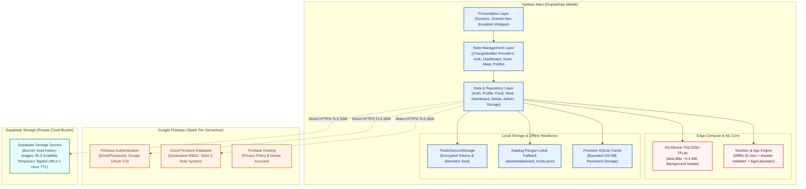

# OopsieEats

[](https://flutter.dev)
[](https://dart.dev)
[-3DDC84?logo=android)](https://developer.android.com)
[](https://firebase.google.com)
[](https://supabase.com)
[-brightgreen?logo=checkmarx)](docs/TESTING_AND_QA.md)

**OopsieEats** (`com.oopsieeats.app`, nama historis repositori: *NutriView*) adalah aplikasi pelacak nutrisi makanan *mobile* berbasis **Flutter** dengan kemampuan **Computer Vision On-Device (YOLO26n TFLite)** dan arsitektur nirserver (**Firebase Serverless + Supabase Storage**).

Pengguna mengatur profil fisik pribadi, memperoleh target kalori dan makronutrien harian secara deterministik menggunakan persamaan Mifflin-St Jeor, serta mencatat makanan dengan memotret hidangan mereka. Model neural network terkuantisasi **YOLO26n TensorFlow Lite (~9.4 MB)** mengidentifikasi 29 kelas makanan populer Indonesia langsung pada perangkat pengguna tanpa memerlukan koneksi internet aktif. Pengguna mengonfirmasi porsi gram, dan metrik gizi dihitung secara deterministik dengan validasi konsistensi faktor energi Atwater sebelum disinkronkan ke Cloud Firestore dan Supabase Storage dengan dukungan persistensi *offline* penuh.

> [!NOTE] **Pernyataan Penyangkalan Medis (Disclaimer)**  
> Nilai gizi dan rekomendasi yang disajikan oleh OopsieEats merupakan estimasi algoritmik untuk pemantauan gaya hidup sehat umum dan **tidak dapat menggantikan saran medis, diagnosis klinis, atau konsultasi ahli gizi profesional**.

---

## 1. Ringkasan Arsitektur Sistem

OopsieEats mengimplementasikan arsitektur *edge-AI mobile* nirserver (*serverless*):



### Karakteristik Utama Arsitektur:
1. **100% On-Device Food Inference**: Model YOLO26n (~9.4 MB) dieksekusi secara lokal via C++ runtime `tflite_flutter` pada *background isolate* tanpa transmisi citra ke server inferensi eksternal, menjamin privasi visual pengguna.
2. **Serverless Cloud Architecture**: Beroperasi pada layanan terkelola Firebase (Authentication, Cloud Firestore, Hosting) dan Supabase Storage (bucket privat `food-history-images` dengan Row Level Security) tanpa memerlukan server VPS, kontainer Docker, atau proses backend mandiri.
3. **Isolasi Data & Keamanan Multi-Tenant**: Catatan makan privat pengguna disimpan di bawah subkoleksi `users/{uid}/meals/{mealId}`, dilindungi secara ketat oleh deklaratif `firestore.rules` dengan sistem peran biner terverifikasi (`admin` dan `user`).
4. **Desain Visual Overkill Neo-Brutalism**: Antarmuka ekspresif dengan batas hitam tebal (`2.0` / `3.0`), bayangan pejal tanpa blur (*hard shadow* dengan `blurRadius: 0`), skala warna berani, dan tipografi tegas.
5. **Penyimpanan Media Hibrida**: Metadata citra dan tautan bertanda tangan (*signed URL*) berumur 1 jam disimpan di Firestore, sedangkan berkas fisik terkompresi disimpan pada bucket privat Supabase.

---

## 2. Fitur Utama Aplikasi

- **Onboarding Interaktif**: 3 slide perkenalan fitur (*Food Discovery*, *Nutrition Awareness*, *Healthy Habits*) dengan stiker ilustrasi dan dekorasi starburst dinamis.
- **Deteksi Makanan On-Device**: Pengenalan citra instan menggunakan model terkuantisasi YOLO26n yang mengenali 29 jenis makanan populer Indonesia.
- **Autentikasi Multi-Metode**: Login via Email/Password, Google Sign-In (OAuth 2.0), autentikasi biometrik lokal (sidik jari/wajah), dan penyimpanan sesi terenkripsi (`FlutterSecureStorage`).
- **Gerbang Kelengkapan Biodata (Complete Profile Guard)**: Memastikan pengguna melengkapi profil fisik (usia dinamis dari tanggal lahir, tinggi, berat badan, tingkat aktivitas, dan target berat) sebelum mengakses fitur utama.
- **Mesin Gizi Deterministik**: Perhitungan BMR dan TDEE berbasis formula Mifflin-St Jeor, penyesuaian target kalori aman (*calorie floor*), dan validasi energi Atwater $((4 \times P) + (4 \times C) + (9 \times F))$.
- **Dashboard Nutrisi Interaktif**: Pelacakan progres kalori harian dinamis, bento grid makronutrien (Protein, Karbohidrat, Lemak), dan daftar asupan makanan terkini.
- **Riwayat Asupan Makan**: Garis waktu catatan makan kronologis, rincian per porsi gram, foto inspeksi terenkripsi dari Supabase Storage, dan opsi hapus catatan.
- **Profil & Personalisasi**: Pilihan avatar vektor prosedural (`AvatarCatalog`) serta unggahan foto profil kustom dengan pemotongan otomatis rasio 1:1.
- **Ketahanan Offline Penuh**: Dukungan persistensi Firestore 100 MB dan *fallback* katalog pangan lokal via `seed_foods.json`.
- **Portal Administrasi & CMS Terintegrasi**: Manajemen katalog pangan, artikel edukasi gizi, pengumuman publik, dan log audit yang bersifat permanen (*immutable*).
- **Kepatuhan Privasi & Penghapusan Akun**: Alur penghapusan akun mandiri (*self-service*) berjenjang (*cascading delete*) di dalam aplikasi serta halaman web publik sesuai regulasi Google Play Store.

---

## 3. Teknologi yang Digunakan (Tech Stack)

| Kategori | Komponen / Pustaka | Versi Aktual | Peran Teknis |
|---|---|---|---|
| **Framework** | Flutter | 3.x (Channel Stable) | Kerangka kerja aplikasi mobile multiplatform |
| **Bahasa Pemrograman** | Dart SDK | `^3.13.4` | Bahasa pemrograman utama aplikasi |
| **State Management** | `provider` | `^6.1.2` | Pengelolaan status reaktif berbasis `ChangeNotifier` |
| **Computer Vision** | `tflite_flutter` | `^0.12.1` | Binding C++ TensorFlow Lite untuk inferensi model lokal |
| **Model ML** | YOLO26n (`best.tflite`) | ~9.4 MB | Model pendeteksi 29 kelas makanan Indonesia |
| **Pemrosesan Citra** | `image` | `^4.12.0` | Decode, rotasi EXIF, resize, dan kompresi JPEG |
| **Kamera & Galeri** | `image_picker` | `^1.1.2` | Akuisisi foto dari kamera perangkat atau galeri |
| **Autentikasi** | `firebase_auth` | `^7.0.1` | Pengelolaan kredensial identitas pengguna |
| **Google Sign-In** | `google_sign_in` | `^7.2.0` | Integrasi autentikasi Google OAuth 2.0 |
| **Sensor Biometrik** | `local_auth` | `^3.0.2` | Sensor sidik jari dan Face ID lokal |
| **Keamanan Kredensial**| `flutter_secure_storage`| `^9.2.2` | Penyimpanan sesi terenkripsi (Keystore/Keyring) |
| **Basis Data Dokumen** | `cloud_firestore` | `^7.1.0` | Penyimpanan data NoSQL dengan aturan keamanan deklaratif |
| **Penyimpanan Media** | `supabase_flutter` | `^2.18.3` | Pengunggahan dan pembuatan signed URL citra privat |
| **Internasionalisasi** | `intl` | `^0.19.0` | Format mata uang, angka, dan tanggal lokal Indonesia |

---

## 4. Struktur Direktori Proyek

```text
OopsieEats/
├── .agents/                    # Konfigurasi skill dan instruksi otomatisasi agen
├── docs/                       # Dokumentasi arsitektur, database, ML, testing, & operasional
│   ├── README.md               # Portal indeks pusat dokumentasi
│   ├── ARCHITECTURE.md         # Spesifikasi arsitektur teknis lengkap
│   ├── DATABASE_AND_BACKEND.md # Dokumentasi skema Cloud Firestore & keamanan
│   ├── SUPABASE_IMAGE_STORAGE.md # Dokumentasi bucket privat Supabase Storage
│   ├── MACHINE_LEARNING.md     # Pipeline inferensi YOLO26n & formulasi gizi
│   ├── DEVELOPMENT_GUIDE.md    # Standar kode, SOLID, & sistem desain Neo-Brutalism
│   ├── TESTING_AND_QA.md       # Laporan pengujian kualitas & hasil verifikasi 359 tests
│   ├── deployment.md           # Panduan build rilis & deployment Firebase
│   ├── diagrams/               # Berkas Mermaid native (.mmd)
│   ├── release/                # Panduan rilis & kepatuhan Google Play Store
│   └── user-flows/             # Spesifikasi alur navigasi dan perjalanan pengguna
├── firebase.json               # Konfigurasi Firebase Auth, Firestore, Hosting, & Emulators
├── firestore.rules             # Aturan keamanan database deklaratif (Strict 2-Role)
├── firestore.indexes.json      # Indeks komposit Cloud Firestore
├── public/                     # Aset web statis Firebase Hosting (Privacy & Delete Account)
│   ├── privacy.html            # Halaman Kebijakan Privasi publik
│   └── delete-account.html     # Halaman alur penghapusan akun publik
├── scripts/                    # Skrip utilitas build, rilis, dan validasi
│   └── validate_release.sh     # Suite otomatisasi 12 tahap validasi rilis Google Play
├── symbols/                    # Direktori arsip simbol obfuskasi Dart rilis
└── frontend/                   # Paket utama aplikasi Flutter (package:oopsieeats)
    ├── android/                # Konfigurasi platform Android (Kotlin DSL build.gradle.kts)
    ├── assets/                 # Aset aplikasi (models, data pangan, gambar)
    ├── lib/                    # Sumber kode Dart aplikasi
    │   ├── main.dart           # Entry point, dependency injection, & route guard
    │   ├── core/               # Konfigurasi, tema, kalkulator gizi, detektor ML
    │   ├── data/               # Model data (DTO), API client, repositori, layanan
    │   ├── features/           # Modul fitur (Auth, Onboarding, Dashboard, Scanner, Meals, dll)
    │   └── shared/             # Komponen antarmuka Overkill Neo-Brutalism pakai-ulang
    └── test/                   # 42 berkas pengujian otomatis (359 test cases)
```

---

## 5. Panduan Memulai Cepat (Getting Started)

### 5.1. Prasyarat Lingkungan Pengembangan
- **Flutter SDK**: Versi `>= 3.24.0` (Dart SDK `>= 3.13.4`)
- **Java Development Kit (JDK)**: OpenJDK 17 (`JavaVersion.VERSION_17`)
- **Android SDK**: `compileSdk = 36`, `targetSdk = 36`, `minSdk = 23`
- **Firebase CLI**: `firebase-tools >= 13.0.0`

### 5.2. Kloning Repositori & Instalasi Dependensi
```bash
git clone https://github.com/ahmadbadawiTzy/OopsieEats.git
cd OopsieEats/frontend
flutter pub get
```

### 5.3. Konfigurasi Kredensial Lingkungan
1. **Firebase**: Pastikan berkas `frontend/android/app/google-services.json` telah diletakkan pada jalurnya dan berkas `frontend/lib/firebase_options.dart` sesuai dengan proyek Firebase Anda.
2. **Supabase Storage (Opsional)**: Aplikasi memiliki *graceful fallback* offline jika Supabase tidak dikonfigurasi. Untuk mengaktifkan upload foto cloud, konfigurasikan via `--dart-define` (lihat template [`.env.example`](../.env.example)):
   ```bash
   --dart-define=SUPABASE_URL=https://<your-project-ref>.supabase.co \
   --dart-define=SUPABASE_ANON_KEY=<your-supabase-publishable-key>
   ```

### 5.4. Menjalankan Aplikasi di Emulator / Perangkat
```bash
cd frontend
flutter run
```

---

## 6. Verifikasi Kualitas & Pengujian Otomatis

Aplikasi OopsieEats memiliki cakupan pengujian komprehensif pada level Unit, Widget, dan Benchmark:

### 6.1. Menjalankan Analisis Statis Kode
```bash
cd frontend
flutter analyze
```
*Hasil Faktual*: **0 issues found!**

### 6.2. Menjalankan Seluruh Test Suite
```bash
cd frontend
flutter test
```
*Hasil Faktual*: **359 tests passed!** (100% lulus pada 42 berkas pengujian).

---

## 7. Panduan Build Rilis Produksi (Google Play Ready)

Proses build rilis Android App Bundle (`.aab`) mewajibkan penandatanganan sertifikat rilis asli via `frontend/android/key.properties` (mekanisme *fail-fast* ketat mencegah fallback ke debug key):

### 7.1. Build Standar Produksi
```bash
cd frontend
flutter build appbundle --release --obfuscate --split-debug-info=../symbols/android
```

### 7.2. Menjalankan Suite Validasi Rilis 12-Tahap
Dari root direktori repositori:
```bash
./scripts/validate_release.sh
```
Skrip akan secara otomatis memverifikasi dependensi, analisis statis, pengujian unit/widget, integritas artefak AAB, keaslian tanda tangan jarsigner, kepatuhan target SDK 36, izin minimal AndroidManifest, hingga keselarasan segmen ELF 16 KB.

---

## 8. Dokumentasi Teknis Lanjutan

Untuk membaca dokumentasi mendalam per modul sistem, kunjungi portal dokumentasi pada direktori [`docs/`](docs/README.md):

- [**Portal Indeks Dokumentasi**](docs/README.md)
- [**Spesifikasi Arsitektur Sistem**](docs/ARCHITECTURE.md)
- [**Basis Data & Aturan Keamanan Firestore**](docs/DATABASE_AND_BACKEND.md)
- [**Panduan Integrasi Supabase Storage**](docs/SUPABASE_IMAGE_STORAGE.md)
- [**Machine Learning & Formulasi Gizi**](docs/MACHINE_LEARNING.md)
- [**Panduan Pengembangan & Standar Rekayasa**](docs/DEVELOPMENT_GUIDE.md)
- [**Laporan Pengujian & QA**](docs/TESTING_AND_QA.md)
- [**Panduan Operasional & Deployment**](docs/deployment.md)
- [**Koleksi Diagram Mermaid (.mmd)**](docs/diagrams/)
- [**Panduan Kepatuhan Google Play Store**](docs/release/GOOGLE_PLAY_COMPLIANCE.md)
- [**Changelog Dokumentasi**](docs/DOCUMENTATION_CHANGELOG.md)

---

## 9. Batasan Sistem yang Diketahui (Known Limitations)

1. **Model ML Terfokus pada 29 Kelas Pangan**: Citra makanan di luar 29 kelas yang dikenali akan berstatus `unmapped`. Pengguna diarahkan untuk mencari padanan makanan secara manual melalui modal pencarian katalog.
2. **Estimasi Porsi Human-in-the-Loop**: Sistem tidak menebak gramasi secara visual dari citra 2D karena variasi kedalaman piring; bobot porsi ditentukan langsung oleh konfirmasi pengguna.
3. **Penyimpanan Gambar Bersifat Opsional**: Pengguna dapat mencatat makanan tanpa menyertakan foto jika mematikan akses kamera atau mencatat secara manual.

---

## 10. Pengembang & Kontak

- **Pengembang**: Ahmad Badawi
- **Peran**: Software Developer & Architect of OopsieEats
- **Profil**: [GitHub](https://github.com/ahmadbadawiTzy) · [LinkedIn](https://www.linkedin.com/in/ahmad-badawi-b87274410) · [Instagram](https://instagram.com/1hmdbdw_)
- **Email Dukungan**: `ahmadbadawi.biu.si@gmail.com`
