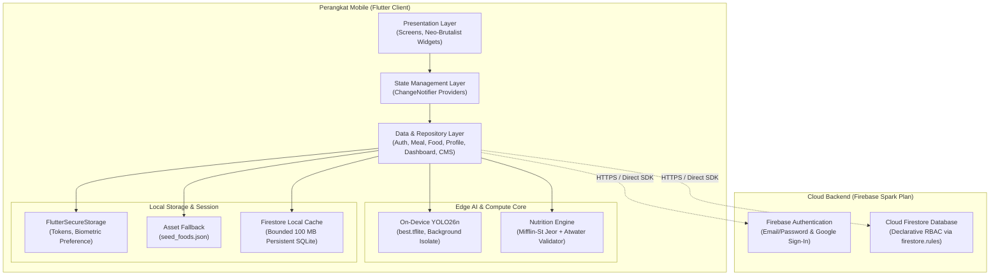
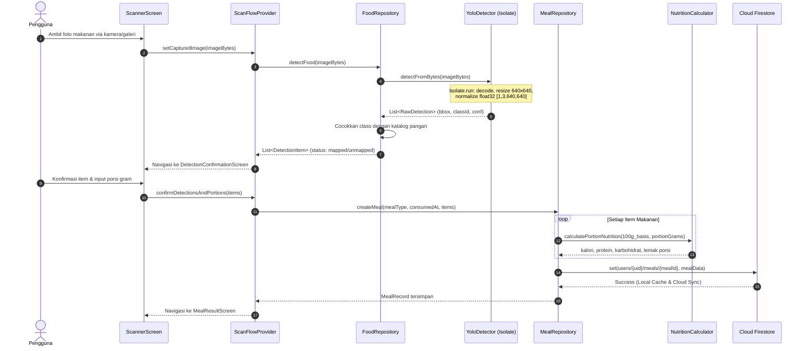
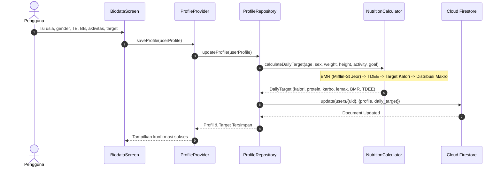

# NutriView — Arsitektur Sistem & Spesifikasi Teknis Perangkat Lunak

Dokumen ini mendokumentasikan arsitektur teknis menyeluruh aplikasi **NutriView: Food Nutrition Recognition & Daily Tracking App** berdasarkan implementasi kode aktual (*single source of truth*).

---

## 1. Ikhtisar Arsitektur (Architectural Overview)

NutriView mengadopsi arsitektur **Serverless Edge-AI Mobile Application**. Seluruh pemrosesan computer vision (deteksi objek makanan) dan kalkulasi nutrisi dijalankan **100% secara lokal pada perangkat pengguna (*on-device*)**, sementara persistensi data, sinkronisasi antar-perangkat, dan autentikasi ditangani secara nirserver (*serverless*) oleh platform Google Firebase.

### Karakteristik Utama Arsitektur:
1. **Zero-Server Backend**: Tidak memerlukan VPS, kontainer Docker, ataupun server API mandiri. Seluruh operasi cloud berjalan langsung melalui Firebase SDK resmi (Authentication & Cloud Firestore).
2. **On-Device Vision AI**: Inferensi model neural network YOLO26n (~9.4 MB) dieksekusi secara lokal menggunakan engine C++ TensorFlow Lite (`tflite_flutter`) pada *background isolate*, menjamin privasi visual pengguna dan latensi deteksi di bawah 500ms.
3. **Offline-First & Local Resilience**:
   - Cache Firestore persisten dibatasi pada kuota aman 100 MB (`cacheSizeBytes: 104857600`).
   - Basis data pangan lokal fallback (`assets/data/seed_foods.json`) memastikan fitur pencarian dan kalkulasi nutrisi tetap berfungsi saat perangkat offline.
4. **Lapisan Keamanan Deklaratif**: Seluruh kontrol akses multi-tenant dan otorisasi peran pengguna diatur melalui Cloud Firestore Security Rules (`firestore.rules`) dengan sistem *Strict 2-Role System* (`admin` dan `user`).

---

## 2. Diagram Arsitektur Tingkat Tinggi (Mermaid)



---

## 3. Struktur Direktori Proyek

Struktur kode NutriView dirancang modular dengan pemisahan tanggung jawab yang jelas (*Separation of Concerns*):

```text
NutriView/
├── .agents/                    # Skill & instruksi engineering agent
├── data/                       # Referensi dataset gizi master (foods.csv)
├── docs/                       # Dokumentasi arsitektur, database, ML, & operasional
├── firebase.json               # Konfigurasi layanan Firebase CLI (Auth, Firestore, Emulators)
├── firestore.rules             # Aturan keamanan database & RBAC deklaratif
├── firestore.indexes.json      # Indeks komposit Cloud Firestore
├── scripts/                    # Skrip Python & Node.js untuk migrasi & seeding data
└── frontend/                   # Paket utama aplikasi mobile Flutter
    ├── android/                # Konfigurasi platform Android (Kotlin DSL build.gradle.kts)
    ├── assets/                 # Aset terbundel aplikasi
    │   ├── data/seed_foods.json    # Data katalog 29 pangan lokal offline fallback
    │   ├── images/                 # Gambar identitas visual & logo
    │   └── models/
    │       ├── best.tflite         # Bobot terkuantisasi YOLO26n (9.4 MB)
    │       └── classes.txt         # 29 Label kelas deteksi pangan
    ├── lib/                    # Sumber kode Dart aplikasi
    │   ├── main.dart               # Entry point, bootstrapping Firebase, warmup ML, MultiProvider
    │   ├── firebase_options.dart   # Konfigurasi platform Firebase hasil generate FlutterFire
    │   ├── core/                   # Konfigurasi global, tema, kalkulator gizi, ML detector
    │   │   ├── config.dart             # Konfigurasi nama aplikasi & teks disclaimer legal
    │   │   ├── config/creator_config.dart # Data profil kreator & branding AboutScreen
    │   │   ├── error_handler.dart      # Hierarki exception terstandar (ApiException)
    │   │   ├── nutrition_calculator.dart # Formulasi Mifflin-St Jeor & validasi Atwater
    │   │   ├── age_calculator.dart     # Utilitas kalkulasi usia dari tanggal lahir
    │   │   ├── routes.dart             # Konstanta rute navigasi aplikasi (AppRoutes)
    │   │   ├── theme.dart              # Konfigurasi ThemeData terang dan gelap
    │   │   ├── neo_tokens.dart         # Token warna, border, dan elevasi Neubrutalism
    │   │   └── ml/
    │   │       ├── yolo_detector.dart      # Conditional export (io vs stub)
    │   │       ├── yolo_detector_io.dart   # Implementasi detektor TFLite via Dart Isolate
    │   │       └── yolo_detector_stub.dart # Stub detektor untuk kompilasi platform web/test
    │   ├── data/                   # Data transfer objects, repositories, dan API client
    │   │   ├── api_client.dart         # Wrapper penyimpanan sesi lokal (FlutterSecureStorage)
    │   │   ├── models/                 # DTO Data Model (User, Profile, Food, Meal, Article, Dashboard)
    │   │   ├── services/
    │   │   │   └── biometric_service.dart # Abstraksi autentikasi biometrik lokal (local_auth)
    │   │   └── repositories/
    │   │       ├── auth_repository.dart      # Operasi autentikasi (Email, Google, Biometrik)
    │   │       ├── profile_repository.dart   # Manajemen data profil, target gizi, & avatar
    │   │       ├── food_repository.dart      # Pencarian katalog pangan & pipeline deteksi YOLO
    │   │       ├── meal_repository.dart      # Pencatatan riwayat makan & kalkulasi porsi
    │   │       ├── dashboard_repository.dart # Agregasi progres intake harian vs target
    │   │       └── article_repository.dart   # Pembacaan artikel & pengumuman CMS gizi
    │   ├── features/               # Modul fitur fungsional
    │   │   ├── admin/                  # Dashboard manajemen katalog, artikel, audit, & user
    │   │   ├── article/                # Tampilan daftar dan detail artikel edukasi gizi
    │   │   ├── auth/                   # Layar Login, Registrasi, Modal Biometrik & Reset Sandi
    │   │   ├── dashboard/              # Layar dashboard utama, bento grid makro, hero kalori
    │   │   ├── meals/                  # Layar riwayat makan dan rincian detail makanan
    │   │   ├── profile/                # Layar profil, biodata kesehatan, dan tentang pengembang
    │   │   ├── scanner/                # Layar kamera scanner, konfirmasi deteksi, & input porsi
    │   │   └── splash/                 # Layar pembuka aplikasi dengan animasi Neo-Badge
    │   └── shared/                 # Komponen antarmuka pakai-ulang (Reusable UI Widgets)
    │       ├── neo/                    # Komponen desain Overkill Neo-Brutalism (Button, Card, Input)
    │       └── widgets/                # Loading indicator dan Error view
    └── test/                       # 32 berkas pengujian (256 test cases unit, widget, & benchmark)
```

---

## 4. Rincian Tanggung Jawab Tiap Layer

### 4.1. Presentation Layer (`lib/features/` & `lib/shared/`)
- **Tanggung Jawab**: Merender antarmuka pengguna, menangani gestur interaksi, menampilkan umpan balik validasi formulir, dan merefleksikan perubahan status (*state*).
- **Design System**: Menggunakan sistem desain kustom **Overkill Neo-Brutalism** dengan kontras tinggi, border hitam tegas (`borderWidth: 2.0` / `3.0`), drop-shadow pejal tanpa blur (*hard shadow*), dan palet warna ekspresif (`vividYellow`, `mintGreen`, `skyBlue`, `coralRed`).
- **Pemisahan Logika**: Tidak ada pemanggilan langsung ke database atau operasi komputasi berat di dalam *widget tree*. Seluruh aksi didelegasikan ke Provider terkait.

### 4.2. Business Logic & State Management Layer (`providers/`)
- Menggunakan pola **Provider** resmi Flutter (`package:provider` v6.1.2) dengan turunan `ChangeNotifier`.
- **Daftar Provider Inti**:
  - `AuthProvider`: Mengelola status login, sesi biometrik, peran pengguna (`role`), pemulihan sandi, dan penghapusan akun.
  - `DashboardProvider`: Mengatur tanggal aktif dashboard, memuat agregasi kalori/makro harian, dan memicu *refresh*.
  - `ScanFlowProvider`: Mengontrol alur multi-langkah pemindaian makanan: pengambilan gambar -> pra-pemrosesan isolate -> inferensi TFLite -> pemetaan pangan -> seleksi porsi gram -> persistensi *meal log*.
  - `MealHistoryProvider`: Memuat riwayat catatan makan pengguna dengan filter tanggal dan paginasi.
  - `ProfileProvider`: Mengelola data fisik pengguna (usia, jenis kelamin, tinggi, berat badan, level aktivitas, target) dan pilihan preset avatar.

### 4.3. Data & Repository Layer (`lib/data/repositories/`)
- **Tanggung Jawab**: Abstraksi sumber data, orkestrasi *caching*, normalisasi format data, dan penanganan kesalahan spesifik infrastruktur.
- **Dependency Injection**: Seluruh kelas repositori menerima dependensi (`ApiClient`, `FirebaseAuth`, `FirebaseFirestore`, `YoloDetector`) melalui konstruktor dengan nilai default *fallback*. Hal ini memungkinkan penyuntikan *mock object* (`mocktail`) saat pengujian otomatis tanpa menginisialisasi layanan cloud riil.
- **Strategi Caching**:
  - `FoodRepository`: Menggunakan in-memory cache dengan TTL 10 menit untuk daftar pangan. Jika Firestore offline, otomatis membaca dari `assets/data/seed_foods.json`.
  - `ArticleRepository`: Menggunakan in-memory cache dengan TTL 5 menit untuk artikel dan kategori CMS.
  - `DashboardRepository`: Menggunakan cache data target pengguna dengan TTL 15 menit untuk mencegah pembacaan ulang dokumen `users/{uid}` saat pengguna berpindah-pindah tanggal kalender.

### 4.4. Core & ML Computation Layer (`lib/core/`)
- Bersifat independen dari UI (*pure Dart logic*).
- `NutritionCalculator`: Implementasi rumus Mifflin-St Jeor untuk BMR, perhitungan TDEE berdasarkan koefisien aktivitas, formula alokasi makronutrien (protein, lemak, karbohidrat), serta validasi energi Atwater $((4 \times P) + (4 \times C) + (9 \times F))$.
- `YoloDetector`: Pengelola siklus hidup interpreter C++ TFLite, isolasi proses pra-pemrosesan citra, eksekusi inferensi matriks $[1, 3, 640, 640]$, dan algoritma *Non-Maximum Suppression* (NMS).

---

## 5. Alur Data Utama Sistem (Sequence Diagrams)

### 5.1. Alur Pemindaian dan Pencatatan Makanan (Scan-to-Meal Flow)



### 5.2. Alur Pengaturan Target Nutrisi Pengguna



---

## 6. Pola Desain (Design Patterns) & Prinsip Rekayasa

1. **Repository Pattern**: Mengisolasi detail implementasi SDK Cloud Firestore dan file asset lokal dari lapisan antarmuka. Pergantian struktur database atau penambahan cache tidak memengaruhi kode UI.
2. **Dependency Injection (Constructor Injection)**: Memungkinkan pengujian unit dan widget secara deterministik menggunakan *mock instance* tanpa sambungan internet atau inisialisasi Firebase.
3. **Single Responsibility Principle (SRP)**:
   - `NutritionCalculator`: Hanya bertanggung jawab atas matematika gizi murni.
   - `YoloDetector`: Hanya bertanggung jawab atas eksekusi inferensi matriks model.
   - `ApiClient`: Hanya bertanggung jawab atas persistensi token dan preferensi di *secure storage*.
4. **Isolate Worker Pattern**: Operasi manipulasi array piksel gambar (decode JPEG, rotasi EXIF, konversi tensor kanal R/G/B) didelegasikan ke *thread* terpisah melalui `Isolate.run`, mencegah terjadinya *frame dropping* (jank) pada UI thread 60/120 Hz.
5. **Fail-Safe / Graceful Degradation**:
   - Jika koneksi internet terputus, query Firestore secara transparan dialihkan ke *local offline cache*.
   - Jika dokumen pangan belum terisi di Firestore, sistem otomatis membaca berkas `seed_foods.json`.
   - Jika gambar artikel gagal dimuat dari jaringan, antarmuka otomatis menampilkan placeholder ikon yang stabil tanpa *crash*.
