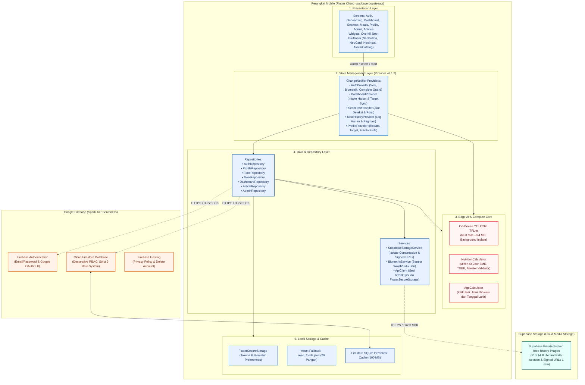
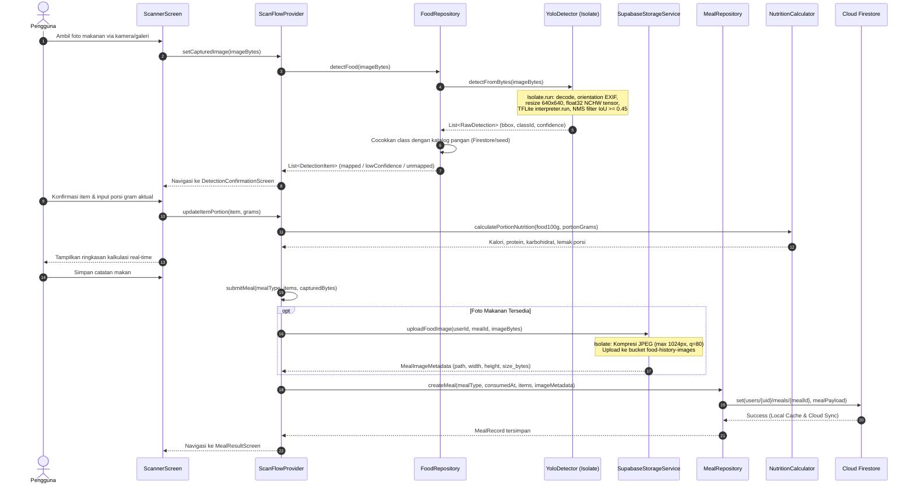
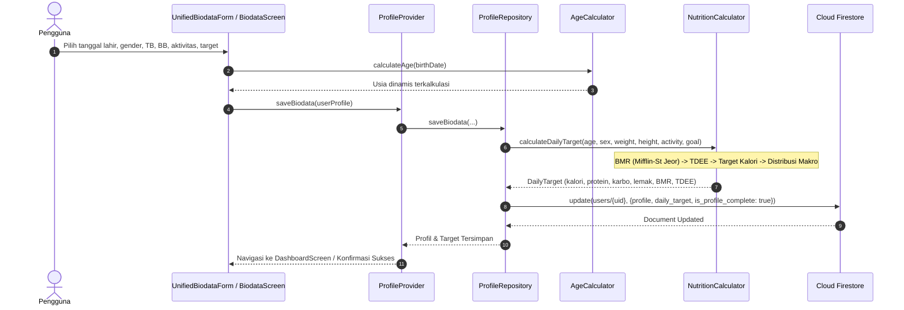
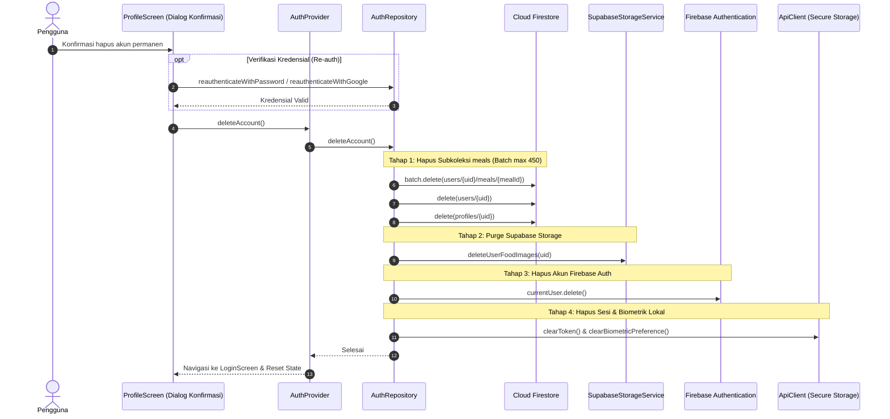

# OopsieEats (NutriView) — Arsitektur Sistem & Spesifikasi Teknis Perangkat Lunak

Dokumen ini mendokumentasikan arsitektur teknis menyeluruh aplikasi **OopsieEats** (`com.oopsieeats.app`, nama historis repositori: *NutriView*) berdasarkan implementasi kode aktual (*single source of truth*).

---

## 1. Ikhtisar Arsitektur (Architectural Overview)

OopsieEats mengadopsi arsitektur **Serverless Edge-AI Mobile Application**. Seluruh pemrosesan computer vision (deteksi objek makanan) dan kalkulasi nutrisi dijalankan **100% secara lokal pada perangkat pengguna (*on-device*)**, sementara persistensi data, sinkronisasi antar-perangkat, autentikasi, dan penyimpanan citra privat ditangani secara nirserver (*serverless*) oleh platform Google Firebase dan Supabase Storage.

### Karakteristik Utama Arsitektur:
1. **Zero-Server Backend**: Tidak memerlukan VPS, kontainer Docker, ataupun server API mandiri. Seluruh operasi cloud berjalan langsung melalui Firebase SDK resmi (Authentication & Cloud Firestore) dan Supabase Storage SDK.
2. **On-Device Vision AI**: Inferensi model neural network YOLO26n (~9.4 MB) dieksekusi secara lokal menggunakan engine C++ TensorFlow Lite (`tflite_flutter`) pada *background isolate*, menjamin privasi visual pengguna dan latensi deteksi di bawah 500 ms tanpa mengirimkan citra ke server inferensi eksternal.
3. **Penyimpanan Media Terisolasi & Bertanda Tangan (Signed URLs)**: Berkas citra riwayat makan dan foto profil pengguna disimpan dalam bucket privat Supabase Storage (`food-history-images`) yang dilindungi Row Level Security (RLS). Akses visual pada klien menggunakan tautan bertanda tangan (*temporary signed URLs*) dengan masa berlaku 1 jam (`signedUrlTtl = Duration(hours: 1)`).
4. **Offline-First & Local Resilience**:
   - Cache Firestore persisten dibatasi pada kuota aman 100 MB (`cacheSizeBytes: 104857600`).
   - Basis data pangan lokal fallback (`assets/data/seed_foods.json`) memastikan fitur pencarian dan kalkulasi nutrisi tetap berfungsi saat perangkat offline.
5. **Lapisan Keamanan Deklaratif & Sistem Peran Biner**: Seluruh kontrol akses multi-tenant dan otorisasi peran pengguna diatur melalui Cloud Firestore Security Rules (`firestore.rules`) dengan sistem *Strict 2-Role System* (`admin` dan `user`).
6. **Gerbang Kelengkapan Biodata (Complete Profile Guard)**: Route guard pada `main.dart` memastikan pengguna yang terautentikasi dan berstatus `!isProfileCompleted` secara otomatis diarahkan ke `AppRoutes.completeProfile` sebelum dapat mengakses dashboard, pemindai, riwayat makan, atau artikel.

---

## 2. Diagram Arsitektur Tingkat Tinggi (Mermaid)

Diagram berikut merefleksikan seluruh komponen aktif sistem dan hubungan antar-layer:



---

## 3. Struktur Direktori Proyek

Struktur kode OopsieEats dirancang modular dengan pemisahan tanggung jawab yang jelas (*Separation of Concerns*):

```text
OopsieEats/
├── .agents/                    # Konfigurasi skill dan instruksi otomatisasi agen
├── docs/                       # Dokumentasi arsitektur, database, ML, & operasional
│   ├── README.md               # Portal indeks pusat dokumentasi
│   ├── ARCHITECTURE.md         # Spesifikasi arsitektur sistem (dokumen ini)
│   ├── DATABASE_AND_BACKEND.md # Dokumentasi basis data Firestore & aturan keamanan
│   ├── SUPABASE_IMAGE_STORAGE.md # Dokumentasi integrasi Supabase Storage
│   ├── MACHINE_LEARNING.md     # Pipeline inferensi YOLO26n & formulasi gizi
│   ├── DEVELOPMENT_GUIDE.md    # Standar kode, SOLID, & sistem desain Neo-Brutalism
│   ├── TESTING_AND_QA.md       # Laporan pengujian kualitas & hasil verifikasi
│   ├── deployment.md           # Panduan build rilis & deployment
│   ├── diagrams/               # Berkas Mermaid diagram (.mmd)
│   ├── release/                # Dokumen rilis & kepatuhan Google Play Store
│   └── user-flows/             # Spesifikasi alur navigasi & peran pengguna
├── firebase.json               # Konfigurasi layanan Firebase CLI (Auth, Firestore, Hosting, Emulators)
├── firestore.rules             # Aturan keamanan database & RBAC deklaratif (Strict 2-Role)
├── firestore.indexes.json      # Indeks komposit Cloud Firestore
├── public/                     # Halaman web statis Firebase Hosting (Privacy & Delete Account)
├── scripts/                    # Skrip Python, Node.js, & Bash untuk rilis/migrasi
│   └── validate_release.sh     # Suite otomatisasi 12 tahap validasi rilis Google Play
├── symbols/                    # Direktori arsip simbol obfuskasi Dart rilis
└── frontend/                   # Paket utama aplikasi mobile Flutter (package:oopsieeats)
    ├── android/                # Konfigurasi Android Gradle Kotlin DSL (build.gradle.kts)
    ├── assets/                 # Aset terbundel aplikasi
    │   ├── data/seed_foods.json    # Katalog 29 pangan lokal offline fallback
    │   ├── images/                 # Gambar identitas visual, logo, & foto kreator
    │   ├── onboarding/             # Foto & stiker ilustrasi onboarding
    │   └── models/
    │       ├── best.tflite         # Bobot terkuantisasi YOLO26n (~9.4 MB)
    │       └── classes.txt         # 29 Label kelas deteksi pangan
    ├── lib/                    # Sumber kode Dart aplikasi
    │   ├── main.dart               # Entry point, bootstrapping, MultiProvider, & Route Guard
    │   ├── firebase_options.dart   # Konfigurasi platform Firebase
    │   ├── core/                   # Konfigurasi global, tema, kalkulator gizi, ML detector
    │   │   ├── config.dart             # Konfigurasi nama aplikasi & teks disclaimer legal
    │   │   ├── config/creator_config.dart # Data profil kreator & link legal
    │   │   ├── config/supabase_config.dart# Konfigurasi bucket Supabase Storage
    │   │   ├── error_handler.dart      # Hierarki exception terstandar (ApiException)
    │   │   ├── nutrition_calculator.dart # Formulasi Mifflin-St Jeor & validasi Atwater
    │   │   ├── age_calculator.dart     # Utilitas kalkulasi usia dinamis dari birth_date
    │   │   ├── profile_photo_logger.dart# Logger terstruktur pipeline foto profil
    │   │   ├── routes.dart             # Konstanta rute navigasi aplikasi (AppRoutes)
    │   │   ├── theme.dart              # Konfigurasi ThemeData terang dan gelap
    │   │   ├── neo_tokens.dart         # Token warna, border, dan elevasi Neubrutalism
    │   │   └── ml/
    │   │       ├── yolo_detector.dart      # Conditional export (io vs stub)
    │   │       ├── yolo_detector_io.dart   # Implementasi detektor TFLite via Dart Isolate
    │   │       └── yolo_detector_stub.dart # Stub detektor untuk kompilasi platform web/test
    │   ├── data/                   # Data transfer objects, repositories, dan services
    │   │   ├── api_client.dart         # Wrapper penyimpanan sesi lokal (FlutterSecureStorage)
    │   │   ├── models/                 # DTO Model (User, Profile, Food, Meal, Article, Dashboard)
    │   │   ├── services/
    │   │   │   ├── biometric_service.dart # Abstraksi autentikasi biometrik lokal (local_auth)
    │   │   │   └── supabase_storage_service.dart # Layanan penyimpanan citra Supabase Storage
    │   │   └── repositories/
    │   │       ├── auth_repository.dart      # Autentikasi (Email, Google, Biometrik, Hapus Akun)
    │   │       ├── profile_repository.dart   # Manajemen profil, target gizi, & avatar/foto
    │   │       ├── food_repository.dart      # Pencarian katalog pangan & pipeline deteksi YOLO
    │   │       ├── meal_repository.dart      # Pencatatan riwayat makan & kalkulasi porsi
    │   │       ├── dashboard_repository.dart # Agregasi progres intake harian vs target
    │   │       └── article_repository.dart   # Pembacaan artikel & pengumuman CMS gizi
    │   ├── features/               # Modul fitur fungsional
    │   │   ├── admin/                  # Dashboard manajemen katalog, artikel, audit, & user
    │   │   ├── article/                # Tampilan daftar dan detail artikel edukasi gizi
    │   │   ├── auth/                   # Layar Login, Registrasi, Modal Biometrik & Reset Sandi
    │   │   ├── dashboard/              # Layar dashboard utama, bento grid makro, hero kalori
    │   │   ├── meals/                  # Layar riwayat makan dan rincian detail makanan
    │   │   ├── onboarding/             # Layar onboarding interaktif 3 slide
    │   │   ├── profile/                # Layar profil, biodata kesehatan, dan tentang kreator
    │   │   ├── scanner/                # Layar kamera scanner, konfirmasi deteksi, & input porsi
    │   │   └── splash/                 # Layar pembuka aplikasi dengan animasi Neo-Badge
    │   └── shared/                 # Komponen antarmuka pakai-ulang (Reusable UI Widgets)
    │       ├── neo/                    # Komponen desain Overkill Neo-Brutalism (Button, Card, Input)
    │       └── widgets/                # Loading indicator, Error view, & NeoImageThumbnail
    └── test/                       # 42 berkas pengujian (359 test cases unit, widget, & benchmark)
```

---

## 4. Rincian Tanggung Jawab Tiap Layer

### 4.1. Presentation Layer (`lib/features/` & `lib/shared/`)
- **Tanggung Jawab**: Merender antarmuka pengguna, menangani gestur interaksi, menampilkan umpan balik validasi formulir, dan merefleksikan perubahan status (*state*).
- **Design System**: Menggunakan sistem desain kustom **Overkill Neo-Brutalism** dengan kontras tinggi, border hitam tegas (`borderWidth: 2.0` / `3.0`), drop-shadow pejal tanpa blur (*hard shadow* dengan `blurRadius: 0`), dan palet warna ekspresif (`vividYellow`, `mintGreen`, `skyBlue`, `coralRed`, `creamBg`).
- **Pemisahan Logika**: Tidak ada pemanggilan langsung ke database atau operasi komputasi berat di dalam *widget tree*. Seluruh aksi didelegasikan ke Provider terkait.

### 4.2. Business Logic & State Management Layer (`providers/`)
- Menggunakan paket resmi `provider` (v6.1.2) dengan turunan `ChangeNotifier`.
- **Daftar Provider Inti**:
  - `AuthProvider`: Mengelola status login, sesi biometrik, peran pengguna (`role`), pemulihan sandi, dan penghapusan akun berjenjang (*cascading delete*).
  - `DashboardProvider`: Mengatur tanggal aktif dashboard, memuat agregasi kalori/makro harian, dan memperbarui target secara reaktif saat biodata diedit.
  - `ScanFlowProvider`: Mengontrol alur multi-langkah pemindaian makanan: pengambilan citra -> pra-pemrosesan isolate -> inferensi TFLite -> pemetaan katalog -> seleksi porsi gram -> unggah citra Supabase Storage -> persistensi *meal log*.
  - `MealHistoryProvider`: Memuat riwayat catatan makan pengguna dengan filter tanggal dan paginasi.
  - `ProfileProvider`: Mengelola data fisik pengguna (usia dinamis, jenis kelamin, tinggi, berat badan, level aktivitas, target), pemilihan preset avatar, serta pengunggahan foto profil ke Supabase Storage.

### 4.3. Data & Repository Layer (`lib/data/repositories/` & `lib/data/services/`)
- **Tanggung Jawab**: Abstraksi sumber data, orkestrasi *caching*, normalisasi format data, dan penanganan kesalahan spesifik infrastruktur.
- **Dependency Injection**: Seluruh kelas repositori menerima dependensi (`ApiClient`, `FirebaseAuth`, `FirebaseFirestore`, `YoloDetector`, `SupabaseStorageService`) melalui konstruktor dengan nilai default *fallback*. Hal ini memungkinkan penyuntikan *mock object* (`mocktail`) saat pengujian otomatis tanpa menginisialisasi layanan cloud riil.
- **Strategi Caching & TTL**:
  - `FoodRepository`: Menggunakan in-memory cache dengan TTL 10 menit untuk daftar pangan. Jika Firestore offline, otomatis membaca dari `assets/data/seed_foods.json`.
  - `ArticleRepository`: Menggunakan in-memory cache dengan TTL 5 menit untuk artikel dan kategori CMS.
  - `DashboardRepository`: Menggunakan cache data target pengguna dengan TTL 15 menit untuk mencegah pembacaan berulang dokumen `users/{uid}`.
  - `SupabaseStorageService`: Menggunakan cache signed URL berbasis waktu kadaluarsa (TTL 1 jam dikurangi *safety buffer* 5 menit) untuk meminimalkan permintaan API ke Supabase.

### 4.4. Core & ML Computation Layer (`lib/core/`)
- Bersifat independen dari UI (*pure Dart logic*).
- `NutritionCalculator`: Implementasi rumus Mifflin-St Jeor untuk BMR, perhitungan TDEE berdasarkan koefisien aktivitas, formula alokasi makronutrien (protein, lemak, karbohidrat), serta validasi energi Atwater $((4 \times P) + (4 \times C) + (9 \times F))$.
- `AgeCalculator`: Menghitung umur pengguna secara deterministik dari `birth_date` (ISO-8601) dibandingkan dengan tanggal hari ini, memastikan data usia selalu mutakhir tanpa intervensi manual.
- `YoloDetector`: Pengelola siklus hidup interpreter C++ TFLite, isolasi proses pra-pemrosesan citra, eksekusi inferensi matriks $[1, 3, 640, 640]$, dan algoritma *Non-Maximum Suppression* (NMS).

---

## 5. Alur Data Utama Sistem (Sequence Diagrams)

### 5.1. Alur Pemindaian dan Pencatatan Makanan (Scan-to-Meal Flow)



### 5.2. Alur Pengaturan Target Nutrisi & Biodata Pengguna



### 5.3. Alur Penghapusan Akun Mandiri (Cascading Account Deletion)



---

## 6. Pola Desain (Design Patterns) & Prinsip Rekayasa

1. **Repository Pattern**: Mengisolasi detail implementasi SDK Cloud Firestore, Supabase Storage, dan aset lokal dari lapisan antarmuka. Pergantian struktur database atau penambahan cache tidak memengaruhi kode UI.
2. **Dependency Injection (Constructor Injection)**: Memungkinkan pengujian unit dan widget secara deterministik menggunakan *mock instance* tanpa sambungan internet atau inisialisasi Firebase/Supabase.
3. **Single Responsibility Principle (SRP)**:
   - `NutritionCalculator`: Hanya bertanggung jawab atas matematika gizi murni.
   - `AgeCalculator`: Hanya bertanggung jawab atas kalkulasi usia dari tanggal lahir.
   - `YoloDetector`: Hanya bertanggung jawab atas eksekusi inferensi matriks model.
   - `SupabaseStorageService`: Hanya bertanggung jawab atas operasi kompresi dan transfer citra ke bucket privat.
   - `ApiClient`: Hanya bertanggung jawab atas persistensi token dan preferensi di *secure storage*.
4. **Isolate Worker Pattern**: Operasi manipulasi array piksel citra (decode JPEG, rotasi EXIF, konversi tensor kanal R/G/B, dan kompresi foto profil) didelegasikan ke *thread* terpisah melalui `Isolate.run`, mencegah terjadinya *frame dropping* (jank) pada UI thread 60/120 Hz.
5. **Fail-Safe / Graceful Degradation**:
   - Jika koneksi internet terputus, query Firestore secara transparan dialihkan ke *local offline cache* (100 MB).
   - Jika dokumen pangan belum terisi di Firestore, sistem otomatis membaca berkas `seed_foods.json`.
   - Jika gambar riwayat atau artikel gagal dimuat dari jaringan, antarmuka otomatis menampilkan placeholder ikon yang stabil tanpa *crash*.

---

## 7. Bukti Verifikasi Implementasi Kode Sumber (Code Evidence)

| Fitur / Komponen | File Implementasi Aktual | Kelas / Simbol Utama |
|---|---|---|
| Entrypoint & MultiProvider | `frontend/lib/main.dart` | `OopsieEatsApp`, `main()` |
| Route Guard Profile | `frontend/lib/main.dart` | `onGenerateRoute` profile completion guard |
| Detektor YOLO TFLite | `frontend/lib/core/ml/yolo_detector_io.dart` | `YoloDetector`, `_runInferencePipeline` |
| Formulasi Gizi & Atwater | `frontend/lib/core/nutrition_calculator.dart` | `NutritionCalculator` |
| Kalkulasi Usia Dinamis | `frontend/lib/core/age_calculator.dart` | `AgeCalculator.calculateAge` |
| Token Desain Neo-Brutalism | `frontend/lib/core/neo_tokens.dart` | `NeoTokens` |
| Layanan Supabase Storage | `frontend/lib/data/services/supabase_storage_service.dart` | `SupabaseStorageService` |
| Autentikasi & Hapus Akun | `frontend/lib/data/repositories/auth_repository.dart` | `AuthRepository.deleteAccount`, `login` |
| Biodata & Target Profil | `frontend/lib/data/repositories/profile_repository.dart` | `ProfileRepository.saveBiodata` |
| Riwayat Asupan Makan | `frontend/lib/data/repositories/meal_repository.dart` | `MealRepository.createMeal` |
| Aturan Keamanan Database | `firestore.rules` | `isValidUserCreate`, `isValidProfile` |
