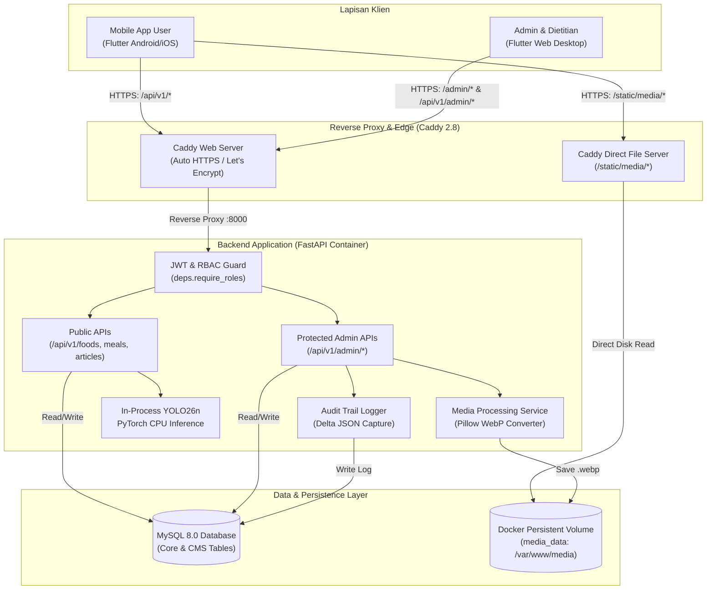
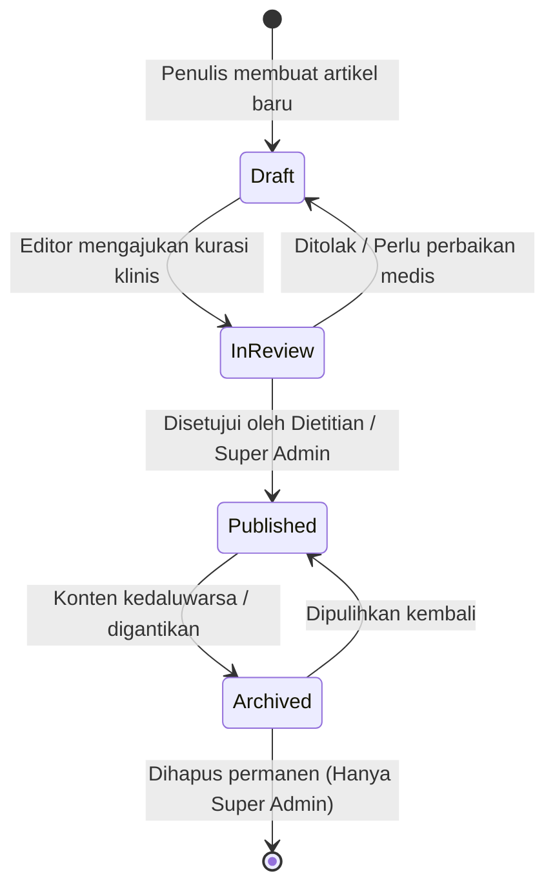
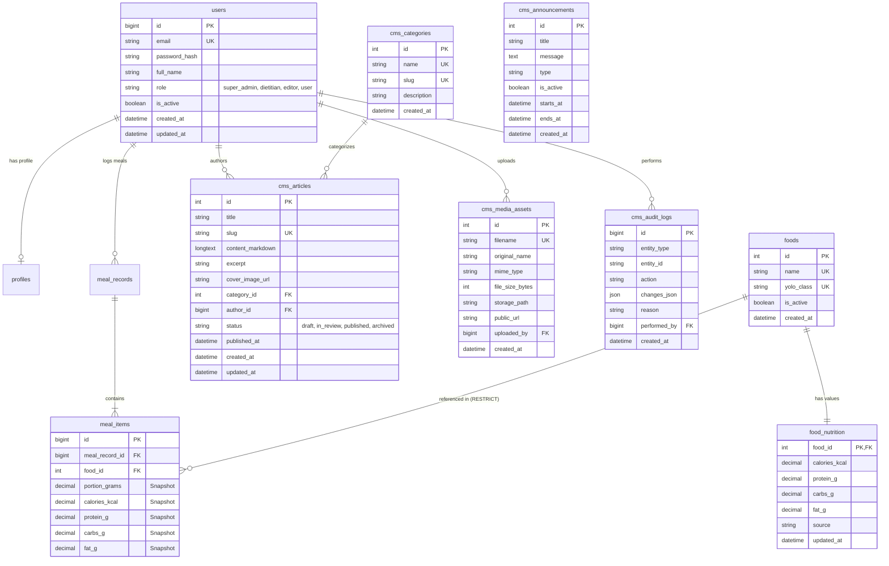
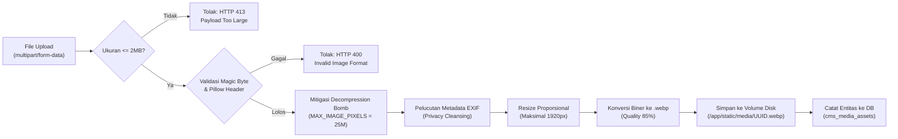

# NutriView — Spesifikasi Teknis Implementasi Content Management System (CMS)

> [!NOTE] **DOKUMEN HISTORIS (HISTORICAL DOCUMENTATION)**  
> Dokumen ini merupakan spesifikasi perancangan awal CMS (23 Oktober 2026) yang membandingkan arsitektur REST FastAPI/Alembic/Docker dengan modul terintegrasi.  
> Implementasi CMS aktual saat ini telah dibangun **secara native di dalam aplikasi Flutter (`AdminDashboardScreen`, `AdminRepository`)** yang terhubung langsung dengan **Cloud Firestore (`cms_articles`, `cms_categories`, `cms_announcements`, `cms_audit_logs`, `cms_media`)**, tanpa server FastAPI maupun bucket Firebase Storage.  
> Untuk arsitektur dan dokumentasi database CMS aktif, lihat:
> - [`docs/ARCHITECTURE.md`](ARCHITECTURE.md)
> - [`docs/DATABASE_AND_BACKEND.md`](DATABASE_AND_BACKEND.md)

**Dokumen**: Technical Architecture & Implementation Specification (Historical)  
**Target File**: `docs/CMS_IMPLEMENTATION_SPEC.md`  
**Proyek**: NutriView — Food Nutrition Recognition & Daily Tracking  
**Status**: HISTORICAL REFERENCE (Implemented via Flutter + Firestore)  
**Versi Dokumen**: 2.0.0 (Historical RFC)  
**Tanggal Audit Terakhir**: 23 Oktober 2026  
**Penulis**: Principal Software Architect, Senior Backend Engineer, Flutter Architect, Database Architect, Application Security Engineer & Technical Documentation Specialist  

---

## DAFTAR ISI

1. [Dokumen Status & Catatan Revisi](#1-dokumen-status--catatan-revisi)
2. [Executive Summary](#2-executive-summary)
3. [Hasil Audit Arsitektur Saat Ini](#3-hasil-audit-arsitektur-saat-ini)
4. [Inventaris Fitur Eksisting & Analisis Kesenjangan (Gaps)](#4-inventaris-fitur-eksisting--analisis-kesenjangan-gaps)
5. [Ruang Lingkup (Scope) & Non-Goals](#5-ruang-lingkup-scope--non-goals)
6. [Analisis Perbandingan Strategi CMS](#6-analisis-perbandingan-strategi-cms)
7. [Architecture Decision Record (ADR): Admin Frontend Technology](#7-architecture-decision-record-adr-admin-frontend-technology)
8. [Target Arsitektur yang Direkomendasikan](#8-target-arsitektur-yang-direkomendasikan)
9. [Diagram Arsitektur Sistem (Mermaid)](#9-diagram-arsitektur-sistem-mermaid)
10. [Kebutuhan Fungsional (Phased Requirements)](#10-kebutuhan-fungsional-phased-requirements)
11. [Kebutuhan Non-Fungsional](#11-kebutuhan-non-fungsional)
12. [Modul CMS & Spesifikasi Layar (Neo-Brutalism UX)](#12-modul-cms--spesifikasi-layar-neo-brutalism-ux)
13. [Siklus Hidup Konten (Content Lifecycle)](#13-siklus-hidup-konten-content-lifecycle)
14. [Model Data & Entity Relationship Diagram (ERD)](#14-model-data--entity-relationship-diagram-erd)
15. [Integritas Data Gizi, Provenansi & Validasi Atwater](#15-integritas-data-gizi-provenansi--validasi-atwater)
16. [Sistem Peran & Matriks Otorisasi (RBAC)](#16-sistem-peran--matriks-otorisasi-rbac)
17. [Spesifikasi API Lengkap (`/api/v1/admin/*` & Publik)](#17-spesifikasi-api-lengkap-apiv1admin--publik)
18. [Arsitektur & Pipeline Pengelolaan Media](#18-arsitektur--pipeline-pengelolaan-media)
19. [Arsitektur Keamanan & Mitigasi OWASP Top 10](#19-arsitektur-keamanan--mitigasi-owasp-top-10)
20. [Strategi Basis Data & Migrasi Skema Alembic](#20-strategi-basis-data--migrasi-skema-alembic)
21. [Operasional & Konfigurasi Deployment (Docker & Caddy)](#21-operasional--konfigurasi-deployment-docker--caddy)
22. [Strategi Pengujian Kualitas (Testing Strategy)](#22-strategi-pengujian-kualitas-testing-strategy)
23. [Roadmap Implementasi Bertahap (6 Milestone)](#23-roadmap-implementasi-bertahap-6-milestone)
24. [Kriteria Penerimaan Terverifikasi (Acceptance Criteria AC-01 s/d AC-10)](#24-kriteria-penerimaan-terverifikasi-acceptance-criteria-ac-01-sd-ac-10)
25. [Matriks Risiko & Mitigasi](#25-matriks-risiko--mitigasi)
26. [Asumsi & Keputusan Final Pertanyaan Terbuka](#26-asumsi--keputusan-final-pertanyaan-terbuka)
27. [Checklist Implementasi Terprioritisasi](#27-checklist-implementasi-terprioritisasi)
28. [Daftar File Repositori yang Terpengaruh](#28-daftar-file-repositori-yang-terpengaruh)

---

## 1. DOKUMEN STATUS & CATATAN REVISI

### 1.1 Metadata Dokumen
- **Status Dokumen**: FINAL SPECIFICATION (Ready for Implementation Phase)
- **Versi**: 2.0.0
- **Klasifikasi**: Internal Architecture & Engineering Blueprint

### 1.2 Ringkasan Perubahan Revisi (v1.0.0 → v2.0.0)
Dokumen ini merupakan hasil revisi menyeluruh dan finalisasi mendalam dari versi draf awal v1.0.0. Perubahan penting meliputi:
1. **Penyempurnaan Struktur Menjadi 28 Bagian Komprehensif**: Menjamin setiap aspek rekayasa perangkat lunak, database, keamanan, dan deployment didokumentasikan tanpa celah ambigu.
2. **Penyusunan Formal ADR (Architecture Decision Record) untuk Admin Portal**: Menetapkan rekomendasi definitif antara **Flutter Web (Embedded Admin Feature Module)** vs **React 18 + Vite (Independent SPA)** dengan analisis matematis trade-off memori, bandwidth, pemeliharaan jangka panjang, serta kondisi pemicu peninjauan ulang (*revisit triggers*).
3. **Formalisasi Integritas Data Gizi & Snapshot Historis**: Memverifikasi bukti kode bahwa `MealItem` telah menerapkan snapshot nilai gizi mandiri saat pencatatan makanan, membuktikan bahwa pembaruan data master tidak akan merusak riwayat makan lama pengguna.
4. **Validasi Silang Makronutrien Sistem Faktor Atwater**: Merumuskan kalkulasi validasi silang $(4 \times \text{protein}) + (4 \times \text{carbs}) + (9 \times \text{fat})$ dengan toleransi $\pm 15\%$ untuk mencegah anomali data gizi klinis.
5. **Strategi Provisi Super Admin & Pertahanan Eskalasi Peran**: Menentukan alur inisialisasi akun super admin pertama via CLI/Environment startup (menutup registrasi publik) dan mencabut sesi JWT seketika jika terjadi perubahan peran.
6. **Pipeline Media Aman & Efisien**: Mengombinasikan validasi *magic byte*, mitigasi *decompression bomb* Pillow (`MAX_IMAGE_PIXELS`), konversi WebP, isolasi volume persisten, dan *direct static serving* via Caddy 2.8.
7. **Pembaruan Kriteria Penerimaan (AC-01 s/d AC-10)**: Menambahkan kriteria penerimaan terukur dengan skenario verifikasi tegas.

---

## 2. EXECUTIVE SUMMARY

### 2.1 Konteks Proyek
NutriView adalah platform pelacak gizi harian berbasis kecerdasan buatan (*Computer Vision*) yang menggabungkan deteksi makanan otomatis menggunakan model Ultralytics YOLO26n dengan kalkulasi gizi deterministik berdasarkan Tabel Komposisi Pangan Indonesia (TKPI Kemenkes). Berdasarkan audit repositori langsung, sistem saat ini beroperasi dengan arsitektur **Modular Monolith** yang terdiri atas:
- **Backend API**: FastAPI (Python 3.12), SQLAlchemy 2.0 ORM, Alembic migrations, PyMySQL (Docker) / SQLite (lokal dev).
- **Inference Engine**: YOLO26n PyTorch CPU inference yang berjalan *in-process* di dalam container backend FastAPI.
- **Frontend Klien**: Flutter (Dart 3.x), Material 3 dengan tema khusus *Extreme Neo-Brutalism* (*Brutal Food Lab*), Provider state management.
- **Infrastruktur Produksi**: Docker Compose multi-container (MySQL 8.0, FastAPI Backend, Caddy 2.8 Reverse Proxy dengan auto-HTTPS Let's Encrypt).

### 2.2 Identifikasi Masalah Utama (Problem Statement)
Katalog pangan referensi NutriView (29 kelas makanan) beserta nilai gizi per 100 gram saat ini diinisialisasi secara statis melalui file CSV lokal (`backend/app/db/seed/foods.csv`) saat server pertama kali menyala. Hasil audit menemukan bahwa beberapa data awal masih bertanda `DATA_BELUM_TERSEDIA` (misalnya Burger, Capcay, Cookie, Donat, Kentang Goreng, Kiwi).

Ketiadaan modul Content Management System (CMS) menimbulkan kendala kritis:
1. **Ketiadaan Kurasi Gizi Mandiri**: Ahli gizi (*dietitian*) tidak dapat mengoreksi data atau melengkapi nilai gizi yang belum tersedia tanpa meminta perubahan langsung pada file CSV repositori dan melakukan deployment ulang.
2. **Ketiadaan Konten Edukasi Terpadu**: Aplikasi mobile belum memiliki saluran artikel gizi harian (*tips of the day*, panduan defisit kalori, edukasi mikronutrien) yang dapat diperbarui secara dinamis oleh tim editorial.
3. **Ketiadaan Sistem Peran Pengguna (RBAC)**: Model `User` saat ini bersifat datar tanpa kolom `role`, sehingga seluruh akun memiliki tingkat akses identik tanpa pemisahan hak staf medis, editor, atau administrator.
4. **Ketiadaan Jejak Audit Medis**: Modifikasi manual pada database berisiko merusak akurasi kalkulasi gizi tanpa riwayat siapa yang mengubah, kapan diubah, dan apa alasan klinis perubahannya.

### 2.3 Solusi Arsitektur CMS yang Direkomendasikan
Solusi arsitektur yang ditetapkan adalah **NutriView Integrated Headless CMS & Admin Portal (Hybrid Monolith Expansion)**:
- **Backend CMS**: Memperluas FastAPI backend dengan namespace rute terlindungi `/api/v1/admin/*`, skema RBAC berbasis dependensi injeksi (`super_admin`, `dietitian`, `editor`, `user`), tabel database relasional baru (`cms_categories`, `cms_articles`, `cms_media_assets`, `cms_audit_logs`, `cms_announcements`), serta pipeline kompresi citra WebP via Pillow.
- **Admin Portal Frontend**: Menyediakan antarmuka web modern dengan design system Neo-Brutalism yang selaras dengan aplikasi mobile, dirancang untuk desktop/tablet guna memudahkan kurasi katalog makanan, validasi Atwater, penulisan artikel Markdown, dan pemantauan log audit.

---

## 3. HASIL AUDIT ARSITEKTUR SAAT INI

Audit dilakukan langsung pada repositori kode sumber NutriView:

```
NutriView/
├── backend/
│   ├── alembic/                      # Migrasi database SQLAlchemy
│   │   ├── versions/
│   │   │   └── 001_initial_schema.py # Skema tabel users, profiles, foods, nutrition, meals
│   │   └── env.py
│   ├── app/
│   │   ├── api/
│   │   │   ├── deps.py               # Dependency injection: get_db, get_current_user, get_detector
│   │   │   └── v1/                   # Endpoint publik & user terautentikasi
│   │   │       ├── auth.py           # Register, Login, Logout (JWT token revocation)
│   │   │       ├── dashboard.py      # Ringkasan progres nutrisi harian
│   │   │       ├── foods.py          # Pencarian makanan, detail, & POST /detect (YOLO26n)
│   │   │       ├── meals.py          # Catatan makan harian & riwayat pengguna
│   │   │       ├── nutrition.py      # Kalkulator deterministik Mifflin-St Jeor
│   │   │       ├── router.py         # Router aggregator /api/v1
│   │   │       └── users.py          # Profil fisik pengguna
│   │   ├── core/
│   │   │   ├── config.py             # Pydantic BaseSettings (JWT, CORS, model thresholds)
│   │   │   ├── errors.py             # AppError custom exception handler & standard JSON error
│   │   │   ├── logging.py            # Structured request-id logger
│   │   │   └── security.py           # Argon2id password hashing, JWT bearer creation/decoding
│   │   ├── db/
│   │   │   ├── base.py               # DeclarativeBase & PrimaryKeyBigInt cross-db support
│   │   │   ├── session.py            # SQLAlchemy engine & sessionmaker (SQLite/MySQL dynamic pool)
│   │   │   └── seed/
│   │   │       ├── foods.csv         # 29 data makanan referensi TKPI Kemenkes
│   │   │       └── seed_data.py      # Parser CSV otomatis saat startup
│   │   ├── ml/
│   │   │   ├── detector.py           # Wrapper FoodDetector Ultralytics YOLO26n CPU
│   │   │   └── weights/best.pt       # Bobot neural network YOLO26n
│   │   ├── models/                   # Definisi model SQLAlchemy ORM
│   │   │   ├── food.py               # Model Food & FoodNutrition (1-to-1)
│   │   │   ├── meal.py               # Model MealRecord & MealItem (1-to-many)
│   │   │   └── user.py               # Model User & UserProfile (1-to-1)
│   │   ├── schemas/                  # Pydantic v2 data validation schemas
│   │   └── services/                 # Layanan kalkulasi nutrisi & pencatatan
├── frontend/
│   ├── lib/
│   │   ├── core/
│   │   │   ├── constants/            # Endpoint URL & konfigurasi klien
│   │   │   ├── errors/               # Penanganan error HTTP & jaringan
│   │   │   ├── services/             # ApiClient, TokenStorage
│   │   │   └── theme/
│   │   │       └── neo_tokens.dart   # Design System Neo-Brutalism (Brutal Food Lab)
│   │   ├── features/
│   │   │   ├── auth/                 # Login & Registrasi
│   │   │   ├── camera/               # Pengambilan foto makanan & integrasi kamera
│   │   │   ├── dashboard/            # Kalori harian & progres makronutrien
│   │   │   ├── food_recognition/     # UI konfirmasi bounding box & pemilihan porsi
│   │   │   └── profile/              # Pengaturan profil fisik & target diet
│   │   ├── shared/
│   │   │   └── neo/                  # Komponen NeoCard, NeoButton, NeoBadge, NeoTextField
│   │   └── main.dart
├── docs/                             # Dokumentasi arsitektur & spesifikasi
├── docker-compose.yml                # Orkestrasi Docker (backend, db, proxy)
├── Dockerfile                        # Kontainerisasi FastAPI Python 3.12
└── Caddyfile                         # Konfigurasi reverse proxy & SSL
```

### 3.1 Temuan Audit Krusial Terkait Data & Relasi
1. **Imutabilitas Riwayat Makan Pengguna (`MealItem`)**:
   Pemeriksaan pada `backend/app/models/meal.py` membuktikan bahwa model `MealItem` telah menduplikasi nilai riwayat secara mandiri:
   ```python
   portion_grams: Mapped[Decimal] = mapped_column(Numeric(6, 2), nullable=False)
   calories_kcal: Mapped[Decimal] = mapped_column(Numeric(7, 2), nullable=False)
   protein_g: Mapped[Decimal] = mapped_column(Numeric(6, 2), nullable=False)
   carbs_g: Mapped[Decimal] = mapped_column(Numeric(6, 2), nullable=False)
   fat_g: Mapped[Decimal] = mapped_column(Numeric(6, 2), nullable=False)
   ```
   *Kesimpulan*: Pembaruan nilai gizi pada tabel master `food_nutrition` **tidak akan mengubah** kalkulasi masa lalu pengguna. Riwayat makan bersifat *immutable snapshot*.
2. **Integritas Relasi Makanan (`ondelete="RESTRICT"`)**:
   Kolom `meal_items.food_id` terikat ke `foods.id` dengan relasi `RESTRICT`. Menghapus baris makanan secara permanen (*hard delete*) akan memicu error integritas foreign key di database jika makanan tersebut pernah dicatat oleh pengguna.
   *Kesimpulan*: Penghapusan makanan **wajib menggunakan mekanisme soft-delete** via flag `is_active = False`.
3. **Ketiadaan Kolom Role pada Tabel User**:
   Pada `backend/app/models/user.py`, entitas `User` saat ini hanya memiliki `id`, `email`, `password_hash`, `full_name`, `created_at`, dan `updated_at`.
   *Kesimpulan*: Migrasi skema baru wajib menambahkan kolom `role` (dengan nilai default `'user'`) dan `is_active` (boolean).

---

## 4. INVENTARIS FITUR EKSISTING & ANALISIS KESENJANGAN (GAPS)

| Fitur / Modul | Status Saat Ini | Kesenjangan (Gaps) untuk Kebutuhan CMS |
|---|---|---|
| **Katalog Makanan** | Statis, dibaca dari `foods.csv` saat startup. Ada beberapa data `DATA_BELUM_TERSEDIA`. | Tidak ada antarmuka web atau API untuk menambah, mengedit, atau menonaktifkan makanan secara dinamis oleh kurator. |
| **Kalkulator Gizi** | Deterministik Mifflin-St Jeor & TKPI per 100g. | Tidak ada mekanisme validasi silang (cross-validation) angka kalori vs makronutrien saat data baru dimasukkan. |
| **Model Deteksi YOLO** | In-process inference YOLO26n CPU (`best.pt`). | Pemetaan label YOLO ke entitas database bersifat statis (`yolo_class`). Perlu modul pemetaan alias label deteksi. |
| **Autentikasi & Sesi** | JWT Bearer Token dengan blacklist `revoked_tokens` di database. | Belum ada pemisahan peran (*role*). Belum ada mekanisme pencabutan hak akses instan saat peran admin diubah. |
| **Konten Artikel & Tips** | Belum tersedia sama sekali di backend maupun mobile. | Pengguna hanya melihat angka kalori. Diperlukan modul artikel Markdown, kategori, dan banner pengumuman. |
| **Manajemen Media** | Belum ada endpoint penyimpanan aset media dinamis. | Gambar hanya bersumber dari aset lokal Flutter. Diperlukan pipeline upload citra terkompresi WebP untuk artikel. |
| **Jejak Audit (Audit Log)**| Belum ada pencatatan riwayat perubahan data gizi. | Perubahan data klinis tidak memiliki jejak (*untracked*), menyulitkan akuntabilitas medis. |

---

## 5. RUANG LINGKUP (SCOPE) & NON-GOALS

### 5.1 Dalam Ruang Lingkup (In-Scope)
1. **Manajemen Katalog Pangan & Gizi**: Penambahan, pengeditan nilai gizi, validasi formula Atwater, soft-delete, dan pemetaan string `yolo_class`.
2. **Jejak Audit Medis (*Clinical Audit Trail*)**: Pencatatan riwayat perubahan gizi mencakup nilai lama (*before*), nilai baru (*after*), timestamp, identitas kurator, dan alasan klinis perubahan (*edit reason*).
3. **Manajemen Konten Editorial (CMS)**: Pembuatan, pengeditan draf, publikasi, kategorisasi, dan pengarsipan artikel gizi berbasis Markdown serta banner pengumuman aktif.
4. **Role-Based Access Control (RBAC)**: Pengamanan endpoint backend menggunakan tingkatan hak akses: `super_admin`, `dietitian`, `editor`, dan `user`.
5. **Pipeline Penyimpanan Media Statis**: Validasi biner gambar, pencegahan *decompression bomb*, konversi ke WebP, penyimpanan disk lokal persisten, dan penyajian langsung via reverse proxy Caddy.
6. **Admin Portal Frontend**: Panel web desktop-friendly berdesain Neo-Brutalism untuk kurasi data dan penulisan konten.

### 5.2 Di Luar Ruang Lingkup (Non-Goals)
1. **Pelatihan Ulang Model AI (YOLO Model Retraining)**: CMS tidak melatih ulang bobot PyTorch (`best.pt`). Pelatihan model adalah proses Machine Learning terpisah (*offline pipeline*). CMS hanya mengelola relasi string deteksi (`yolo_class`) ke ID makanan.
2. **Web Scraping Otomatis**: CMS tidak melakukan scraping otomatis data gizi dari situs pihak ketiga secara ilegal/tanpa izin. Semua data harus diinput atau disetujui kurator berlisensi.
3. **Fitur Chat Telehealth 1-on-1 Realtime**: CMS bukan modul telekonsultasi dokter/pasien via WebSocket/WebRTC.
4. **Monetisasi / Gateway Pembayaran**: Tidak mencakup integrasi sistem *subscription* atau *paywall* konten pada rilis ini.

---

## 6. ANALISIS PERBANDINGAN STRATEGI CMS

Kami mengevaluasi 3 opsi arsitektur implementasi CMS untuk NutriView:

| Parameter Evaluasi | Opsi 1: Third-Party Headless CMS (Strapi / Directus) | Opsi 2: Django Admin Decoupled Microservice | Opsi 3: Custom Integrated CMS (FastAPI Extension) [REKOMENDASI] |
|---|---|---|---|
| **Kesesuaian Arsitektur** | Rendah. Memerlukan sinkronisasi dua database terpisah (MySQL NutriView vs DB Strapi). | Sedang. Menambahkan runtime Python Django terpisah di samping FastAPI. | **Sangat Tinggi**. Menyatu langsung dengan SQLAlchemy 2.0 ORM, model Pydantic, dan auth eksisting. |
| **Konsumsi Sumber Daya (VPS 2GB RAM)** | **Buruk**. Node.js runtime Strapi memakan 350-500 MB RAM tambahan, melebihi batas aman VPS. | **Sedang**. Django instance memakan 150-250 MB RAM tambahan. | **Optimal**. Overhead RAM hampir 0 MB karena berjalan di dalam proses FastAPI yang sudah aktif. |
| **Integritas Relasi Basis Data** | Berisiko tinggi desinkronisasi antara tabel makanan NutriView dan Strapi. | Kompleks (sharing database antar dua ORM: Django vs SQLAlchemy). | **Sempurna**. Foreign key native, relasi 1-to-1 gizi, dan constraint database langsung ditegakkan. |
| **Beban Pemeliharaan & Operasional** | Kompleks (perlu backup 2 database, patch keamanan Strapi, plugin maintenance). | Menengah (dua framework Python berbeda dalam satu repositori). | **Minimal**. Satu pipeline CI/CD, satu migrasi Alembic, satu service Docker. |
| **Kecepatan Implementasi** | Cepat untuk UI, lambat untuk sinkronisasi webhook gizi. | Cepat untuk admin standar, kaku untuk kustomisasi UI Neo-Brutalism. | **Cepat & Terarah**. UI dirancang persis dengan kebutuhan alur kerja ahli gizi NutriView. |

---

## 7. ARCHITECTURE DECISION RECORD (ADR): ADMIN FRONTEND TECHNOLOGY

### 7.1 Status
**DECIDED (Diterima & Disetujui)**

### 7.2 Konteks & Masalah
NutriView memerlukan antarmuka visual (Admin Portal) untuk staf kurator gizi dan editor konten. Terdapat dua alternatif teknologi utama:
1. **Opsi A: Flutter Web (Embedded Admin Feature Module)** di dalam repositori frontend eksisting.
2. **Opsi B: React 18 + Vite + Tailwind/Shadcn (Independent SPA)** di direktori baru `admin-web/`.

### 7.3 Evaluasi Pilihan

#### Opsi A: Flutter Web (Embedded Admin Feature Module)
- **Kelebihan**:
  - **100% Code & Design Reuse**: Menggunakan langsung token warna dan gaya *Extreme Neo-Brutalism* (`neo_tokens.dart`), widget kustom (`NeoCard`, `NeoButton`, `NeoBadge`, `NeoTextField`), model DTO, dan `ApiClient`.
  - **Single Language & Toolchain**: Tim hanya perlu menguasai Dart/Flutter tanpa perlu mengelola dependensi Node.js, `npm/yarn/pnpm`, Vite, dan variasi CSS.
  - **Unified Build & Repository**: Tidak ada sub-proyek terpisah; rute admin dilindungi via *Guard Navigation* di Flutter (`/admin/login`, `/admin/foods`, `/admin/articles`).
- **Kekurangan**:
  - Ukuran bundle awal CanvasKit/Wasm relatif lebih besar (~3-4 MB).
  - Manipulasi DOM native terbatas (namun tidak relevan untuk portal internal).
  - Penanganan file picker web membutuhkan conditional import (`package:file_picker`).

#### Opsi B: React 18 + Vite (Independent SPA)
- **Kelebihan**:
  - Bundle size sangat kecil (< 200 KB gzipped) dan waktu muat awal *near-instant*.
  - Ekosistem pustaka komponen tabel data desktop (TanStack Table) dan Markdown editor (Milkdown, TipTap) sangat melimpah.
- **Kekurangan**:
  - **Duplikasi Desain & Token**: Seluruh token warna Neo-Brutalism, border 3px, hard shadows, dan tipografi harus ditulis ulang ke dalam Tailwind CSS/CSS Modules.
  - **Beban Perawatan Ekosistem Baru**: Menambahkan runtime Node.js, rentan terhadap kerentanan keamanan dependensi npm, dan memerlukan konfigurasi build terpisah di Caddyfile.
  - **Context Switching**: Menuntut pemeliharaan dua bahasa pemrograman yang berbeda (Dart untuk mobile vs TypeScript untuk web admin).

### 7.4 Keputusan Arsitektur
**Kami menetapkan OPSI A: FLUTTER WEB (EMBEDDED ADMIN TARGET)** sebagai teknologi frontend admin portal NutriView, dengan ketentuan teknis:
1. Kode admin portal ditempatkan secara modular di `frontend/lib/features/admin/` terisolasi dari fitur mobile konsumen.
2. Kompilasi web memanfaatkan optimasi modern Flutter Wasm/CanvasKit yang dikompresi menggunakan modul `zstd/gzip` bawaan Caddy 2.8.
3. Klien HTTP tetap memanfaatkan instance singleton `ApiClient` yang telah dilengkapi manajemen header Bearer Token dan penanganan error standar.

### 7.5 Kondisi Pemicu Peninjauan Ulang (*Revisit Triggers*)
Keputusan ini wajib ditinjau ulang dan dialihkan ke Opsi B (React/Vite) jika salah satu dari kondisi berikut terpenuhi:
1. Tim operasional admin bertambah menjadi tim editorial independen berskala besar yang membutuhkan integrasi ekstensi browser pihak ketiga, manajemen multi-tab DOM kompleks, atau integrasi plugin desktop yang tidak didukung Flutter Web.
2. Waktu render rendering Flutter CanvasKit di browser desktop berspesifikasi rendah menimbulkan keluhan latensi pengetikan yang mengganggu efisiensi kerja staf medis.
3. Kebutuhan editor Markdown bertransformasi menjadi visual WYSIWYG kolaboratif real-time (seperti Google Docs / Notion) yang memerlukan manipulasi contenteditable DOM secara mendalam.

---

## 8. TARGET ARSITEKTUR YANG DIREKOMENDASIKAN

Arsitektur target mengusung konsep **Integrated Modular Monolith Expansion**:
1. **Core Backend (FastAPI)**:
   - Namespace `/api/v1/admin/*` untuk operasi administratif terotentikasi dan terotorisasi.
   - Namespace `/api/v1/articles` dan `/api/v1/announcements` untuk konsumsi publik (aplikasi mobile dan web).
   - Injeksi dependensi `require_roles("super_admin", "dietitian")` untuk menegakkan otorisasi granular di tingkat rute API.
2. **Persistence Layer (SQLAlchemy 2.0 & MySQL 8.0)**:
   - Skema diperluas dengan 5 tabel CMS baru tanpa memutus relasi tabel eksisting.
   - Pemanfaatan tipe data JSON native untuk menyimpan delta perubahan (*audit changes*).
3. **Media Pipeline**:
   - Pemrosesan gambar *in-memory* dengan Pillow (resize maksimal 1920px, konversi WebP q=85).
   - Penyimpanan lokal pada volume Docker persisten `media_data` (`/app/static/media`).
   - Caddy 2.8 bertindak sebagai static file server langsung dengan header *aggressive caching*.

---

## 9. DIAGRAM ARSITEKTUR SISTEM (MERMAID)



---

## 10. KEBUTUHAN FUNGSIONAL (PHASED REQUIREMENTS)

### 10.1 Fase MVP (Tahap 1 - Fondasi Mutlak)
- **FR-01 (Katalog Pangan)**: Staf dapat mencari, menambah, memperbarui nama, porsi standar, dan angka nutrisi (kalori, protein, lemak, karbohidrat) makanan.
- **FR-02 (Soft-Delete Makanan)**: Makanan dapat dinonaktifkan (`is_active = false`) agar tidak muncul di pencarian user baru tanpa merusak catatan makan lama.
- **FR-03 (Audit Trail Gizi)**: Setiap pembaruan nutrisi wajib merekam alasan perubahan (*edit reason*), user ID kurator, serta delta JSON nilai sebelum dan sesudah.
- **FR-04 (Autentikasi & RBAC)**: Login admin memvalidasi kredensial pengguna dan menolak peran yang tidak memiliki izin operasional.
- **FR-05 (Artikel Gizi Dasar)**: Editor dapat menulis artikel berformat Markdown, memilih kategori, dan menerbitkannya ke publik.

### 10.2 Fase 2 (Pengkayaan Fitur & Otomasi)
- **FR-06 (Galeri Media Terpadu)**: Staf dapat mengunggah gambar pendukung, melihat daftar media, dan menyalin URL gambar WebP untuk disematkan pada artikel.
- **FR-07 (Banner Pengumuman)**: Super Admin dapat membuat banner pengumuman (info pemeliharaan sistem, tips gizi harian) yang muncul di dashboard aplikasi mobile.
- **FR-08 (Validasi Atwater Interaktif)**: Form pengisian gizi memberikan kalkulasi otomatis selisih energi teoritis vs input kurator secara real-time di UI.

### 10.3 Fase Mendatang (Future Enhancements)
- **FR-09 (Batch CSV Import/Export)**: Kurator dapat mengekspor seluruh katalog gizi ke format CSV berstandar TKPI Kemenkes dan mengimpor pembaruan massal.
- **FR-10 (Penerbitan Terjadwal)**: Penjadwalan tanggal dan jam terbit artikel secara otomatis via background scheduler.

---

## 11. KEBUTUHAN NON-FUNGSIONAL

1. **Performa & Latensi**:
   - Waktu respons endpoint admin P95 $< 200\text{ ms}$ untuk operasi baca dan $< 400\text{ ms}$ untuk operasi tulis database.
   - Waktu penyajian aset media via Caddy $< 50\text{ ms}$ berkat *caching* disk dan kompresi WebP.
2. **Ketersediaan & Stabilitas Sumber Daya (VPS 2GB RAM)**:
   - Backend FastAPI saat kondisi *idle* tidak boleh mengonsumsi lebih dari $200\text{ MB}$ RAM.
   - Pemrosesan gambar dibatasi maksimal $1920\text{ px}$ dan dijalankan di worker thread terpisah (`anyio.to_thread`) agar tidak memblokir event loop async FastAPI.
3. **Keamanan & Otorisasi**:
   - Seluruh password di-hash menggunakan Argon2id dengan parameter komputasi standar OWASP.
   - Proteksi brute-force login admin maksimal 5 percobaan gagal per 5 menit per alamat IP.
   - Tidak ada kebocoran pesan error SQL mentah ke klien; seluruh error dibungkus skema standar `{ "error": { "code": "...", "message": "...", "request_id": "..." } }`.
4. **Kompatibilitas Antar Basis Data**:
   - Semua migrasi Alembic dan skema SQLAlchemy 2.0 wajib kompatibel 100% pada SQLite (pengujian lokal/CI) dan MySQL 8.0 (lingkungan kontainer produksi).

---

## 12. MODUL CMS & SPESIFIKASI LAYAR (NEO-BRUTALISM UX)

Admin Portal NutriView mengadopsi bahasa visual *Extreme Neo-Brutalism* (*Brutal Food Lab*) yang selaras dengan aplikasi mobile:
- **Background**: Sand/Canvas (`#F7F4EB`)
- **Card Surface**: High-contrast Pure White (`#FFFFFF`)
- **Text/Borders**: Ink Black (`#1A1A1A` / `#000000`), Stroke Border padat $3\text{ px}$
- **Hard Drop Shadows**: $4\text{ px}\ 4\text{ px}\ 0\text{ px}\ \#000000$ (tanpa efek blur)
- **Aksen Fungsional**: Neo-Lime (`#E7F55C` - Sukses/Aktif), Neo-Tangerine (`#FF6B4A` - Peringatan/Hapus), Neo-Sky (`#4AE2FF` - Informasi/Aksi), Neo-Cobalt (`#2B4CDE` - Navigasi Primer).

### 12.1 Modul 1: Admin Login Screen
- **Tampilan**: Card terpusat berbingkai hitam $3\text{ px}$ dengan shadow tebal.
- **Elemen Input**: Email field, Password field (dengan toggle visibilitas), Tombol "MASUK KE ADMIN PORTAL" (Neo-Lime dengan efek klik translate).
- **Keamanan UI**: Menampilkan indikator jika akun tidak memiliki peran staf (`super_admin`, `dietitian`, `editor`).

### 12.2 Modul 2: Admin Overview Dashboard
- **HUD Metric Cards**:
  - Total Makanan Aktif (Angka besar monospaced + NeoBadge hijau).
  - Makanan dengan Gizi Belum Lengkap (Peringatan Neo-Tangerine untuk item yang butuh kurasi).
  - Total Artikel Terbit vs Draf.
  - Aktivitas Audit Terbaru (3 catatan perubahan terakhir).
- **Quick Actions**: Tombol "Tambah Makanan Baru", "Tulis Artikel", "Buka Galeri Media".

### 12.3 Modul 3: Katalog Pangan & Kurasi Gizi
- **Tabel Data Neo-Brutal**:
  - Kolom: ID, Nama Makanan, Label YOLO (`yolo_class`), Kalori (kkal), Protein (g), Karbo (g), Lemak (g), Status (Aktif/Nonaktif), Aksi.
  - Baris memiliki hover state kontras tinggi dan border pemisah $2\text{ px}$.
- **Filter & Pencarian**: Search bar instan untuk nama makanan, dropdown filter status (`Semua`, `Aktif`, `Nonaktif`), filter kelengkapan data.
- **Drawer / Modal Editor Gizi**:
  - Field nama makanan, mapping kelas YOLO (dropdown/autocomplete string model).
  - Grid input makronutrien: Kalori, Protein, Karbohidrat, Lemak (per 100 gram).
  - Field Sumber Data Gizi (contoh: "TKPI 2020 Kode B-45").
  - Field Wajib: Alasan Perubahan Data (*Edit Reason*). Form tidak dapat disubmit jika alasan kosong.
  - **Widget Atwater Energy Checker**: Indikator langsung yang menghitung estimasi kalori matematis vs input manual kurator.

### 12.4 Modul 4: Manajemen Artikel & Penulisan Markdown
- **Layout Split-View**:
  - Sisi Kiri: Markdown Source Editor dengan syntax highlight sederhana (Title, Slug, Excerpt, Kategori, Status Draf/Terbit).
  - Sisi Kanan: Live Neo-Brutalism Preview yang menampilkan format artikel persis seperti yang akan dilihat pengguna di aplikasi mobile.
- **Cover Image Selector**: Tombol integrasi langsung ke Galeri Media untuk memilih gambar sampul artikel.

### 12.5 Modul 5: Galeri Media (Media Asset Manager)
- **Tampilan Grid Kartu Media**: Kartu persegi dengan pratinjau gambar, nama file, ukuran file, dan tanggal unggah.
- **Drag-and-Drop Dropzone**: Area unggah file dengan border putus-putus (*dashed border*) $3\text{ px}$ dengan validasi ukuran file maksimal $2\text{ MB}$.
- **Tombol "SALIN LINK"**: Otomatis menyalin URL relatif (`/static/media/[uuid].webp`) ke clipboard untuk langsung ditempelkan pada naskah Markdown.

### 12.6 Modul 6: Log Audit & Riwayat Perubahan Gizi
- **Tampilan Timeline Kronologis**: Daftar log audit terurut dari yang terbaru.
- **Detail Perubahan JSON**: Tampilan *diff viewer* sederhana (Nilai Lama berwarna merah coret vs Nilai Baru berwarna hijau tebal).
- **Metadata**: Menampilkan nama dan email staf yang mengeksekusi, IP address, waktu kejadian, dan alasan klinis.

---

## 13. SIKLUS HIDUP KONTEN (CONTENT LIFECYCLE)



### 13.1 Aturan Transisi Status Konten
1. **DRAFT**:
   - Konten disimpan sementara. Hanya dapat dilihat dan disunting oleh penulis asli (`author_id`), Dietitian, atau Super Admin.
   - Endpoint publik `/api/v1/articles` memfilter secara ketat dan **tidak akan mengekspos** status ini ke publik.
2. **IN_REVIEW**:
   - Naskah artikel telah rampung dan menunggu verifikasi akurasi ilmiah oleh ahli gizi (`dietitian`).
3. **PUBLISHED**:
   - Artikel resmi dapat diakses publik melalui endpoint mobile dan pencarian.
   - Memiliki timestamp `published_at` yang valid.
4. **ARCHIVED**:
   - Artikel dinonaktifkan dari peredaran publik tanpa menghapus catatan historis dari basis data.

---

## 14. MODEL DATA & ENTITY RELATIONSHIP DIAGRAM (ERD)

### 14.1 Spesifikasi Entitas & Skema Basis Data

#### 1. Perubahan pada Entitas Eksisting `users`
- Tambah kolom `role`: `VARCHAR(20)`, Default `'user'`, Not Null. Nilai Enum: `super_admin`, `dietitian`, `editor`, `user`.
- Tambah kolom `is_active`: `BOOLEAN`, Default `TRUE`, Not Null.

#### 2. Entitas Baru `cms_categories`
- `id`: `INTEGER`, Primary Key, Autoincrement.
- `name`: `VARCHAR(100)`, Not Null, Unique.
- `slug`: `VARCHAR(120)`, Not Null, Unique, Index.
- `description`: `VARCHAR(255)`, Nullable.
- `created_at`: `DATETIME`, Default `CURRENT_TIMESTAMP`.

#### 3. Entitas Baru `cms_articles`
- `id`: `INTEGER`, Primary Key, Autoincrement.
- `title`: `VARCHAR(255)`, Not Null.
- `slug`: `VARCHAR(280)`, Not Null, Unique, Index.
- `content_markdown`: `LONGTEXT`, Not Null.
- `excerpt`: `VARCHAR(500)`, Nullable.
- `cover_image_url`: `VARCHAR(500)`, Nullable.
- `category_id`: `INTEGER`, ForeignKey ke `cms_categories.id`, `ON DELETE SET NULL`, Nullable.
- `author_id`: `BIGINT`, ForeignKey ke `users.id`, `ON DELETE RESTRICT`, Not Null.
- `status`: `VARCHAR(20)`, Default `'draft'`, Not Null. Enum: `draft`, `in_review`, `published`, `archived`.
- `published_at`: `DATETIME`, Nullable.
- `created_at`: `DATETIME`, Default `CURRENT_TIMESTAMP`.
- `updated_at`: `DATETIME`, Default `CURRENT_TIMESTAMP`, OnUpdate `CURRENT_TIMESTAMP`.

#### 4. Entitas Baru `cms_media_assets`
- `id`: `INTEGER`, Primary Key, Autoincrement.
- `filename`: `VARCHAR(255)`, Not Null, Unique.
- `original_name`: `VARCHAR(255)`, Not Null.
- `mime_type`: `VARCHAR(50)`, Not Null (misal: `image/webp`).
- `file_size_bytes`: `INTEGER`, Not Null.
- `storage_path`: `VARCHAR(500)`, Not Null.
- `public_url`: `VARCHAR(500)`, Not Null.
- `uploaded_by`: `BIGINT`, ForeignKey ke `users.id`, `ON DELETE RESTRICT`, Not Null.
- `created_at`: `DATETIME`, Default `CURRENT_TIMESTAMP`.

#### 5. Entitas Baru `cms_audit_logs`
- `id`: `BIGINT`, Primary Key, Autoincrement.
- `entity_type`: `VARCHAR(50)`, Not Null (misal: `food_nutrition`, `food`, `article`).
- `entity_id`: `VARCHAR(100)`, Not Null, Index.
- `action`: `VARCHAR(20)`, Not Null (misal: `CREATE`, `UPDATE`, `SOFT_DELETE`).
- `changes_json`: `JSON`, Not Null (berisi `{ "before": {...}, "after": {...} }`).
- `reason`: `VARCHAR(255)`, Not Null.
- `performed_by`: `BIGINT`, ForeignKey ke `users.id`, `ON DELETE RESTRICT`, Not Null.
- `created_at`: `DATETIME`, Default `CURRENT_TIMESTAMP`.

#### 6. Entitas Baru `cms_announcements`
- `id`: `INTEGER`, Primary Key, Autoincrement.
- `title`: `VARCHAR(200)`, Not Null.
- `message`: `TEXT`, Not Null.
- `type`: `VARCHAR(30)`, Default `'info'`, Not Null. (Enum: `info`, `warning`, `maintenance`).
- `is_active`: `BOOLEAN`, Default `TRUE`, Not Null.
- `starts_at`: `DATETIME`, Nullable.
- `ends_at`: `DATETIME`, Nullable.
- `created_at`: `DATETIME`, Default `CURRENT_TIMESTAMP`.

### 14.2 Entity Relationship Diagram (Mermaid)



---

## 15. INTEGRITAS DATA GIZI, PROVENANSI & VALIDASI ATWATER

### 15.1 Jaminan Imutabilitas Catatan Historis Pengguna
Dalam sistem pelacak gizi klinis, perubahan pada data master tidak boleh merusak akurasi kalkulasi riwayat diet pengguna di masa lampau:
- Model `MealItem` (`backend/app/models/meal.py`) menyimpan salinan nilai gizi mutlak (*immutable snapshot*) saat makanan dicatat:
  $$\text{Snapshot Kalori} = \text{Nutrisi Master} \times \left( \frac{\text{Porsi Gram}}{100} \right)$$
- Pembaruan nilai gizi master pada tabel `food_nutrition` hanya akan berlaku untuk pencatatan makanan **di masa depan**, menjaga akuntabilitas medis catatan harian yang telah lewat.

### 15.2 Larangan Penghapusan Keras (*Soft-Delete Enforcement*)
Tabel `meal_items` merujuk ke `foods.id` dengan relasi `ondelete="RESTRICT"`. Untuk mencegah kegagalan *foreign key integrity*:
- Administrator dilarang mengeksekusi `DELETE FROM foods WHERE id = :id`.
- Modul CMS mengimplementasikan *soft-delete* dengan mengubah `foods.is_active = FALSE`.
- Makanan non-aktif secara otomatis disembunyikan dari autocomplete pencarian pengguna publik, namun riwayat log makanan lama tetap dapat menampilkan nama makanan dengan benar.

### 15.3 Validasi Silang Makronutrien Sistem Faktor Atwater
Untuk mencegah kesalahan input angka gizi yang mustahil secara biologis/fisika, sistem backend dan form UI CMS menerapkan formula konversi energi standar internasional (*Atwater Specific Energy Factors*):

$$\text{Kalori Teoritis (kkal)} \approx (4 \times \text{Protein}) + (4 \times \text{Karbohidrat}) + (9 \times \text{Lemak})$$

1. **Batasan Fisik Absolut (Hard Validation)**:
   - Jumlah total makronutrien dalam 100 gram makanan tidak boleh melebihi 100 gram:
     $$\text{Protein (g)} + \text{Karbohidrat (g)} + \text{Lemak (g)} \le 100\text{ g}$$
   - Nilai tidak boleh bernilai negatif: $\text{Kalori} \ge 0,\ \text{Protein} \ge 0,\ \text{Karbo} \ge 0,\ \text{Lemak} \ge 0$.
2. **Toleransi Biologis Atwater ($\pm 15\%$)**:
   - Adanya serat pangan tak larut, kadar air (*moisture*), abu, dan asam organik dapat menyebabkan deviasi alami antara kalori terukur bomb kalorimeter dengan rumus Atwater dasar.
   - Pydantic validator akan memvalidasi rasio:
     $$\text{Deviasi} = \left| \frac{\text{Kalori Input} - \text{Kalori Teoritis}}{\max(1, \text{Kalori Input})} \right|$$
   - Jika $\text{Deviasi} > 15\%$, sistem memberikan status peringatan (*warning badge*) pada antarmuka kurator untuk memastikan nilai rujukan benar.
   - Jika $\text{Deviasi} > 30\%$, permintaan simpan **ditolak keras** (`HTTP 422 Unprocessable Entity`) untuk mencegah korupsi data klinis.

### 15.4 Pelacakan Provenansi Data Pangan
Setiap entitas gizi pada `food_nutrition` wajib menyertakan atribut `source` yang merujuk pada dokumen rujukan terakreditasi (misal: `"TKPI Kemenkes 2020 Kode B-45"` atau `"USDA FoodData Central #171077"`). Setiap perubahan akan memicu *event listener* SQLAlchemy untuk menyimpan perubahan ke `cms_audit_logs`.

---

## 16. SISTEM PERAN & MATRIKS OTORISASI (RBAC)

### 16.1 Definisi Peran (*Roles*)
1. **`super_admin`**: Pemilik teknis dan pengelola sistem. Memiliki akses menyeluruh ke seluruh API, konfigurasi sistem, dan manajemen akun staf.
2. **`dietitian`** (Ahli Gizi): Kurator konten medis berlisensi. Memiliki wewenang mengelola katalog pangan, mengoreksi angka gizi, meninjau artikel gizi, dan melihat log audit.
3. **`editor`**: Staf redaksi dan penulisan. Memiliki wewenang membuat draf artikel edukasi, mengunggah aset media, dan mengelola draf naskah.
4. **`user`**: Pengguna akhir aplikasi NutriView (Mobile & Web). Hanya memiliki akses baca ke katalog aktif dan artikel terbitan.

### 16.2 Matriks Hak Akses Granular (Granular RBAC Matrix)

| Aksi / Kemampuan Sistem | `super_admin` | `dietitian` | `editor` | `user` |
|---|:---:|:---:|:---:|:---:|
| Baca Katalog Makanan Aktif | ✅ | ✅ | ✅ | ✅ |
| Baca Seluruh Katalog Makanan (Termasuk Nonaktif) | ✅ | ✅ | ❌ | ❌ |
| Tambah Makanan Baru ke Katalog | ✅ | ✅ | ❌ | ❌ |
| Edit Nilai Gizi Makanan & Alasan Audit | ✅ | ✅ | ❌ | ❌ |
| Soft-Delete (Aktifkan / Nonaktifkan) Makanan | ✅ | ✅ | ❌ | ❌ |
| Lihat Log Audit Perubahan Gizi | ✅ | ✅ | ❌ | ❌ |
| Buat Draf Artikel Edukasi | ✅ | ✅ | ✅ | ❌ |
| Edit Draf Artikel Milik Sendiri | ✅ | ✅ | ✅ | ❌ |
| Edit Draf Artikel Milik Penulis Lain | ✅ | ✅ | ❌ | ❌ |
| Terbitkan (*Publish*) Artikel ke Publik | ✅ | ✅ | ❌ | ❌ |
| Arsipkan / Hapus Artikel | ✅ | ❌ | ❌ | ❌ |
| Unggah Aset Media (Gambar WebP) | ✅ | ✅ | ✅ | ❌ |
| Hapus Aset Media dari Disk | ✅ | ❌ | ❌ | ❌ |
| Buat / Edit Banner Pengumuman Sistem | ✅ | ❌ | ❌ | ❌ |
| Ubah Peran Pengguna / Angkat Staf Admin | ✅ | ❌ | ❌ | ❌ |

### 16.3 Strategi Provisi Akun Super Admin & Pencegahan Eskalasi
1. **Larangan Registrasi Publik untuk Akun Staf**:
   Endpoint publik `POST /api/v1/auth/register` secara ketat menetapkan `role = 'user'`. Tidak ada parameter request yang mengizinkan penetapan role secara mandiri oleh pendaftar umum.
2. **Provisi Super Admin Pertama Kali (CLI Seeder)**:
   Akun Super Admin pertama hanya dapat diinisialisasi melalui CLI server lokal atau environment container saat instalasi awal:
   ```bash
   python -m app.cli.create_admin --email admin@nutriview.id --password [SECURE_PASSWORD] --name "Master Administrator"
   ```
   Atau dibaca melalui variabel lingkungan `INITIAL_ADMIN_EMAIL` & `INITIAL_ADMIN_PASSWORD` saat proses migrasi awal.
3. **Pencabutan Sesi Seketika (*Instant Session Invalidation*)**:
   Jika seorang pengguna dicabut hak adminnya atau perannya diubah oleh Super Admin, token JWT pengguna tersebut langsung dibatalkan dengan memasukkan seluruh token aktif `jti` milik user bersangkutan ke tabel `revoked_tokens`.

---

## 17. SPESIFIKASI API LENGKAP (`/api/v1/admin/*` & PUBLIK)

Seluruh respons API mengikuti format standar JSON NutriView:
- Berhasil: Objek data langsung atau `{ "data": ... }`
- Gagal: `{ "error": { "code": "...", "message": "...", "request_id": "...", "details": [...] } }`

### 17.1 Protected Admin Endpoints

#### 1. `POST /api/v1/admin/auth/login`
- **Akses**: Publik (dibatasi rate limiter 5 percobaan/5 menit).
- **Request Body**:
  ```json
  {
    "email": "dietitian@nutriview.id",
    "password": "StrongPassword123!"
  }
  ```
- **Response `200 OK`**:
  ```json
  {
    "access_token": "eyJhbGciOiJIUzI1NiIs...",
    "token_type": "bearer",
    "user": {
      "id": 2,
      "email": "dietitian@nutriview.id",
      "full_name": "Dr. Sarah Sp.GK",
      "role": "dietitian"
    }
  }
  ```

#### 2. `GET /api/v1/admin/foods`
- **Akses**: `super_admin`, `dietitian`.
- **Query Params**: `search` (string), `is_active` (boolean, opsional), `page` (default 1), `limit` (default 20).
- **Response `200 OK`**: Mengembalikan daftar makanan lengkap beserta status aktif dan relasi gizi.

#### 3. `POST /api/v1/admin/foods`
- **Akses**: `super_admin`, `dietitian`.
- **Request Body**:
  ```json
  {
    "name": "Ikan Tongkol Balado",
    "yolo_class": "ikan_balado",
    "calories_kcal": 185.0,
    "protein_g": 24.5,
    "carbs_g": 3.2,
    "fat_g": 8.1,
    "source": "TKPI 2020 No. B-45"
  }
  ```
- **Validasi Atwater**: Otomatis mengevaluasi kesesuaian kalori vs makronutrien.
- **Response `201 Created`**.

#### 4. `PUT /api/v1/admin/foods/{id}`
- **Akses**: `super_admin`, `dietitian`.
- **Request Body**:
  ```json
  {
    "name": "Ikan Tongkol Balado",
    "yolo_class": "ikan_balado",
    "calories_kcal": 190.0,
    "protein_g": 25.0,
    "carbs_g": 3.0,
    "fat_g": 8.5,
    "source": "TKPI 2020 Rev. 2",
    "edit_reason": "Koreksi kadar protein berdasarkan data uji lab Balitbangkes terbaru"
  }
  ```
- **Efek Samping**: Menulis log perubahan otomatis ke tabel `cms_audit_logs`.
- **Response `200 OK`**.

#### 5. `PATCH /api/v1/admin/foods/{id}/status`
- **Akses**: `super_admin`, `dietitian`.
- **Request Body**: `{ "is_active": false, "reason": "Bahan pangan ditarik sementara dari katalog referensi" }`.
- **Response `200 OK`**.

#### 6. `POST /api/v1/admin/articles`
- **Akses**: `super_admin`, `dietitian`, `editor`.
- **Request Body**:
  ```json
  {
    "title": "Mengenal Peran Karbohidrat Kompleks",
    "slug": "mengenal-karbohidrat-kompleks",
    "content_markdown": "# Mengapa Karbohidrat Penting...\n\nKarbohidrat kompleks...",
    "excerpt": "Panduan praktis memilih sumber karbohidrat lambat cerna.",
    "category_id": 2,
    "cover_image_url": "/static/media/7b8f9e01-1234-4567-89ab-cdef01234567.webp",
    "status": "draft"
  }
  ```
- **Response `201 Created`**.

#### 7. `PUT /api/v1/admin/articles/{id}`
- **Akses**: Penulis asli (`editor`), atau `super_admin`/`dietitian`.
- **Request Body**: Update field artikel dan transisi status (`in_review`, `published`).

#### 8. `POST /api/v1/admin/media/upload`
- **Akses**: `super_admin`, `dietitian`, `editor`.
- **Payload**: `multipart/form-data` dengan field `file`.
- **Response `201 Created`**:
  ```json
  {
    "id": 14,
    "original_name": "infografis-gizi.png",
    "filename": "7b8f9e01-1234-4567-89ab-cdef01234567.webp",
    "public_url": "/static/media/7b8f9e01-1234-4567-89ab-cdef01234567.webp",
    "file_size_bytes": 452100,
    "mime_type": "image/webp"
  }
  ```

#### 9. `GET /api/v1/admin/audit-logs`
- **Akses**: `super_admin`, `dietitian`.
- **Query Params**: `entity_type`, `entity_id`, `page`, `limit`.
- **Response `200 OK`**: Daftar rekaman log audit beserta delta JSON.

### 17.2 Public Content Endpoints

#### 1. `GET /api/v1/articles`
- **Akses**: Terbuka / Publik.
- **Filter**: Secara permanen menyaring `status = 'published'`.
- **Query Params**: `category_id`, `search`, `page`, `limit`.

#### 2. `GET /api/v1/articles/{slug}`
- **Akses**: Terbuka / Publik.
- **Response `200 OK`**: Data detail artikel untuk dirender oleh pembaca Markdown di aplikasi mobile.

#### 3. `GET /api/v1/announcements/active`
- **Akses**: Terbuka / Publik.
- **Response `200 OK`**: Menampilkan banner aktif (`is_active = true` dan berada dalam rentang `starts_at` - `ends_at`).

---

## 18. ARSITEKTUR & PIPELINE PENGELOLAAN MEDIA



### 18.1 Tahapan Pemrosesan Citra
1. **Validasi Biner & Pencegahan File Berbahaya**:
   - Pengecekan *content-type* header dan ekstensi (`.jpg`, `.jpeg`, `.png`, `.webp`).
   - Verifikasi integritas header citra menggunakan `Image.open()`.
   - Penerapan `Image.MAX_IMAGE_PIXELS = 25_000_000` untuk menggagalkan serangan *zip-bomb / decompression bomb*.
2. **Pelucutan Metadata & Privasi**:
   - Seluruh tag metadata EXIF (termasuk lokasi koordinat GPS kamera kurator) dihapus sepenuhnya saat kompresi ulang.
3. **Standarisasi WebP**:
   - Seluruh citra dikonversi ke format WebP dengan kompresi *lossy* kualitas 85% untuk efisiensi transfer bandwidth seluler.
4. **Penyajian Cepat (*Direct Serving*) via Caddy**:
   - File media disimpan pada volume Docker bersama `media_data` yang dipasang pada Caddy di `/var/www/media`.
   - Caddy menyajikan gambar secara langsung tanpa melewati worker Python FastAPI, dilengkapi header:
     ```http
     Cache-Control: public, max-age=31536000, immutable
     ```

---

## 19. ARSITEKTUR KEAMANAN & MITIGASI OWASP TOP 10

| Risiko OWASP Top 10 | Mitigasi Spesifik pada NutriView CMS |
|---|---|
| **A01: Broken Access Control** | Penegakan dekorator dependensi `require_roles()` di FastAPI. Verifikasi ganda bahwa user aktif memiliki hak atas operasi tertentu. Invalidation instan sesi JWT via `revoked_tokens`. |
| **A02: Cryptographic Failures** | Penyimpanan kata sandi dengan Argon2id. Enkripsi TLS/HTTPS otomatis pada reverse proxy Caddy 2.8. |
| **A03: Injection (SQL & XSS)** | 100% kueri database menggunakan SQLAlchemy 2.0 ORM dengan *parameterized queries*. Parser Markdown pada klien Flutter menonaktifkan eksekusi tag `<script>` HTML mentah. |
| **A04: Insecure Design** | Penerapan batas validasi Atwater pada input data gizi untuk mencegah anomali klinis. Pembatasan operasi penghapusan menggunakan *soft-delete* guna melindungi integritas referensi. |
| **A05: Security Misconfiguration** | CORS dikonfigurasi melalui allowlist domain resmi di `config.py`. Pengaturan debug dinonaktifkan di lingkungan produksi. |
| **A07: Identification & Auth Failures** | Penerapan rate limiter pada endpoint login admin (maksimal 5 kegagalan per 5 menit per IP). Token JWT memiliki waktu kedaluwarsa terbatas (*short-lived access tokens*). |
| **A08: Software & Data Integrity Failures** | Validasi magic byte Pillow pada upload file untuk mencegah injeksi web-shell polyglot. Migrasi skema terkontrol via Alembic versions. |
| **A09: Security Logging & Monitoring** | Pencatatan structured JSON logging dengan UUID `request_id`. Tabel khusus `cms_audit_logs` menyimpan riwayat audit klinis permanen. |

---

## 20. STRATEGI BASIS DATA & MIGRASI SKEMA ALEMBIC

### 20.1 Pemisahan Data Statis CSV dan Data Dinamis CMS
1. **Inisialisasi Awal**: File CSV `backend/app/db/seed/foods.csv` tetap digunakan sebagai inisialisasi basis data pertama kali saat instalasi *cold-start*.
2. **Kedaulatan Database Dinamis**: Setelah instalasi awal berjalan, tabel database relasional menjadi *single source of truth*. File CSV tidak akan menimpa data yang telah dimodifikasi oleh ahli gizi di CMS.

### 20.2 Skrip Migrasi Alembic (`002_add_cms_tables.py`)
- Skrip migrasi menambahkan kolom `role` dan `is_active` ke tabel `users` dengan nilai default `role = 'user'` dan `is_active = TRUE`.
- Skrip membuat 5 tabel baru (`cms_categories`, `cms_articles`, `cms_media_assets`, `cms_audit_logs`, `cms_announcements`).
- Semua relasi didefinisikan menggunakan tipe foreign key standar yang kompatibel dengan dialek SQLite dan MySQL.

### 20.3 Prosedur Cadangan & Rollback Aman
1. **Pencadangan Sebelum Migrasi**:
   ```bash
   docker exec nutriview-db mysqldump -u nutriview_user -p nutriview > /backup/pre_cms_migration.sql
   ```
2. **Rollback Skema**:
   Jika terjadi anomali saat rilis, eksekusi perintah rollback Alembic:
   ```bash
   alembic downgrade -1
   ```
   Fungsi `downgrade()` dalam skrip migrasi telah dirancang untuk menghapus tabel CMS baru dan mencopot kolom role tanpa merusak integritas tabel utama.

---

## 21. OPERASIONAL & KONFIGURASI DEPLOYMENT (DOCKER & CADDY)

### 21.1 Pembaruan `docker-compose.yml`

```yaml
services:
  backend:
    build:
      context: .
      dockerfile: Dockerfile
    volumes:
      - ./backend/app/ml/weights:/app/app/ml/weights:ro
      - media_data:/app/static/media # Volume persisten untuk file media CMS
    environment:
      - DATABASE_URL=mysql+pymysql://nutriview_user:nutriview_pass@db:3306/nutriview
      - MEDIA_STORAGE_DIR=/app/static/media
    depends_on:
      db:
        condition: service_healthy

  proxy:
    image: caddy:2.8-alpine
    restart: unless-stopped
    ports:
      - "80:80"
      - "443:443"
    volumes:
      - ./Caddyfile:/etc/caddy/Caddyfile:ro
      - media_data:/var/www/media:ro # Akses baca langsung Caddy ke storage media
      - caddy_data:/data
      - caddy_config:/config
    depends_on:
      - backend

volumes:
  mysql_data:
    name: nutriview_mysql_data
  media_data:
    name: nutriview_media_data # Volume baru persisten media
```

### 21.2 Pembaruan `Caddyfile`

```caddyfile
{$DOMAIN:localhost} {
    encode zstd gzip

    # 1. Sajikan media statis langsung dari disk via Caddy (Ultra-fast, Zero Python Overhead)
    handle_path /static/media/* {
        root * /var/www/media
        file_server
        header Cache-Control "public, max-age=31536000, immutable"
    }

    # 2. Reverse proxy untuk API Backend
    handle /api/* {
        reverse_proxy backend:8000
    }

    # 3. Reverse proxy untuk Frontend Web / Admin Portal
    handle {
        reverse_proxy backend:8000
    }
}
```

---

## 22. STRATEGI PENGUJIAN KUALITAS (TESTING STRATEGY)

Pengujian kualitas dilakukan secara berjenjang:
1. **Unit & Integration Tests Backend (Pytest)**:
   - Pengujian otorisasi peran: Memastikan `user` mendapat `403 Forbidden` pada rute `/api/v1/admin/*`.
   - Pengujian kalkulasi Atwater: Memastikan input gizi yang melanggar batas deviasi $30\%$ menghasilkan `422 Unprocessable Entity`.
   - Pengujian audit trail: Memastikan setiap `PUT /api/v1/admin/foods/{id}` menghasilkan entri baru di `cms_audit_logs`.
   - Pengujian sanitasi media: Memastikan file executable atau dokumen non-gambar ditolak oleh validator header Pillow.
2. **Frontend Widget & Logic Tests (Flutter Test)**:
   - Pengujian form validasi editor gizi dengan input alasan perubahan.
   - Pengujian role-guard navigasi: Pengalihan pengguna non-staf ke halaman login jika mencoba membuka URL `/admin/*`.
3. **End-to-End Regression Test**:
   - Memastikan alur deteksi citra YOLO26n di aplikasi mobile tetap berjalan normal tanpa penurunan akurasi atau regresi latensi.

---

## 23. ROADMAP IMPLEMENTASI BERTAHAP (6 MILESTONE)

```
[Milestone 1: Skema Database & Fondasi RBAC]
                    │
                    ▼
[Milestone 2: Protected Admin API - Katalog Pangan & Audit]
                    │
                    ▼
[Milestone 3: Media Pipeline & Layanan Editorial Artikel]
                    │
                    ▼
[Milestone 4: Web Admin Portal - Katalog & Kurator Gizi]
                    │
                    ▼
[Milestone 5: Web Admin Portal - Artikel & Media Manager]
                    │
                    ▼
[Milestone 6: Pengujian Penetrasi, Integrasi E2E & Rilis]
```

### Milestone 1: Skema Database & Fondasi RBAC
- **Deliverables**: Skrip migrasi Alembic `002_add_cms_tables.py`, pembaruan model SQLAlchemy, implementasi `require_roles` di `deps.py`, dan CLI seeder akun admin.
- **Definition of Done (DoD)**: Migrasi berhasil dieksekusi di SQLite dan MySQL; unit test hak akses mengembalikan `403` jika role tidak sesuai.

### Milestone 2: Protected Admin API — Katalog Pangan & Audit
- **Deliverables**: Endpoint CRUD `/api/v1/admin/foods`, validasi formula Atwater Pydantic, dan pencatatan otomatis ke `cms_audit_logs`.
- **Definition of Done (DoD)**: Dietitian dapat menambah dan mengedit makanan via Postman/cURL, dan delta nilai terekam utuh di tabel audit.

### Milestone 3: Media Pipeline & Layanan Editorial Artikel
- **Deliverables**: Servis pemrosesan WebP (`media_service.py`), endpoint `/api/v1/admin/media/upload`, endpoint `/api/v1/admin/articles`, dan endpoint publik `/api/v1/articles`.
- **Definition of Done (DoD)**: File gambar berhasil di-resize ke WebP, tersimpan di volume, dan artikel draf tidak bocor ke endpoint publik.

### Milestone 4: Web Admin Portal — Katalog & Kurator Gizi
- **Deliverables**: Scaffold antarmuka web Flutter di `frontend/lib/features/admin/`, layar login admin, tabel katalog makanan Neo-Brutalism, modal editor gizi dengan Atwater checker.
- **Definition of Done (DoD)**: Staf ahli gizi dapat login dari browser desktop dan mengoreksi data makanan secara visual.

### Milestone 5: Web Admin Portal — Artikel & Media Manager
- **Deliverables**: Markdown split-view editor di web admin, grid galeri media dengan copy link, dan widget pembaca artikel di aplikasi mobile.
- **Definition of Done (DoD)**: Editor dapat menulis artikel, memilih gambar dari galeri, menerbitkan artikel, dan artikel langsung tampil di dashboard mobile pengguna.

### Milestone 6: Pengujian Penetrasi, Integrasi E2E & Rilis
- **Deliverables**: Pengujian regresi menyeluruh, uji beban memori pada VPS 2GB RAM, integrasi volume Docker & Caddyfile di server produksi.
- **Definition of Done (DoD)**: 10 kriteria penerimaan (AC-01 s/d AC-10) terpenuhi 100%, nihil celah keamanan kritis, dan dokumentasi operasional terverifikasi.

---

## 24. KRITERIA PENERIMAAN TERVERIFIKASI (ACCEPTANCE CRITERIA AC-01 S/D AC-10)

| ID | Skenario Pengujian | Kondisi Masukan | Hasil yang Diharapkan (Pass Criteria) |
|---|---|---|---|
| **AC-01** | Pengujian Otorisasi Peran Non-Staf | User biasa memanggil `POST /api/v1/admin/foods` | Server mengembalikan `HTTP 403 Forbidden` dengan pesan error standar NutriView. |
| **AC-02** | Pencatatan Audit Trail Data Gizi | Dietitian mengedit nilai protein "Ayam Goreng" dari 34.2g menjadi 35.0g dengan alasan valid | Data terbarui dan entri baru tercipta di `cms_audit_logs` memuat delta JSON lengkap. |
| **AC-03** | Validasi Formula Atwater | Kurator memasukkan Kalori = 50 kkal padahal Lemak = 20g (Deviasi Atwater > 30%) | Sistem menolak dengan `HTTP 422 Unprocessable Entity` dan pesan error inkonsistensi energi. |
| **AC-04** | Perlindungan Riwayat Catatan Makan | Admin menonaktifkan (*soft delete*) makanan yang pernah dicatat user | Status makanan menjadi `is_active = false`, catatan lama user di `meal_items` tetap utuh. |
| **AC-05** | Larangan Penghapusan Keras (Hard Delete) | Admin mencoba mengeksekusi hard delete pada makanan yang memiliki relasi di `meal_items` | Database menolak dengan `Foreign Key Restrict Error`, sistem menyarankan *soft delete*. |
| **AC-06** | Keamanan Upload Citra | Pengguna mengunggah skrip berbahaya bereksistensi palsu `.jpg` | Validasi magic byte Pillow mendeteksi file korup dan mengembalikan `HTTP 400 Bad Request`. |
| **AC-07** | Isolasi Draf Artikel | Pengguna publik mengakses `GET /api/v1/articles` | Hanya artikel berstatus `published` yang dikembalikan. Artikel `draft` tidak bocor. |
| **AC-08** | Keamanan Brute Force Login | Terjadi 6 kali percobaan login salah berturut-turut pada akun admin dalam waktu 2 menit | Request ke-6 diblokir dengan `HTTP 429 Too Many Requests`. |
| **AC-09** | Imutabilitas Data Historis Pengguna | Nilai master gizi makanan diubah di CMS setelah pengguna mencatat makanan | Nilai kalori dan makronutrien pada `meal_items` lama pengguna tidak berubah sedikit pun. |
| **AC-10** | Regresi Deteksi Citra YOLO26n | Klien mobile menjalankan foto makanan via deteksi YOLO26n | Bounding box dan nama kelas terdeteksi normal tanpa kendala pasca-implementasi CMS. |

---

## 25. MATRIKS RISIKO & MITIGASI

| Risiko Teridentifikasi | Tingkat Risiko | Dampak Potensial | Tindakan Mitigasi Terencana |
|---|:---:|---|---|
| **Lonjakan Penggunaan CPU saat Resize Gambar** | Sedang | Event loop async FastAPI terhambat, menyebabkan latensi API mobile naik. | Resize gambar dibatasi maksimal 1920px dan dieksekusi di background thread (`anyio.to_thread`). |
| **Kesalahan Manusia pada Input Gizi** | Tinggi | Rekomendasi diet pengguna menjadi tidak akurat secara klinis. | Validasi Atwater ketat ($\pm 15\%$ warning, $> 30\%$ reject), wajib mengisi kolom referensi sumber data dan alasan audit. |
| **Penumpukan Aset Media di Disk VPS** | Sedang | Kapasitas SSD VPS cepat habis. | Konversi otomatis ke WebP kualitas 85% (menghemat ukuran file 60-80%), pembatasan ukuran unggah maksimal 2 MB. |
| **Eskalasi Hak Akses Ilegal** | Tinggi | Pengguna biasa mengangkat dirinya sendiri menjadi admin. | Kolom `role` dilindungi dari registrasi publik; perubahan role hanya bisa dilakukan oleh Super Admin dari dalam sistem. |

---

## 26. ASUMSI & KEPUTUSAN FINAL PERTANYAAN TERBUKA

### 26.1 Asumsi Terkonfirmasi
1. **Pemisahan Model ML**: Model AI YOLO26n tetap berjalan secara terpisah dan mandiri; CMS hanya mengelola relasi string nama label (`yolo_class`), bukan melatih ulang (*re-training*) bobot neural network.
2. **Kapasitas Penyimpanan**: Volume penyimpanan disk SSD VPS mencukupi untuk menampung aset media statis (estimasi kebutuhan awal: $< 1\text{ GB}$).
3. **Ketersediaan Staf**: Ahli gizi atau kurator data memiliki perangkat desktop/laptop dengan browser modern untuk mengakses Admin Portal.

### 26.2 Keputusan Final atas Pertanyaan Terbuka
1. *Pertanyaan: Apakah Admin Portal dibangun dengan Flutter Web atau React/Vite?*  
   **Keputusan Final**: Telah diputuskan menggunakan **Flutter Web (Embedded Admin Feature Module)** sebagaimana didokumentasikan pada Bagian 7 (ADR) untuk memaksimalkan penggunaan ulang kode Neo-Brutalism dan menjaga efisiensi tim.
2. *Pertanyaan: Bagaimana sinkronisasi ke basis data Kemenkes di masa depan?*  
   **Keputusan Final**: Pada rilis ini kurasi dilakukan secara semi-otomatis melalui form input berstandar TKPI. Arsitektur telah disiapkan agar dapat ditambahkan background worker sinkronisasi API Kemenkes di masa mendatang tanpa merombak skema tabel.

---

## 27. CHECKLIST IMPLEMENTASI TERPRIORITISASI

Daftar periksa ini dapat langsung digunakan oleh agen pengembang AI atau tim rekayasa saat implementasi disetujui:

### Fase 1: Database, Model & RBAC
- [ ] Buat file migrasi Alembic `backend/alembic/versions/002_add_cms_tables.py`.
- [ ] Tambahkan kolom `role` (enum: `super_admin`, `dietitian`, `editor`, `user`) dan `is_active` ke tabel `users`.
- [ ] Buat tabel `cms_categories`, `cms_articles`, `cms_media_assets`, `cms_audit_logs`, dan `cms_announcements`.
- [ ] Jalankan migrasi dan pastikan kompatibel di SQLite (lokal) dan MySQL (Docker).
- [ ] Buat dependensi injeksi `require_roles(*roles)` di `backend/app/api/deps.py`.
- [ ] Buat CLI script `backend/app/cli/create_admin.py` untuk provisi Super Admin pertama.

### Fase 2: Backend Admin API — Katalog Pangan & Audit
- [ ] Buat skema Pydantic request/response dengan validasi formula Atwater.
- [ ] Implementasikan endpoint `GET /api/v1/admin/foods` (filter, search, pagination).
- [ ] Implementasikan endpoint `POST /api/v1/admin/foods` dengan role guard (`super_admin`, `dietitian`).
- [ ] Implementasikan endpoint `PUT /api/v1/admin/foods/{id}` dengan pencatatan otomatis ke `cms_audit_logs`.
- [ ] Implementasikan endpoint `PATCH /api/v1/admin/foods/{id}/status` untuk soft-delete.
- [ ] Implementasikan endpoint `GET /api/v1/admin/audit-logs`.
- [ ] Tulis unit test Pytest untuk memverifikasi hak akses dan pencatatan audit.

### Fase 3: Backend Media & Editorial
- [ ] Pasang pustaka `Pillow` pada lingkungan virtual backend.
- [ ] Buat servis kompresi citra WebP `backend/app/services/media_service.py` dengan mitigasi decompression bomb.
- [ ] Implementasikan endpoint upload media `POST /api/v1/admin/media/upload`.
- [ ] Implementasikan endpoint CRUD artikel gizi `POST`, `PUT`, `GET` `/api/v1/admin/articles`.
- [ ] Implementasikan endpoint publik `GET /api/v1/articles` dan `GET /api/v1/articles/{slug}`.

### Fase 4: Frontend Web Admin Portal
- [ ] Siapkan modular feature folder `frontend/lib/features/admin/`.
- [ ] Bangun halaman login admin dengan tema Neo-Brutalism.
- [ ] Bangun layout dashboard admin desktop (sidebar navigasi, top bar profil, status badge).
- [ ] Bangun tabel katalog makanan interaktif (pencarian instan, filter kelengkapan data).
- [ ] Bangun drawer/modal form kurator gizi lengkap dengan widget Atwater Energy Checker.
- [ ] Bangun editor Markdown split-view untuk naskah artikel.
- [ ] Bangun galeri media aset dengan tombol unggah dan salin tautan URL.
- [ ] Bangun layar penampil riwayat audit log.

### Fase 5: Konfigurasi Deployment & Verifikasi E2E
- [ ] Tambahkan volume persisten `nutriview_media_data` pada `docker-compose.yml`.
- [ ] Perbarui blok `handle_path /static/media/*` pada `Caddyfile`.
- [ ] Jalankan pengujian verifikasi 10 Kriteria Penerimaan (AC-01 s/d AC-10).
- [ ] Verifikasi bahwa alur deteksi citra makanan YOLO26n pada aplikasi mobile berjalan normal 100%.

---

## 28. DAFTAR FILE REPOSITORI YANG TERPENGARUH

Berikut adalah daftar file repositori yang akan ditambahkan atau dimodifikasi saat implementasi dimulai:

### 1. Database & Migrasi
- `backend/alembic/versions/002_add_cms_tables.py` *(File Baru)*
- `backend/app/models/user.py` *(Dimodifikasi: Tambah kolom role & is_active)*
- `backend/app/models/cms.py` *(File Baru: Model Category, Article, Media, AuditLog, Announcement)*
- `backend/app/models/__init__.py` *(Dimodifikasi: Export model CMS baru)*

### 2. Keamanan & Autentikasi
- `backend/app/api/deps.py` *(Dimodifikasi: Tambah fungsi require_roles)*
- `backend/app/core/security.py` *(Dimodifikasi: Injeksi claim role ke JWT payload)*
- `backend/app/cli/create_admin.py` *(File Baru: Script CLI provisi akun super admin)*

### 3. API Endpoints & Skema Validasi
- `backend/app/schemas/cms.py` *(File Baru: Kontrak Pydantic CMS & validasi Atwater)*
- `backend/app/api/v1/admin/auth.py` *(File Baru: Login admin portal)*
- `backend/app/api/v1/admin/foods.py` *(File Baru: Kurasi pangan & gizi)*
- `backend/app/api/v1/admin/articles.py` *(File Baru: CRUD artikel admin)*
- `backend/app/api/v1/admin/media.py` *(File Baru: Upload & galeri media)*
- `backend/app/api/v1/admin/audit.py` *(File Baru: Pembaca log audit)*
- `backend/app/api/v1/articles.py` *(File Baru: Endpoint publik konsumsi artikel)*
- `backend/app/api/v1/router.py` *(Dimodifikasi: Mount router admin & public articles)*

### 4. Bisnis Logika & Servis
- `backend/app/services/cms_service.py` *(File Baru: Logika editorial & audit logging)*
- `backend/app/services/media_service.py` *(File Baru: Pipeline Pillow resize & WebP converter)*

### 5. Frontend (Admin Portal Module)
- `frontend/lib/features/admin/` *(Direktori Baru)*
  - `presentation/screens/admin_login_screen.dart`
  - `presentation/screens/admin_dashboard_screen.dart`
  - `presentation/screens/food_catalog_screen.dart`
  - `presentation/screens/article_editor_screen.dart`
  - `presentation/screens/media_gallery_screen.dart`
  - `presentation/screens/audit_log_screen.dart`
  - `presentation/widgets/atwater_checker_widget.dart`
- `frontend/lib/main.dart` *(Dimodifikasi: Registrasi route admin)*

### 6. Deployment & Infrastruktur
- `docker-compose.yml` *(Dimodifikasi: Mount volume media_data)*
- `Caddyfile` *(Dimodifikasi: Konfigurasi static file server /static/media/*)*
