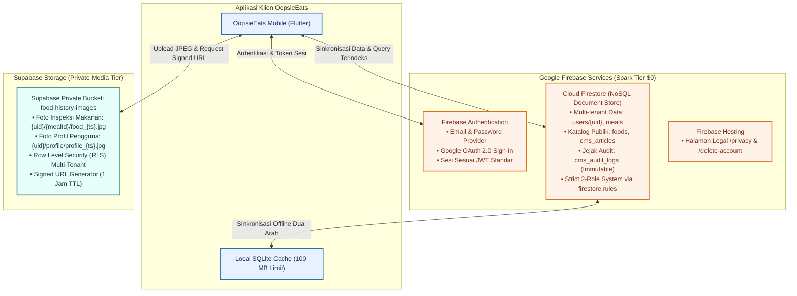

# OopsieEats (NutriView) — Arsitektur Basis Data & Layanan Backend

Dokumen ini mendokumentasikan spesifikasi teknis dan implementasi aktual basis data serta layanan backend pada aplikasi **OopsieEats** (`com.oopsieeats.app`, nama historis: *NutriView*).

---

## 1. Topologi Layanan Cloud Backend

OopsieEats beroperasi menggunakan arsitektur nirserver (*serverless*) hibrida yang menggabungkan platform **Google Firebase (Spark Plan - Bebas Biaya $0)** untuk autentikasi dan basis data dokumen dengan **Supabase Storage** untuk penyimpanan citra biner privat:



### Layanan yang Aktif Digunakan:
1. **Firebase Authentication**: Mengelola identitas pengguna, login via Email/Password, pendaftaran akun baru, pemulihan kata sandi, dan integrasi Google Sign-In (OAuth 2.0).
2. **Cloud Firestore**: Basis data dokumen NoSQL fleksibel dengan dukungan *real-time listener*, indeks komposit, serta *offline caching* otomatis.
3. **Supabase Storage**: Bucket privat `food-history-images` untuk menyimpan foto inspeksi makanan dan foto profil pengguna dengan perlindungan RLS dan *signed URLs* 1 jam.
4. **Firebase Hosting**: Menyediakan endpoint web publik untuk Kebijakan Privasi (`/privacy`) dan Panduan Penghapusan Akun (`/delete-account`).
5. **Firebase Local Emulators**: Emulator pengujian lokal untuk Authentication (port 9099), Firestore (port 8080), dan Emulator Suite UI (port 4000).

### Status Layanan yang TIDAK Digunakan (Klarifikasi Faktual):
- **Firebase Cloud Storage**: **TIDAK DIGUNAKAN** (menghindari kewajiban upgrade ke paket berbayar Blaze). Seluruh kebutuhan penyimpanan citra biner dialihkan ke **Supabase Storage**.
- **Cloud Functions for Firebase**: **TIDAK DIGUNAKAN**. Seluruh logika bisnis dan kalkulasi gizi dieksekusi secara terdistribusi di sisi klien (*edge compute*).
- **Firebase Analytics / Crashlytics**: **TIDAK DIGUNAKAN**. Kebutuhan pemantauan audit sistem ditangani secara internal melalui koleksi `cms_audit_logs`.

---

## 2. Struktur Koleksi & Skema Dokumen Firestore

Cloud Firestore pada OopsieEats menggunakan struktur berorientasi dokumen dengan pemisahan ketat antara data privat pengguna dan data master publik.

### 2.1. Koleksi `users/{userId}` (Profil & Pengaturan Akun)
Menyimpan identitas akun, peran sistem, status aktivasi, status kelengkapan biodata, serta data fisik pengguna. ID Dokumen wajib berupa Firebase Auth UID (`request.auth.uid`).

```json
{
  "id": 182746281,
  "uid": "ABcdEFGhij1234567890",
  "email": "user@example.com",
  "full_name": "Ahmad Badawi",
  "role": "user",
  "is_active": true,
  "is_profile_complete": true,
  "avatar_preset": "chef_pro",
  "photo_url": "https://rnfvudxqcwcwilcyicow.supabase.co/storage/v1/object/sign/food-history-images/...?token=...",
  "photo_path": "ABcdEFGhij1234567890/profile/profile_1731456000000.jpg",
  "created_at": "2026-10-24T10:00:00.000Z",
  "updated_at": "2026-11-13T12:30:00.000Z",
  "profile": {
    "age": 22,
    "birth_date": "2004-05-15",
    "sex": "male",
    "weight_kg": 68.5,
    "height_cm": 175.0,
    "activity_level": "moderate",
    "goal": "maintain_weight",
    "profession": "Software Developer"
  },
  "daily_target": {
    "calories_kcal": 2450,
    "protein_g": 82.2,
    "carbs_g": 345.5,
    "fat_g": 68.1,
    "basis": {
      "bmr_kcal": 1683.8,
      "tdee_kcal": 2610.0,
      "formula": "mifflin_st_jeor"
    }
  }
}
```

### 2.2. Subkoleksi `users/{userId}/meals/{mealId}` (Catatan Asupan Makan)
Menyimpan riwayat konsumsi makanan harian pengguna. Berada di bawah subkoleksi dokumen pengguna untuk isolasi data multi-tenant yang aman. Dokumen memuat metadata citra Supabase Storage opsional (`image`).

```json
{
  "id": 1731456000000,
  "meal_type": "breakfast",
  "consumed_at": "2026-11-13T07:30:00.000Z",
  "consumed_date": "2026-11-13",
  "created_at": "2026-11-13T07:32:15.000Z",
  "image": {
    "provider": "supabase",
    "bucket": "food-history-images",
    "path": "ABcdEFGhij1234567890/1731456000000/food_1731456000123.jpg",
    "mime_type": "image/jpeg",
    "size_bytes": 142580,
    "width": 1024,
    "height": 768
  },
  "items": [
    {
      "id": 1,
      "food_id": 14,
      "food_name": "Nasi Putih",
      "portion_grams": 150.0,
      "calories_kcal": 262.5,
      "protein_g": 4.5,
      "carbs_g": 59.7,
      "fat_g": 0.45,
      "source": "TKPI 2020",
      "detection_confidence": 0.9412
    },
    {
      "id": 2,
      "food_id": 25,
      "food_name": "Telur Goreng",
      "portion_grams": 60.0,
      "calories_kcal": 144.0,
      "protein_g": 8.4,
      "carbs_g": 0.6,
      "fat_g": 11.4,
      "source": "TKPI 2020",
      "detection_confidence": 0.8850
    }
  ],
  "totals": {
    "calories_kcal": 406.5,
    "protein_g": 12.9,
    "carbs_g": 60.3,
    "fat_g": 11.85
  }
}
```

### 2.3. Koleksi `foods/{foodId}` (Katalog Komposisi Pangan Acuan)
Menyimpan referensi komposisi zat gizi per 100 gram bahan makanan acuan (Tabel Komposisi Pangan Indonesia / TKPI Kemenkes). Bersifat *read-only* bagi pengguna umum dan hanya dapat dimodifikasi oleh admin.

```json
{
  "id": 14,
  "name": "Nasi Putih",
  "calories_kcal_per_100g": 175.0,
  "protein_g_per_100g": 3.0,
  "carbs_g_per_100g": 39.8,
  "fat_g_per_100g": 0.3,
  "source": "TKPI 2020",
  "is_active": true
}
```

### 2.4. Koleksi `cms_articles/{articleId}` (Artikel Edukasi Gizi)
Menyimpan artikel edukasi kesehatan yang ditulis oleh tim gizi melalui panel admin CMS.

```json
{
  "title": "Mengenal Peran Makronutrien untuk Energi Tubuh",
  "slug": "mengenal-peran-makronutrien-energi-tubuh",
  "excerpt": "Panduan ringkas tentang proporsi seimbang protein, karbohidrat, dan lemak harian.",
  "content": "## Apa itu Makronutrien?\n\nMakronutrien adalah zat gizi yang dibutuhkan tubuh...",
  "image_url": "https://images.unsplash.com/photo-1490645935967-10de6ba17061",
  "category_id": "nutrisi-dasar",
  "author_name": "Ahmad Badawi",
  "status": "published",
  "created_at": "2026-10-24T08:00:00.000Z",
  "updated_at": "2026-10-24T08:00:00.000Z"
}
```

### 2.5. Koleksi `cms_audit_logs/{logId}` (Jejak Audit Medis & Sistem)
Menyimpan rekaman riwayat aksi administratif secara permanen (*immutable*). Sekali tercatat, dokumen ini tidak dapat diubah maupun dihapus oleh akun mana pun (`update, delete: if false`).

```json
{
  "action": "update",
  "entity": "foods",
  "entity_id": "14",
  "performed_by": "ADMIN_UID_12345",
  "timestamp": "2026-10-25T09:15:00.000Z",
  "payload": {
    "field": "calories_kcal_per_100g",
    "old_value": 175.0,
    "new_value": 180.0,
    "reason": "Penyesuaian hasil uji lab TKPI revisi"
  }
}
```

---

## 3. Aturan Keamanan Database (`firestore.rules`)

Aturan keamanan menerapkan prinsip *Least Privilege* dengan sistem peran biner terverifikasi:

```javascript
rules_version = '2';
service cloud.firestore {
  match /databases/{database}/documents {

    function isSignedIn() {
      return request.auth != null;
    }

    function isOwner(userId) {
      return isSignedIn() && request.auth.uid == userId;
    }

    function getUserData() {
      return get(/databases/$(database)/documents/users/$(request.auth.uid)).data;
    }

    // Strict 2-Role System: hanya 'admin' dan 'user'
    function isAdmin() {
      return isSignedIn() &&
        exists(/databases/$(database)/documents/users/$(request.auth.uid)) &&
        getUserData().role == 'admin' &&
        getUserData().is_active == true;
    }

    // --- Users & Profiles Collection ---
    match /users/{userId} {
      allow read: if isSignedIn() && (request.auth.uid == userId || isAdmin());
      allow create: if isSignedIn() && isValidUserCreate(userId);
      allow update: if isSignedIn() && (
        isValidUserUpdateByOwner(userId) ||
        (isAdmin() && isValidUserUpdateByAdmin())
      );
      allow delete: if isOwner(userId) || isAdmin();

      // User Meals Subcollection (strict multi-tenant isolation)
      match /meals/{mealId} {
        allow read, write: if isOwner(userId);
      }

      match /{allSubcollections=**} {
        allow read, write: if isOwner(userId);
      }
    }

    // Top-level Profiles mapping (legacy backward compatibility)
    match /profiles/{userId} {
      allow read, write: if isOwner(userId) || isAdmin();
    }

    // --- Foods Catalog (Read: User, Write: Admin) ---
    match /foods/{foodId} {
      allow read: if isSignedIn();
      allow create, update, delete: if isAdmin();
    }

    // --- CMS Collections (Read: User, Write: Admin) ---
    match /cms_articles/{articleId} {
      allow read: if isSignedIn();
      allow create, update, delete: if isAdmin();
    }

    match /cms_categories/{categoryId} {
      allow read: if isSignedIn();
      allow create, update, delete: if isAdmin();
    }

    match /cms_announcements/{announcementId} {
      allow read: if isSignedIn();
      allow create, update, delete: if isAdmin();
    }

    // --- CMS Audit Logs (Read: Admin, Create: Admin, Immutable) ---
    match /cms_audit_logs/{logId} {
      allow read: if isAdmin();
      allow create: if isAdmin() && request.resource.data.performed_by == request.auth.uid;
      allow update, delete: if false; // Mutlak permanen
    }

    match /cms_media/{mediaId} {
      allow read: if isSignedIn();
      allow create, update, delete: if isAdmin();
    }

    // Default Deny
    match /{document=**} {
      allow read, write: if false;
    }
  }
}
```

---

## 4. Indeks Komposit Database (`firestore.indexes.json`)

Untuk mendukung kueri pengurutan dan pemfilteran gabungan tanpa menimbulkan galat *missing index*, empat indeks komposit telah dideklarasikan:

| Koleksi | Field 1 | Field 2 | Field 3 | Tujuan Kueri |
|---|---|---|---|---|
| `meals` | `consumed_date` (ASC) | `consumed_at` (DESC) | - | Riwayat makan harian terurut kronologis |
| `cms_articles` | `status` (ASC) | `created_at` (DESC) | - | Daftar artikel terbitan terbaru |
| `cms_articles` | `category_id` (ASC) | `status` (ASC) | `created_at` (DESC) | Filter artikel per kategori terbitan |
| `foods` | `is_active` (ASC) | `name` (ASC) | - | Pencarian katalog pangan aktif terurut nama |

---

## 5. Strategi Persistensi Offline & Cache Budget

1. **Firestore Offline Persistence (100 MB Bound)**:
   Inisialisasi Firestore di `main.dart` mengunci batas cache SQLite lokal agar aplikasi tidak mengalami bloat memori:
   ```dart
   FirebaseFirestore.instance.settings = const Settings(
     persistenceEnabled: true,
     cacheSizeBytes: 104857600, // Tepat 100 MB
   );
   ```
2. **Katalog Pangan Offline Fallback (`seed_foods.json`)**:
   Apabila perangkat berada di luar jangkauan sinyal internet dan cache lokal Firestore belum terisi, `FoodRepository` secara transparan memuat data dari berkas aset terbundel `frontend/assets/data/seed_foods.json`. Fitur pencarian pangan dan kalkulasi gizi porsi tetap berfungsi normal tanpa hambatan.
