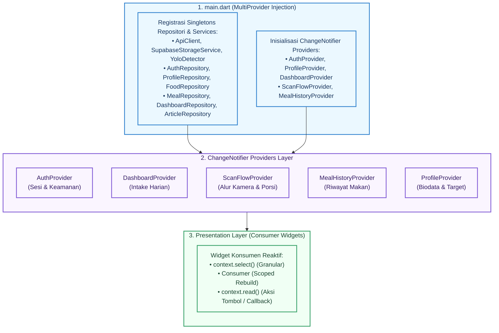

# OopsieEats (NutriView) — Panduan Pengembangan & Standar Rekayasa

Dokumen ini memuat panduan komprehensif bagi developer mengenai konvensi kode, arsitektur perangkat lunak, sistem desain antarmuka, serta penanganan error pada aplikasi **OopsieEats** (`com.oopsieeats.app`, nama historis: *NutriView*).

---

## 1. Konvensi & Standar Kode Dart

OopsieEats mengikuti pedoman resmi [*Effective Dart*](https://dart.dev/effective-dart) yang ditegakkan secara otomatis melalui linter `flutter_lints`:

1. **Penamaan Berkas & Simbol**:
   - Berkas: `snake_case.dart` (contoh: `nutrition_calculator.dart`, `dashboard_screen.dart`).
   - Kelas, Enum, & Typedef: `PascalCase` (contoh: `FoodRepository`, `DailyTarget`, `AppRoutes`).
   - Variabel, Parameter, & Method: `camelCase` (contoh: `calculateDailyTarget`, `portionGrams`).
   - Konstanta Global & Token: `camelCase` atau `SCREAMING_SNAKE_CASE` untuk konfigurasi lingkungan statis.
2. **Immutability & Stateless Preference**:
   - Seluruh model data (DTO) bersifat `immutable` dengan anotasi `@immutable`, menggunakan field `final`, dan menyertakan konstruktor `const` bilamana memungkinkan.
   - Gunakan `StatelessWidget` sebagai pilihan utama. Gunakan `StatefulWidget` hanya jika widget mengelola status transien lokal (misal: pengontrol animasi teks atau tab internal).
3. **Penyusunan Kode Terstruktur**:
   - Urutan komponen dalam berkas kelas:
     1. Deklarasi field statis / konstanta.
     2. Deklarasi field instance `final`.
     3. Konstruktor (`const` diutamakan).
     4. Getters / Setters.
     5. Public methods.
     6. Private helper methods.

---

## 2. Penerapan Prinsip SOLID & OOP

Arsitektur OopsieEats menerapkan kelima prinsip SOLID secara konsisten:

| Prinsip | Implementasi Aktual pada OopsieEats |
|---|---|
| **Single Responsibility Principle (SRP)** | - `NutritionCalculator`: Hanya berisi komputasi matematis BMR, TDEE, makronutrien, dan Atwater.<br>- `AgeCalculator`: Hanya menghitung umur dinamis dari tanggal lahir.<br>- `YoloDetector`: Hanya mengelola siklus hidup model dan inferensi TFLite.<br>- `SupabaseStorageService`: Hanya mengelola kompresi dan transfer citra ke bucket Supabase.<br>- `ApiClient`: Hanya bertanggung jawab atas persistensi token dan preferensi sesi pada secure storage. |
| **Open/Closed Principle (OCP)** | - `AvatarCatalog`: Penambahan karakter avatar baru dilakukan dengan menambahkan entri objek `GameAvatarCharacter` ke dalam daftar tanpa perlu mengubah widget modal seleksi (`AvatarSelectionModal`) atau layar profil. |
| **Liskov Substitution Principle (LSP)** | - Seluruh repositori menerima klien dan database melalui antarmuka atau parameter opsional yang dapat digantikan sepenuhnya oleh objek tiruan (*test doubles/mocks*) tanpa merusak kontrak kode. |
| **Interface Segregation Principle (ISP)** | - `BiometricService` memisahkan fungsi pengecekan perangkat keras (`isAvailable`), query jenis sensor (`getAvailableBiometrics`), dan autentikasi (`authenticate`) secara atomik. |
| **Dependency Inversion Principle (DIP)** | - Kelas lapisan atas (Providers dan Screens) tidak bergantung pada instansiasi konkret SDK cloud secara langsung, melainkan bergantung pada repositori yang disuntikkan via `Provider` di `main.dart`. |

---

## 3. Manajemen Status (State Management via Provider v6.1.2)

Aplikasi menggunakan pola **MultiProvider** resmi Flutter dengan pemisahan peran yang tegas antara lapisan UI dan State:



### Praktik Terbaik Konsumsi State:
1. **Hindari `context.watch()` di Root Widget Build**:
   Gunakan `context.select<T, R>()` atau bungkus widget dengan `Consumer<T>` tepat pada elemen antarmuka yang memerlukan render ulang. Hal ini mencegah *re-render* seluruh halaman saat hanya satu nilai kecil yang berubah.
2. **Gunakan `context.read()` untuk Eksekusi Aksi**:
   Pada fungsi *callback* tombol atau event handler (`onPressed`, `onTap`), gunakan `context.read<AuthProvider>().login(...)`. Jangan menggunakan `watch` di dalam event handler.
3. **Invalidasi Lintas Provider Saat Logout & Update Biodata**:
   - `authProvider.onLogout`: Mengikat aksi invalidasi cache pada `DashboardRepository`, `FoodRepository`, `ArticleRepository`, dan `SupabaseStorageService` untuk mencegah kebocoran data antar-sesi pengguna.
   - `profileProvider.onProfileUpdated`: Menginvalidasi cache dashboard dan memperbarui target gizi di `DashboardProvider` secara instan.

---

## 4. Sistem Desain Antarmuka: Overkill Neo-Brutalism

OopsieEats menggunakan bahasa visual **Overkill Neo-Brutalism** yang khas, energik, dan kontras tinggi:

### 4.1. Token Desain (`neo_tokens.dart`)
- **Warna Aksen**:
  - `NeoTokens.vividYellow` (`0xFFFFDE59`): Kalori harian & aksen utama hero.
  - `NeoTokens.mintGreen` (`0xFF2EE6A8`): Protein & indikator sukses/terpenuhi.
  - `NeoTokens.skyBlue` (`0xFF45B6FE`): Karbohidrat & elemen informatif.
  - `NeoTokens.coralRed` (`0xFFFF5757`): Lemak & peringatan batas/error.
  - `NeoTokens.creamBg` (`0xFFF9F6EE`): Warna kanvas latar belakang aplikasi.
- **Garis Batas (Border)**:
  - Ketebalan tegas: `borderWidth: 2.0` (komponen standar) atau `3.0` (komponen hero/modal).
  - Warna: Wajib hitam pekat `NeoTokens.black` (`0xFF111111`).
- **Bayangan Pejal (Drop Shadow)**:
  - Wajib menggunakan bayangan pejal tanpa blur (*hard solid shadow*):
    ```dart
    boxShadow: [
      BoxShadow(
        color: NeoTokens.black,
        offset: Offset(4, 4),
        blurRadius: 0, // Dilarang menggunakan blur radius!
      ),
    ]
    ```

---

## 5. Hierarki & Penanganan Kesalahan (Error Handling)

Aplikasi menggunakan kelas pengecualian terpusat `ApiException` (`error_handler.dart`):

```dart
class ApiException implements Exception {
  final int statusCode;
  final String code;
  final String message;
  final Map<String, dynamic>? details;

  ApiException({
    required this.statusCode,
    required this.code,
    required this.message,
    this.details,
  });
}
```

### Pencegahan Kebocoran Data Sensitif (*Error Sanitization*)
Metode `AuthRepository.sanitizeErrorMessage(raw)` secara otomatis memindai pesan galat dari backend atau SDK. Apabila pesan mengandung:
- Pola *stack trace* (`#0 `, `package:`, `dart:`, `Exception: `)
- Kueri basis data / kata kunci SQL (`SELECT`, `INSERT`, `FIRESTORE`, dll)
- Kunci API / token (`AIza...`, `sb_...`, `Bearer ...`)
- Alamat URL internal (`http://`, `https://`)
- Kode galat Firebase mentah (`[firebase_auth/...]`)

Sistem akan secara otomatis menyensornya dan menggantinya dengan pesan ramah pengguna:
*"Terjadi kesalahan pada sistem. Silakan coba lagi."*
Hal ini mencegah risiko kebocoran arsitektur internal kepada pihak yang tidak berhak.
