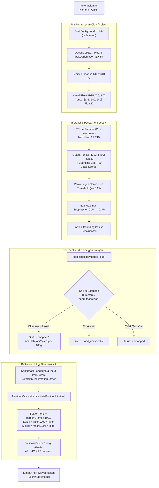

# NutriView — Arsitektur Machine Learning & Formulasi Gizi

Dokumen ini mendokumentasikan spesifikasi teknis model kecerdasan buatan (Computer Vision), alur pra-pemrosesan citra, inferensi *on-device*, serta integrasi formulasi gizi deterministik pada aplikasi **NutriView**.

---

## 1. Filosofi & Batasan Rekayasa AI

1. **AI untuk Identifikasi, Bukan Tebakan Medis**:
   Model computer vision bertugas mengenali **jenis makanan** (klasifikasi dan lokalisasi batas objek/bounding box). Model **tidak pernah** menebak nilai kalori secara magis. Nilai kalori dan makronutrien dihitung secara deterministik berbasis data acuan laboratorium (Tabel Komposisi Pangan Indonesia / TKPI 2020) dan bobot porsi dalam gram yang dikonfirmasi oleh pengguna.
2. **Manusia Tetap dalam Kendali (*Human-in-the-Loop*)**:
   Hasil deteksi YOLO26n disajikan sebagai saran/kandidat. Pengguna memiliki kendali penuh untuk menerima, mengedit porsi gram, mengganti jenis makanan, atau menghapus item sebelum dicatat ke riwayat makan.
3. **Privasi & Kecepatan (*Edge-First*)**:
   Seluruh pemrosesan gambar dan inferensi model berjalan 100% secara offline di perangkat pengguna (*on-device*). Gambar makanan pengguna **tidak pernah diunggah ke server cloud** untuk dianalisis.

---

## 2. Diagram Alur Pipeline Computer Vision & Gizi (Mermaid)



---

## 3. Spesifikasi Model YOLO26n On-Device

| Parameter | Spesifikasi Aktual |
|---|---|
| **Arsitektur Model** | Custom YOLO26n (Nano architecture) |
| **Format Model** | TensorFlow Lite (`.tflite`) |
| **Lokasi Berkas** | `frontend/assets/models/best.tflite` |
| **Ukuran Berkas** | ~9.4 MB (9,856,521 bytes) |
| **Dimensi Input Tensor** | `[1, 3, 640, 640]` tipe data `Float32` (Channels-First: NCHW) |
| **Normalisasi Input** | Rentang $[0.0, 1.0]$ ($R/255.0, G/255.0, B/255.0$) |
| **Dimensi Output Tensor** | `[1, 33, 8400]` tipe data `Float32` |
| **Struktur Kanal Output** | Kanal 0: `cx` (center X ter-normalisasi)<br>Kanal 1: `cy` (center Y ter-normalisasi)<br>Kanal 2: `w` (lebar ter-normalisasi)<br>Kanal 3: `h` (tinggi ter-normalisasi)<br>Kanal 4–32: 29 skor probabilitas kelas makanan |
| **Jumlah Anchor Candidates**| 8,400 grid prediksi |
| **Ambang Batas Keyakinan** | `confidenceThreshold = 0.15` (default), `< 0.30` ditandai `lowConfidence: true` |
| **Ambang Batas NMS** | `iouThreshold = 0.45` |
| **Alokasi Thread** | 4 threads jika inti CPU $\ge 4$, 2 threads jika inti CPU $< 4$ |

---

## 4. Daftar 29 Kelas Pangan yang Dikenali

Model dilatih untuk mengenali 29 jenis makanan populer Indonesia yang terdaftar di `frontend/assets/models/classes.txt`:

| No | Kelas Model | No | Kelas Model | No | Kelas Model |
|---|---|---|---|---|---|
| 1 | `Apple` | 11 | `Kiwi` | 21 | `Spaghetti` |
| 2 | `Ayam Goreng` | 12 | `Mie Goreng` | 22 | `Steak` |
| 3 | `Bakso` | 13 | `Nasi Goreng` | 23 | `Strawberry` |
| 4 | `Banana` | 14 | `Nasi Putih` | 24 | `Tahu Goreng` |
| 5 | `Burger` | 15 | `Nugget` | 25 | `Telur Goreng` |
| 6 | `Capcay` | 16 | `Pempek` | 26 | `Telur Rebus` |
| 7 | `Chocolate Chip Cookie` | 17 | `Pineapples` | 27 | `Tempe Goreng` |
| 8 | `Donat` | 18 | `Pizza` | 28 | `Terong Balado` |
| 9 | `Ikan Goreng` | 19 | `Rendang Sapi` | 29 | `Tumis Kangkung` |
| 10 | `Kentang Goreng` | 20 | `Sate` | | |

---

## 5. Implementasi Teknis Pipeline (`yolo_detector_io.dart`)

### 5.1. Isolasi Pemrosesan Citra (*Background Isolate*)
Untuk mencegah terjadinya penurunan frame rate (*jank*) pada thread UI Flutter saat mendekode gambar kamera beresolusi tinggi, fungsi pra-pemrosesan dijalankan di dalam worker isolate terpisah:

```dart
final preprocessed = await Isolate.run(() => _preprocessImage(imageBytes));
```

Fungsi `_preprocessImage` melakukan:
1. Dekode format biner gambar (JPEG/PNG) menggunakan paket `image`.
2. Koreksi rotasi orientasi kamera berdasarkan tag EXIF (`img.bakeOrientation`).
3. Pengubahan ukuran gambar menjadi $640 \times 640$ piksel (`img.copyResize` dengan interpolasi linier).
4. Penataan matriks piksel channels-first `[1, 3, 640, 640]` float32 dengan normalisasi $1/255$.

### 5.2. Pasca-Pemrosesan Cepat & Non-Maximum Suppression (NMS)
Pada pembacaan output tensor berukuran $[1, 33, 8400]$, kode melakukan optimasi *array hoisting*:
- Menghindari pemanggilan akses array berulang yang memicu lebih dari 730.000 pemeriksaan batas indeks (*bounds checks*) di Dart VM.
- Mengeliminasi duplikasi bounding box menggunakan algoritma NMS berbasis nilai *Intersection-over-Union* (IoU):
  $$\text{IoU} = \frac{\text{Area}(\text{Interseksi})}{\text{Area}(A) + \text{Area}(B) - \text{Area}(\text{Interseksi})}$$
  Jika $\text{IoU} > 0.45$ untuk kelas makanan yang sama, kotak dengan keyakinan lebih rendah otomatis disingkirkan.

---

## 6. Formulasi Gizi Deterministik (`nutrition_calculator.dart`)

Seluruh komputasi gizi dieksekusi menggunakan rumus matematis terstandarisasi secara deterministik (*pure function*):

### 6.1. Basal Metabolic Rate (BMR) — Rumus Mifflin-St Jeor
- **Pria**:
  $$\text{BMR} = 10 \times \text{berat}(\text{kg}) + 6.25 \times \text{tinggi}(\text{cm}) - 5 \times \text{usia}(\text{tahun}) + 5$$
- **Wanita**:
  $$\text{BMR} = 10 \times \text{berat}(\text{kg}) + 6.25 \times \text{tinggi}(\text{cm}) - 5 \times \text{usia}(\text{tahun}) - 161$$

### 6.2. Total Daily Energy Expenditure (TDEE) & Target Kalori
$$\text{TDEE} = \text{BMR} \times \text{Faktor Aktivitas}$$

| Level Aktivitas | Faktor Multiplikasi |
|---|---|
| `sedentary` (Sangat sedikit aktivitas fisik) | 1.200 |
| `light` (Aktivitas ringan 1–3 hari/minggu) | 1.375 |
| `moderate` (Aktivitas sedang 3–5 hari/minggu) | 1.550 |
| `active` (Aktivitas berat 6–7 hari/minggu) | 1.725 |
| `very_active` (Latihan fisik sangat berat / atlet) | 1.900 |

Penyesuaian target berdasarkan sasaran pengguna (*Goal Delta*):
- `lose_weight`: TDEE $- 500\text{ kkal}$
- `maintain_weight`: TDEE $\pm 0\text{ kkal}$
- `gain_weight`: TDEE $+ 300\text{ kkal}$

*Batas Bawah Kalori Aman (Calorie Floor)*:
Target kalori harian tidak boleh jatuh di bawah **1500 kkal untuk pria** dan **1200 kkal untuk wanita** demi mencegah defisiensi gizi ekstrem.

### 6.3. Alokasi Makronutrien Harian
1. **Protein**:
   - `lose_weight` atau `gain_weight`: $1.6\text{ g per kg berat badan}$
   - `maintain_weight`: $1.2\text{ g per kg berat badan}$
2. **Lemak**:
   - Dialokasikan sebesar $25\%$ dari total target kalori harian:
     $$\text{Lemak}(\text{g}) = \frac{0.25 \times \text{Target Kalori}}{9\text{ kkal/g}}$$
3. **Karbohidrat**:
   - Mengisi sisa kebutuhan kalori yang belum terpenuhi dari protein dan lemak:
     $$\text{Karbohidrat}(\text{g}) = \max\left(0, \frac{\text{Target Kalori} - (\text{Protein} \times 4) - (\text{Lemak} \times 9)}{4\text{ kkal/g}}\right)$$

### 6.4. Validasi Integritas Makronutrien Sistem Faktor Atwater
Untuk mencegah inkonsistensi data gizi masukan oleh admin atau kesalahan sistem:
1. Total penjumlahan makronutrien $(\text{Protein} + \text{Karbohidrat} + \text{Lemak})$ tidak boleh melebihi $100\text{ gram}$ per 100 gram bahan pangan.
2. Selisih antara kalori tertera dengan estimasi makronutrien $((4 \times P) + (4 \times C) + (9 \times F))$ tidak boleh melebihi toleransi batas wajar $30\%$:
   $$\frac{|\text{Kalori Input} - (4P + 4C + 9F)|}{\max(1.0, \text{Kalori Input})} \le 0.30$$
