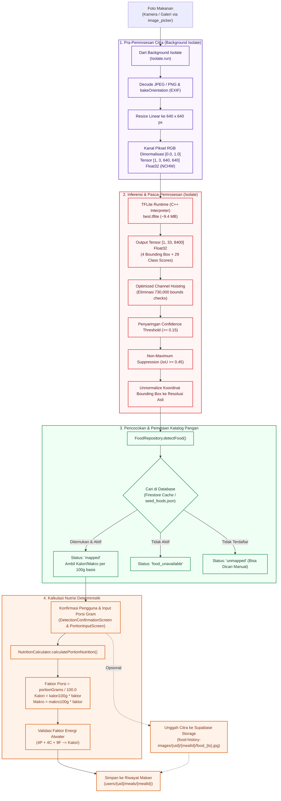

# OopsieEats (NutriView) — Arsitektur Machine Learning & Formulasi Gizi

Dokumen ini mendokumentasikan spesifikasi teknis model kecerdasan buatan (*Computer Vision*), alur pra-pemrosesan citra, inferensi *on-device*, serta integrasi formulasi gizi deterministik pada aplikasi **OopsieEats** (`com.oopsieeats.app`, nama historis: *NutriView*).

---

## 1. Filosofi & Batasan Rekayasa AI

1. **AI untuk Identifikasi, Bukan Tebakan Medis**:
   Model computer vision bertugas mengenali **jenis makanan** (klasifikasi dan lokalisasi batas objek/bounding box). Model **tidak pernah** menebak nilai kalori secara magis. Nilai kalori dan makronutrien dihitung secara deterministik berbasis data acuan laboratorium (Tabel Komposisi Pangan Indonesia / TKPI 2020) dan bobot porsi dalam gram yang dikonfirmasi oleh pengguna.
2. **Manusia Tetap dalam Kendali (*Human-in-the-Loop*)**:
   Hasil deteksi YOLO26n disajikan sebagai saran/kandidat. Pengguna memiliki kendali penuh untuk menerima, mengedit porsi gram, mengganti jenis makanan via pencarian manual, atau menghapus item sebelum dicatat ke riwayat makan.
3. **Privasi & Kecepatan (*Edge-First*)**:
   Seluruh pemrosesan gambar dan inferensi model berjalan 100% secara offline di perangkat pengguna (*on-device*). Gambar makanan pengguna **tidak pernah dikirimkan ke server inferensi cloud eksternal** untuk dianalisis.

---

## 2. Diagram Alur Pipeline Computer Vision & Gizi (Mermaid)



---

## 3. Spesifikasi Model YOLO26n On-Device

| Parameter | Spesifikasi Aktual |
|---|---|
| **Arsitektur Model** | Custom YOLO26n (Nano architecture) |
| **Format Model** | TensorFlow Lite (`.tflite`) terkuantisasi |
| **Lokasi Berkas** | `frontend/assets/models/best.tflite` |
| **Ukuran Berkas** | ~9.4 MB (9,856,521 bytes) |
| **Dimensi Input Tensor** | `[1, 3, 640, 640]` tipe data `Float32` (Channels-First: NCHW) |
| **Normalisasi Input** | Rentang $[0.0, 1.0]$ ($R/255.0, G/255.0, B/255.0$) |
| **Dimensi Output Tensor** | `[1, 33, 8400]` tipe data `Float32` |
| **Struktur Kanal Output** | Kanal 0: `cx` (center X ter-normalisasi)<br>Kanal 1: `cy` (center Y ter-normalisasi)<br>Kanal 2: `w` (lebar ter-normalisasi)<br>Kanal 3: `h` (tinggi ter-normalisasi)<br>Kanal 4–32: 29 skor probabilitas kelas makanan |
| **Jumlah Anchor Candidates**| 8,400 grid prediksi |
| **Ambang Batas Keyakinan** | `confidenceThreshold = 0.15` (default), `< 0.30` ditandai `lowConfidence: true` |
| **Ambang Batas NMS** | `iouThreshold = 0.45` |
| **Alokasi Thread** | 4 threads jika inti CPU $\ge 4$, 2 threads jika inti CPU $< 4$ |

---

## 4. Daftar 29 Kelas Pangan yang Dikenali

Model dilatih untuk mengenali 29 jenis makanan populer Indonesia yang terdaftar di `frontend/assets/models/classes.txt`:

| No | Kelas Model | No | Kelas Model | No | Kelas Model |
|---|---|---|---|---|---|
| 1 | `Apple` | 11 | `Kiwi` | 21 | `Spaghetti` |
| 2 | `Ayam Goreng` | 12 | `Mie Goreng` | 22 | `Steak` |
| 3 | `Bakso` | 13 | `Nasi Goreng` | 23 | `Strawberry` |
| 4 | `Banana` | 14 | `Nasi Putih` | 24 | `Tahu Goreng` |
| 5 | `Burger` | 15 | `Nugget` | 25 | `Telur Goreng` |
| 6 | `Capcay` | 16 | `Pempek` | 26 | `Telur Rebus` |
| 7 | `Chocolate Chip Cookie` | 17 | `Pineapples` | 27 | `Tempe Goreng` |
| 8 | `Donat` | 18 | `Pizza` | 28 | `Terong Balado` |
| 9 | `Ikan Goreng` | 19 | `Rendang Sapi` | 29 | `Tumis Kangkung` |
| 10 | `Kentang Goreng` | 20 | `Sate` | | |

---

## 5. Implementasi Teknis Pipeline (`yolo_detector_io.dart`)

### 5.1. Optimasi Channel Hoisting
Output tensor model berdimensi `[1, 33, 8400]`. Akses multi-dimensi langsung pada loop $8400 \times 29$ akan menghasilkan lebih dari 730,000 operasi *bounds checking* yang membebani CPU. `yolo_detector_io.dart` melakukan pengangkatan (*hoisting*) kanal array ke variabel lokal satu dimensi sebelum iterasi dimulai:

```dart
final List<List<double>> outputChannels = output[0];
final List<double> cxList = outputChannels[0];
final List<double> cyList = outputChannels[1];
final List<double> wList = outputChannels[2];
final List<double> hList = outputChannels[3];

final List<List<double>> classScoreLists = List<List<double>>.generate(
  YoloDetector.numClasses,
  (c) => outputChannels[4 + c],
  growable: false,
);
```

### 5.2. Algoritma Non-Maximum Suppression (NMS)
Untuk setiap anchor candidate yang melebihi batas keyakinan ($score \ge 0.15$), kandidat diurutkan secara *descending*. Kandidat dengan *Intersection over Union* (IoU) $\ge 0.45$ terhadap kotak deteksi yang memiliki skor lebih tinggi pada kelas yang sama akan disupresi secara otomatis.

---

## 6. Formulasi Gizi Deterministik (`NutritionCalculator`)

### 6.1. Rumus Basal Metabolic Rate (BMR) Mifflin-St Jeor
BMR dihitung berdasarkan data fisik pengguna:
- **Laki-laki**:
  $$\text{BMR} = (10 \times \text{berat\_kg}) + (6.25 \times \text{tinggi\_cm}) - (5 \times \text{usia}) + 5$$
- **Perempuan**:
  $$\text{BMR} = (10 \times \text{berat\_kg}) + (6.25 \times \text{tinggi\_cm}) - (5 \times \text{usia}) - 161$$

### 6.2. Total Daily Energy Expenditure (TDEE)
$$\text{TDEE} = \text{BMR} \times \text{Koefisien Aktivitas}$$

| Level Aktivitas | Nilai Koefisien |
|---|---|
| `sedentary` (Jarang olahraga) | $1.2$ |
| `light` (Olahraga 1–3 hari/minggu) | $1.375$ |
| `moderate` (Olahraga 3–5 hari/minggu) | $1.55$ |
| `active` (Olahraga 6–7 hari/minggu) | $1.725$ |
| `very_active` (Latihan fisik berat harian) | $1.9$ |

### 6.3. Penyesuaian Berdasarkan Target (*Goal Adjustment*)
- `lose_weight`: $\text{Target Kalori} = \text{TDEE} - 500\text{ kcal}$
- `maintain_weight`: $\text{Target Kalori} = \text{TDEE}$
- `gain_weight`: $\text{Target Kalori} = \text{TDEE} + 500\text{ kcal}$

**Calorie Floor**: Target kalori harian tidak boleh berada di bawah batas aman kesehatan: minimal $1200\text{ kcal}$ untuk perempuan dan $1500\text{ kcal}$ untuk laki-laki.

### 6.4. Distribusi Makronutrien Seimbang
- **Protein**: $20\%$ dari target kalori ($\div 4\text{ kcal/g}$)
- **Karbohidrat**: $55\%$ dari target kalori ($\div 4\text{ kcal/g}$)
- **Lemak**: $25\%$ dari target kalori ($\div 9\text{ kcal/g}$)

### 6.5. Validasi Konsistensi Faktor Energi Atwater
Untuk mendeteksi anomali pada data katalog makanan, sistem menerapkan verifikasi faktor energi Atwater:
$$\text{Kalori Terhitung} = (4 \times \text{protein\_g}) + (4 \times \text{carbs\_g}) + (9 \times \text{fat\_g})$$
Perbedaan antara kalori acuan dan kalori hasil rumus Atwater diperbolehkan maksimal $\pm 15\%$ untuk mengakomodasi variasi kadar serat dan abu pada bahan pangan alami.
