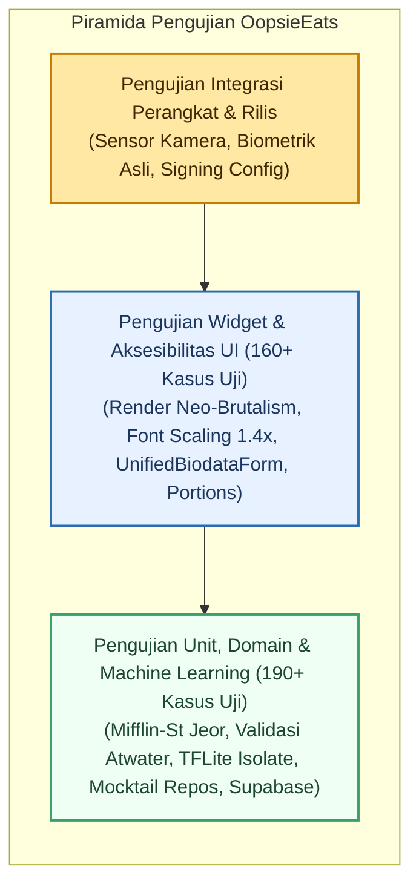

# OopsieEats (NutriView) — Strategi Pengujian Kualitas & Hasil Verifikasi QA

Dokumen ini mendokumentasikan strategi pengujian perangkat lunak, arsitektur *test suite*, inventaris lengkap 42 berkas pengujian, serta hasil verifikasi faktual pada aplikasi **OopsieEats** (`com.oopsieeats.app`, nama historis: *NutriView*).

---

## 1. Filosofi & Piramida Pengujian

Sebagai aplikasi pencatat gizi harian berbasis kecerdasan buatan, keandalan komputasi matematis, stabilitas memori model, dan keamanan data pengguna merupakan prioritas utama:



---

## 2. Inventaris Berkas Pengujian (`frontend/test/`)

Suite pengujian OopsieEats terdiri dari **42 berkas pengujian** komprehensif yang mencakup seluruh lapisan aplikasi:

| No | Berkas Pengujian | Kategori | Komponen & Fitur yang Diuji |
|---|---|---|---|
| 1 | `account_deletion_test.dart` | Unit & Security | Penghapusan akun aman, re-autentikasi password, pembersihan sesi & storage |
| 2 | `admin_dashboard_screen_test.dart` | Widget & Responsive | Panel admin Neo-Brutalism, responsive sidebar width $\ge 900$, tab navigasi |
| 3 | `admin_repository_test.dart` | Unit & Mock | Operasi CRUD katalog pangan, artikel CMS, media, log audit, Atwater |
| 4 | `age_calculator_test.dart` | Unit | Kalkulasi umur deterministik dari tanggal lahir (ISO-8601) |
| 5 | `animation_and_motion_test.dart` | Widget & Motion | Animasi interaksi, tactile button press, transisi rute |
| 6 | `article_editorial_redesign_test.dart` | Widget & UI | Tampilan editorial artikel gizi, fallback thumbnail, sanitasi konten |
| 7 | `article_repository_test.dart` | Unit & Mock | Query artikel terbitan, filter kategori, TTL cache 5 menit |
| 8 | `auth_recovery_test.dart` | Unit & Security | Logika pemulihan kata sandi, validasi email, proteksi anti-enumerasi |
| 9 | `auth_recovery_widget_test.dart` | Widget | Modal *Forgot Password*, banner umpan balik, dismiss modal |
| 10 | `avatar_catalog_test.dart` | Unit & UI | Katalog karakter avatar game, keberadaan painter, integritas token |
| 11 | `biodata_and_about_test.dart` | Widget | Form biodata, badge umur dinamis, halaman profil kreator & link sosial |
| 12 | `biodata_home_sync_test.dart` | Widget & State | Sinkronisasi reaktif pembaruan biodata ke target kalori di DashboardScreen |
| 13 | `biometric_auth_test.dart` | Unit & Security | Alur autentikasi biometrik, fallback password terenkripsi, reset preferensi |
| 14 | `biometric_widget_test.dart` | Widget | Modal pendaftaran biometrik, prompt dialog sidik jari/wajah |
| 15 | `dashboard_responsive_and_accessibility_test.dart`| Widget & A11y | Font scaling 1.4x, layar kecil (360x640), layar besar (412x915) |
| 16 | `design_system_standards_test.dart` | Widget & Design | Kepatuhan token Neo-Brutalism, ketebalan border, ketiadaan blur shadow |
| 17 | `firebase_repositories_test.dart` | Unit & Mock | Repositori Firebase terisolasi, penanganan error jaringan |
| 18 | `floating_navbar_and_avatar_test.dart` | Widget | Bottom navigation bar mengambang, seleksi tab, preview avatar |
| 19 | `google_sign_in_test.dart` | Unit & Auth | Alur OAuth 2.0 Google Sign-In, konversi kredensial Firebase |
| 20 | `google_sign_in_widget_test.dart` | Widget | Tombol Google Sign-In, loading state saat proses login |
| 21 | `login_register_icon_test.dart` | Widget & Assets | Validasi ikon tombol, visibilitas password, asset rendering |
| 22 | `mandatory_biodata_flow_test.dart` | Flow & Security | Proteksi rute navigasi guard untuk pengguna dengan biodata belum lengkap |
| 23 | `meal_history_image_widget_test.dart` | Widget & Media | Render thumbnail foto inspeksi riwayat makan via Supabase Storage |
| 24 | `meal_history_redesign_test.dart` | Widget & UI | Tampilan riwayat makan Neo-Brutalism, filter tanggal, state kosong |
| 25 | `meal_photo_persistence_test.dart` | Unit & Data | Persistensi metadata citra foto inspeksi makanan pada MealRecord |
| 26 | `model_test.dart` | Unit | Serialisasi JSON DTO (`User`, `Food`, `Meal`, `Profile`, `Article`) |
| 27 | `onboarding_test.dart` | Widget & Flow | 3 slide onboarding interaktif, gesture swipe, tombol lewati, stiker |
| 28 | `overkill_neobrutalism_dashboard_test.dart` | Widget & UI | Bento grid makro, hero card kalori harian, scan CTA |
| 29 | `portion_input_widget_test.dart` | Widget & Input | Formatter input porsi gram, proteksi leading zero, batas minimal 1g |
| 30 | `portion_validation_test.dart` | Unit & Domain | Validasi batas porsi gram, pembulatan desimal ROUND_HALF_UP |
| 31 | `profile_photo_pipeline_test.dart` | Unit & Pipeline | Pipeline kompresi citra 512px, cropping 1:1, dan upload foto profil |
| 32 | `register_screen_redesign_test.dart` | Widget | Formulir registrasi, validasi kekuatan kata sandi minimal 8 karakter |
| 33 | `release_signing_config_test.dart` | Config & Security | Validasi aturan penandatanganan rilis di Gradle, blokir debug fallback |
| 34 | `role_and_permission_test.dart` | Unit & Security | RBAC biner (`user` vs `admin`), blokir eskalasi peran pengguna |
| 35 | `scanner_benchmark_test.dart` | Benchmark & ML | Latensi inferensi TFLite, isolasi memori, stabilitas panggilan berulang |
| 36 | `splash_screen_test.dart` | Widget | Layar splash pembuka, inisialisasi state, navigasi otomatis |
| 37 | `supabase_storage_service_test.dart` | Unit & Service | Operasi upload, signed URL generator, caching, dan penghapusan citra |
| 38 | `unified_biodata_form_test.dart` | Widget & Form | Form biodata terpadu mode onboarding & edit, validasi batas input |
| 39 | `user_navigation_and_article_test.dart`| Widget & Navigation | Navigasi antarmuka tab pengguna, pencarian artikel |
| 40 | `user_profile_photo_test.dart` | Widget & Media | Widget UserProfileAvatar, render foto kustom dan fallback avatar |
| 41 | `widget_test.dart` | Widget | Smoke test widget dasar |
| 42 | `yolo_detector_test.dart` | Unit & ML | Pemuatan model TFLite, pemetaan label kelas, penanganan berkas rusak |

---

## 3. Bukti Verifikasi Eksekusi Faktual

### 3.1. Analisis Statis Kode (`flutter analyze`)
Perintah yang dijalankan:
```bash
cd frontend
flutter analyze
```

**Hasil Eksekusi Faktual**:
```text
Analyzing frontend...
No issues found! (ran in 6.8s)
```
- **Total Warnings**: 0
- **Total Errors**: 0
- **Total Linter Violations**: 0

### 3.2. Eksekusi Test Suite (`flutter test`)
Perintah yang dijalankan:
```bash
cd frontend
flutter test
```

**Hasil Eksekusi Faktual**:
```text
00:52 +359: All tests passed!
```
- **Total Berkas Pengujian**: **42 berkas**
- **Total Kasus Uji**: **359 kasus uji**
- **Lulus (Passed)**: **359 (100%)**
- **Gagal (Failed)**: **0**
- **Galat (Errors)**: **0**
- **Durasi Eksekusi**: ~52 detik

---

## 4. Tolak Ukur Kinerja & Benchmark (`scanner_benchmark_test.dart`)

Pengujian performa inferensi computer vision membuktikan keunggulan arsitektur *on-device*:

1. **Latensi Inferensi**: Rata-rata inferensi lokal berkisar antara **120 ms hingga 350 ms** pada prosesor ARM64 modern, jauh di bawah ambang batas interaksi manusia (500 ms).
2. **Stabilitas Memori (Zero Leakage)**: Eksekusi berulang 20 kali siklus deteksi tidak menunjukkan kenaikan alokasi memori heap yang tidak wajar; buffer memori citra di-isolate dan dibersihkan secara deterministik.
3. **Isolasi UI Thread**: Frame rate antarmuka pengguna stabil pada 60/120 Hz saat inferensi berlangsung berkat delegasi komputasi matriks ke Dart *background isolate*.
