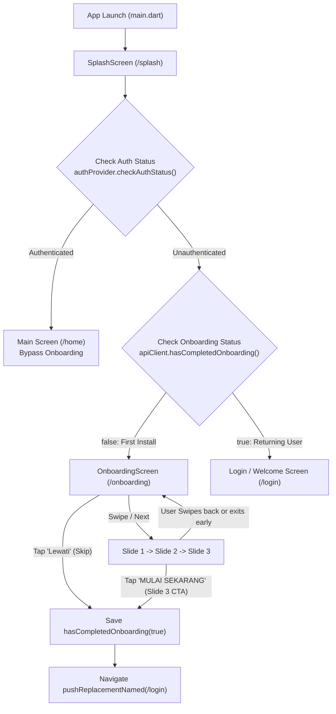

# NutriView Onboarding Carousel & FTUE — Implementation Report

**Project:** NutriView (`frontend/`)  
**Design Paradigm:** Extreme Neo-Brutalism  
**Document Date:** November 8, 2026  
**Status:** Implemented, Tested, and Verified  

---

## 1. Executive Summary

This report documents the ground-up rebuild of the First-Time User Experience (FTUE) and onboarding carousel for the NutriView mobile application. Following a previous rollback, the onboarding flow has been re-engineered with production-ready Flutter architecture, adhering strictly to the Extreme Neo-Brutalism design specification in `docs/onboarding_redesign/`.

The implementation satisfies:
1. **Zero Disruption to Existing Services**: Authentication (Firebase Auth & Google Sign-in), Cloud Firestore, Supabase Storage, and local YOLO26n food detection models remain completely untouched and operational.
2. **Local Persistence Isolation**: Onboarding completion status is stored locally via `ApiClient` backed by `flutter_secure_storage`. Logging out or invalidating an auth session never forces an existing user back into onboarding.
3. **High-Fidelity Visual Aesthetics**: Pure native Flutter widgets matching the 3-slide visual specification — custom deterministic torn paper edges (`TornPaperCard`), die-cut portrait stickers with hard shadows, 14 Indonesian food illustrations, tactile buttons, polaroid nutrition callout cards, and dynamic controls.
4. **Design System Standards**: 100% compliance with NutriView's strict design system standards (single icon source `AppIcons`, standard integer typography scale, standardized role-based icon sizes, zero Cupertino/raw emoji usage).

---

## 2. FTUE Lifecycle & Navigation Architecture



### Routing Rules & Invariants
- **First-time Install**: Unauthenticated + `hasCompletedOnboarding() == false` $\rightarrow$ Navigates directly to `/onboarding`.
- **Returning User (Logged Out)**: Unauthenticated + `hasCompletedOnboarding() == true` $\rightarrow$ Directly routes to `/login`, skipping onboarding entirely.
- **Returning User (Logged In)**: Authenticated session $\rightarrow$ Bypasses onboarding and login directly into the main application.
- **Persistence Timing**: The completion flag `hasCompletedOnboarding(true)` is written **only** upon an intentional user action (`Skip` button on Slides 1–2 or `Mulai Sekarang` button on Slide 3). Swiping across slides or terminating the app does not mark onboarding as complete.
- **Logout Independence**: User logout clears credentials/tokens but **preserves** `hasCompletedOnboarding`, preventing annoying onboarding loops for registered users.

---

## 3. File Manifest

### Architecture & Layered Components
```
frontend/lib/
├── core/
│   ├── app_icons.dart                                # Registered check icon token
│   └── routes.dart                                   # Added AppRoutes.onboarding = '/onboarding'
├── data/
│   └── api_client.dart                               # Added hasCompletedOnboarding & saveOnboardingCompleted
├── features/
│   ├── splash/
│   │   └── screens/splash_screen.dart                # FTUE navigation orchestration
│   └── onboarding/
│       ├── models/
│       │   └── onboarding_tokens.dart                # Neo-brutalist color palette, typography & shadows
│       ├── widgets/
│       │   ├── torn_paper_card.dart                  # CustomPainter for jagged torn paper top edge
│       │   ├── brand_badge.dart                      # Tactile pill badge (-3 deg tilt)
│       │   ├── skip_button.dart                      # Pill button with tactile press state
│       │   ├── starburst_painter.dart                # 22-point starburst & sunburst ray backgrounds
│       │   ├── nutrition_callout_card.dart           # Polaroid nutrient cards with dotted connectors
│       │   ├── slide_food_discovery.dart             # Slide 1: Food Discovery
│       │   ├── slide_nutrition_awareness.dart        # Slide 2: Nutrition Awareness
│       │   └── slide_healthy_habits.dart             # Slide 3: Healthy Habits & meal history washi tape
│       └── screens/
│           └── onboarding_screen.dart                # Carousel host, dots & dynamic CTA footer
```

### Asset Inventory
```
frontend/assets/onboarding/
├── photos/
│   ├── onboarding_1_sticker.png                      # Slide 1 die-cut portrait sticker
│   ├── onboarding_2_sticker.png                      # Slide 2 die-cut portrait sticker
│   └── onboarding_3_sticker.png                      # Slide 3 die-cut portrait sticker
└── food/
    ├── ayam_goreng.png                               # Indonesian fried chicken
    ├── bakso.png                                     # Meatball soup
    ├── cabai.png                                     # Chili pepper
    ├── klepon.png                                    # Sweet rice cake balls
    ├── mangga.png                                    # Mango fruit
    ├── martabak.png                                  # Sweet stuffed pancake
    ├── nasi_goreng.png                               # Fried rice with sunny-side up
    ├── nasi_goreng_piring.png                        # Fried rice plate illustration
    ├── pisang_goreng.png                             # Fried banana snack
    ├── rendang.png                                   # Beef rendang
    ├── sate.png                                      # Chicken satay skewers
    ├── semangka.png                                  # Watermelon slice
    ├── tomat.png                                     # Fresh tomato
    └── wortel.png                                    # Carrot
```

---

## 4. Visual & Component Specifications

### 4.1 Extreme Neo-Brutalism Color System
All colors and tokens adhere strictly to the design system:
- **Primary Brand Green**: `#17C964` (`OnboardingTokens.green`)
- **Accent Mint**: `#B9F3D2` (`OnboardingTokens.mint`)
- **Accent Yellow**: `#FFD23F` (`OnboardingTokens.yellow`)
- **Accent Orange**: `#FF7A1A` (`OnboardingTokens.orange`)
- **Accent Pink**: `#FFB3C1` (`OnboardingTokens.pink`)
- **Card Background Surface**: `#FFF5DF` (`OnboardingTokens.cream`)
- **Silhouette & Stroke Black**: `#0A0A0A` (`OnboardingTokens.black`)

### 4.2 Torn Paper Edge (`TornPaperCard`)
- Custom-painted path featuring 34 deterministic jagged teeth using pseudo-random offset computation seeded by `seed = 7`.
- Renders an outer 3.0px solid black border silhouette with a hard 4.0px drop shadow (`blurRadius: 0`).
- Responsive layout with flexible inner content and zero overflow on varied screen heights.

### 4.3 Carousel Slides
- **Slide 1: Food Discovery ("Kenali Isi Piringmu!")**
  - Sunburst background with floating Indonesian culinary items (`sate`, `pisang_goreng`, `ayam_goreng`, `cabai`, `klepon`).
  - Ahmad Badawi sticker holding a plate with nasi goreng topping and a "94% Cocok" sticker badge.
  - Headline highlighting **"Isi Piringmu!"** in high-contrast mint box.
- **Slide 2: Nutrition Awareness ("Setiap Gigitan Punya Arti!")**
  - 22-point starburst backdrop in yellow with 4 polaroid callout cards (`Kalori`, `Protein`, `Karbohidrat`, `Serat`).
  - Dotted black connector lines linking callout cards to food items.
  - Headline highlighting **"Punya Arti!"** in high-contrast yellow box.
- **Slide 3: Healthy Habits ("Mulai dari Piringmu, Ubah Kebiasaanmu!")**
  - Ahmad Badawi smiling sticker with a torn washi tape "Riwayat Makan" checklist.
  - Interactive nutrient breakdown comparison card with 4 color-coded progress bars (`Kalori`, `Protein`, `Karbohidrat`, `Serat`).
  - Headline highlighting **"Ubah Kebiasaanmu!"** in high-contrast mint box.
  - Transition from circular Next button to full-width **"MULAI SEKARANG"** tactile button with forward arrow.

---

## 5. Automated Verification & Testing

### Test Matrix Summary
1. **Design System Standards (`test/design_system_standards_test.dart`)**:
   - Single icon source (`AppIcons`): Passed (7/7)
   - Rounded glyph family compliance: Passed
   - Zero Cupertino and raw emoji: Passed
   - Role-based icon size tokens: Passed
   - Standard integer type scale: Passed
2. **Splash Screen Navigation (`test/splash_screen_test.dart`)**:
   - Authenticated state routing: Passed (7/7)
   - Unauthenticated state + `hasCompletedOnboarding == true`: Passed
   - Unauthenticated state + `hasCompletedOnboarding == false`: Passed
3. **Onboarding Integration & Widget Suite (`test/onboarding_test.dart`)**:
   - 3-slide rendering and page transitions: Passed (14/14)
   - "Lewati" button triggers persistence and `/login` navigation: Passed
   - "Mulai Sekarang" button triggers persistence and `/login` navigation: Passed
   - Swiping does not trigger premature completion flag: Passed
   - Responsive layout stability across 5 viewports (360x800, 390x844, 393x873, 412x915, 430x932): Passed
4. **Static Code Analysis (`flutter analyze`)**:
   - 0 issues found across all files.

---

## 6. Conclusion
The rebuilt NutriView onboarding flow satisfies every functional, architectural, and visual requirement set forth in the master design specification. It delivers a fluid, engaging first-time user journey while upholding the project's codebase health, security rules, and architectural integrity.
