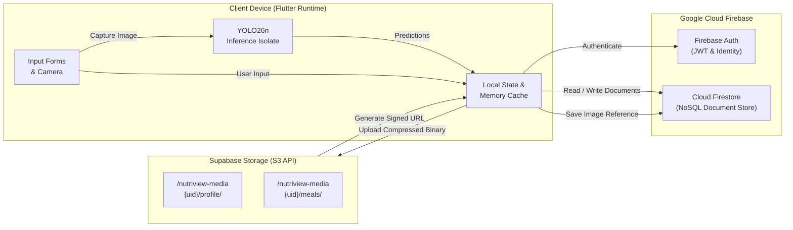
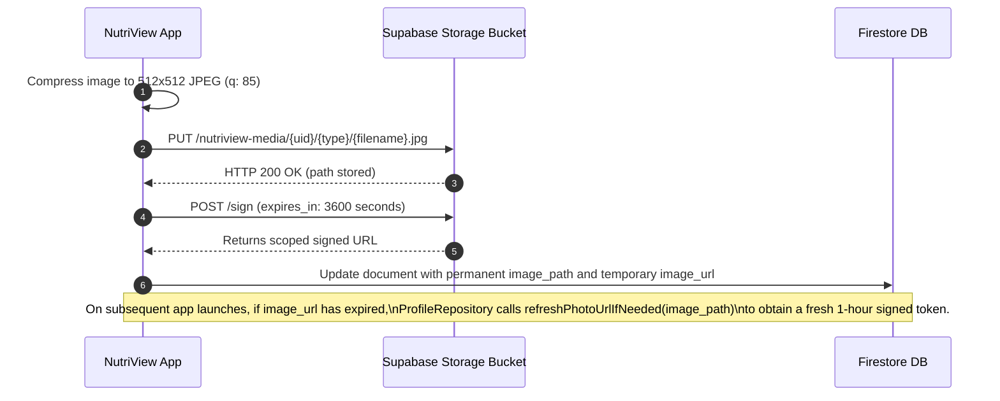

# Application Data Flow

## 1. End-to-End Data Pipeline Architecture

NutriView utilizes a dual-cloud data persistence model combining Cloud Firestore for relational document storage with Supabase Storage for media binary assets.



---

## 2. Firestore Document Entity Schemas

### 2.1 User Document (`users/{uid}`)
```json
{
  "id": 1042,
  "email": "ahmad@nutriview.id",
  "full_name": "Ahmad Badawi",
  "role": "user",
  "is_active": true,
  "is_profile_complete": true,
  "photo_path": "uid_1042/profile/profile_1730971200000.jpg",
  "photo_url": "https://<supabase-id>.supabase.co/storage/v1/object/sign/nutriview-media/...?token=...",
  "avatar_preset": "chef_pro",
  "created_at": "2026-10-24T12:00:00Z",
  "updated_at": "2026-11-07T14:30:00Z"
}
```

### 2.2 Profile Sub-Collection (`users/{uid}/profile/current`)
```json
{
  "age": 26,
  "birth_date": "2000-05-15T00:00:00.000Z",
  "sex": "male",
  "height_cm": 172.0,
  "weight_kg": 65.0,
  "activity_level": "moderate",
  "goal": "maintain_weight",
  "profession": "Programmer",
  "updated_at": "2026-11-07T14:30:00Z"
}
```

### 2.3 Meal Sub-Collection (`users/{uid}/meals/{mealId}`)
```json
{
  "id": "meal_20261107_123045",
  "meal_type": "lunch",
  "image_path": "uid_1042/meals/meal_1730971845.jpg",
  "image_url": "https://<supabase-id>.supabase.co/storage/v1/object/sign/nutriview-media/uid_1042/meals/meal_1730971845.jpg?token=...",
  "logged_at": "2026-11-07T12:30:45Z",
  "foods": [
    {
      "food_name": "Nasi Putih",
      "portion_grams": 200.0,
      "calories": 260.0,
      "protein_g": 5.4,
      "carbs_g": 57.2,
      "fat_g": 0.6
    },
    {
      "food_name": "Ayam Goreng Dada",
      "portion_grams": 100.0,
      "calories": 246.0,
      "protein_g": 30.2,
      "carbs_g": 0.0,
      "fat_g": 12.8
    }
  ],
  "totals": {
    "calories": 506.0,
    "protein_g": 35.6,
    "carbs_g": 57.2,
    "fat_g": 13.4
  }
}
```

---

## 3. Image Storage Protocol & Signed URL Flow


