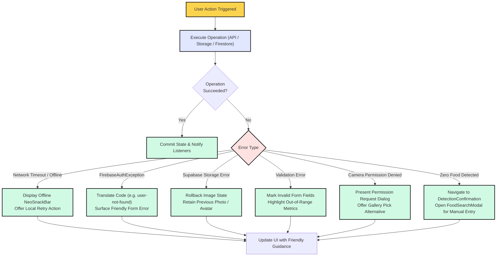
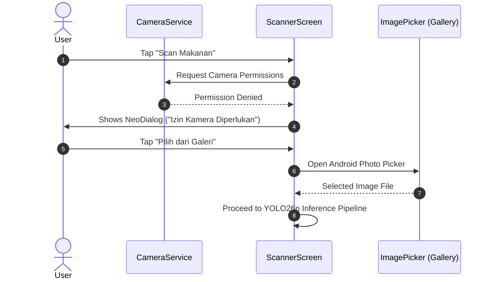

# Application Error Recovery Flow

## 1. System Resilience & Error Handling Architecture

NutriView enforces structured error handling through `ErrorHandler`, `ApiException`, and transactional state rollbacks across all user interaction paths.

---

## 2. Granular Recovery Scenarios

### 2.1 Profile Photo Upload Error & State Rollback
When uploading a new photo to Supabase fails due to network outage or timeout:
1. `ProfileProvider.updateProfilePhoto()` intercepts the exception.
2. The transient photo preview is rolled back.
3. The previous `_user.photoUrl` and `_user.photoPath` remain completely untouched.
4. An error message (`Gagal memperbarui foto profil.`) is dispatched via `NeoSnackBars.error(context, ...)` without crash or state corruption.

### 2.2 Camera Permission Rejection Recovery
If the user denies camera access during food scanning:

### 2.3 Zero-Detection Fallback
If YOLO26n detects no recognized food classes in the image (e.g. poor lighting, non-food item):
1. The scanner pipeline navigates to `DetectionConfirmationScreen` with an empty detection array.
2. A prominent banner displays: `Tidak ada makanan yang terdeteksi otomatis`.
3. An action button triggers `FoodSearchModal`, allowing the user to search the 100+ item local nutrition database and manually add food items with custom portion sizes.
