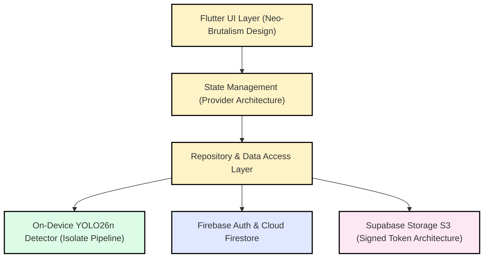
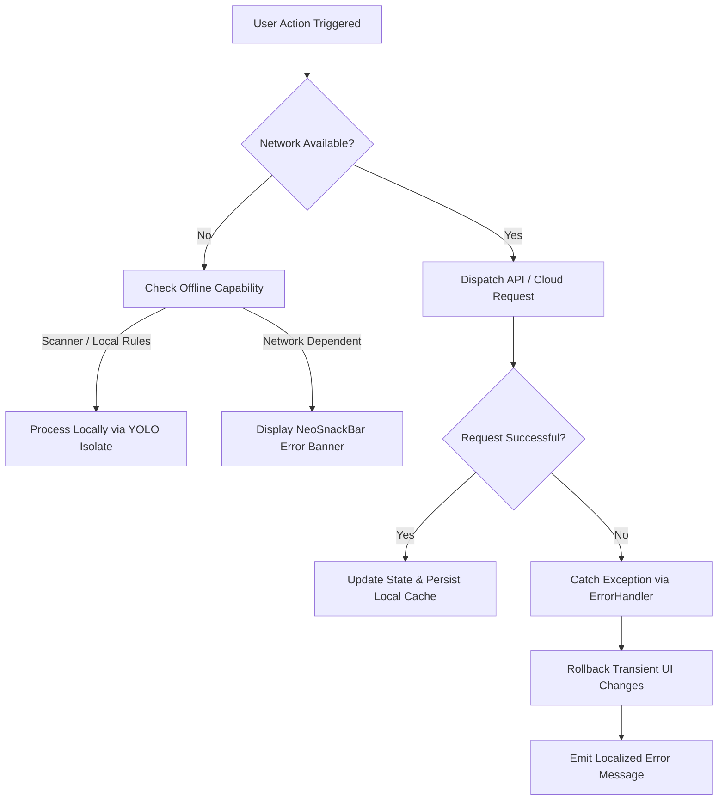

# NutriView Application Flow Architecture

## 1. Architectural Overview

NutriView is an offline-first, client-driven nutritional intelligence mobile application developed in Flutter. The architecture orchestrates deterministic local machine learning inference (YOLO26n via ONNX/TFLite), high-fidelity cloud state synchronization (Google Cloud Firestore), secure binary asset persistence (Supabase Storage with scoped signed URLs), and role-based access control (Firebase Authentication & Custom Claims).

---

## 2. Layered Architecture Principles

### 2.1 Presentation Layer (UI & Widgets)
- **Controlled Neo-Brutalism:** Strict design tokens (`NeoTokens`), 2.0–2.5px solid black borders (`#000000`), zero-blur hard drop shadows, warm tinted canvas (`#FBF9F4`), monospace metrics (`Space Mono`), and standard font families (`Plus Jakarta Sans`).
- **Iconography Standardization:** Single icon source of truth via `AppIcons` exclusively using Material Icons Rounded (`Icons.*_rounded`). Cupertino glyphs and loose emojis are strictly prohibited and machine-checked in CI (`test/design_system_standards_test.dart`).
- **Unified Forms:** Reusable input architectures (such as `UnifiedBiodataForm`) ensuring zero UI drift between first-time onboarding and profile management.

### 2.2 Domain & State Management Layer (Providers)
- **Separation of Concerns:** Distinct business controllers (`AuthProvider`, `ProfileProvider`, `ScanFlowProvider`, `MealHistoryProvider`, `DashboardProvider`, `ArticleProvider`, `AdminProvider`).
- **Synchronization Guarantees:** Route guarding driven by atomic provider state inspection. `main.dart` evaluates composite boolean completeness:
  $$\text{isProfileCompleted} = \text{auth.isProfileComplete} \lor \text{profileProvider.isProfileComplete}$$
  preventing route desynchronization and infinite onboarding redirect loops.
- **Fail-Safe Rollbacks:** Transient upload errors or network faults restore previously cached state and expose localized user-friendly error banners (`NeoSnackBars`).

### 2.3 Data & Remote Services Layer (Repositories & APIs)
- **Multi-Cloud Partitioning:**
  - **Firebase Auth:** Handles credential validation, biometric re-authentication tokens, and session renewal.
  - **Cloud Firestore:** Document datastore for user accounts, meal logs, daily summaries, food database, articles, and audit logs.
  - **Supabase Storage:** Dedicated image bucket (`nutriview-media`) housing user profile avatars and food inspection photos with scoped signed URLs (60-minute expiration for privacy).
- **On-Device Machine Learning:** Low-latency food object detection and classification executed in a detached background `Isolate`, keeping the Flutter UI thread at a sustained 60 FPS.

---

## 3. Core Subsystems

| Subsystem | Primary Tech Stack | Security & Performance Guarantees |
| :--- | :--- | :--- |
| **Authentication** | Firebase Auth + Local Biometrics | PBKDF2/Argon2 password hashing, biometric fallback to email password, zero password caching in memory. |
| **User Profile & Biodata** | Cloud Firestore + UnifiedBiodataForm | Harris-Benedict & Mifflin-St Jeor deterministic BMR/TDEE calculation; zero dummy default values. |
| **Profile Photo Management** | Supabase Storage + Image Caching | Client-side 512x512 square crop, JPEG compression, signed URL generation, fallback to colored initials. |
| **Food Scanner** | On-device YOLO26n + Isolate Worker | Camera stream capture, normalized bounding box interpolation, Atwater macro validation. |
| **Meal Tracking & History** | Cloud Firestore + Paginated Queries | Sub-collection query partitioning, macro summary aggregation, thumbnail cache. |
| **Role-Based Administration** | Cloud Firestore Security Rules | Admin custom claims verification, audit trail logging, schema validation on CRUD. |

---

## 4. Error Handling and Resilience Matrix

---

## 5. Security & Privacy Boundary

1. **Firestore Security Rules:** Hardened schema validation enforcing `hasOnlyAllowedUserFields` (including `photo_path`), preventing unauthorized privilege escalation.
2. **Android Photo Picker:** Built-in Android Photo Picker contract (`pickImage(source: ImageSource.gallery)`) eliminating invasive storage permission requirements (`READ_EXTERNAL_STORAGE`) on modern Android 13+ devices.
3. **Signed Storage URLs:** Meal and profile images stored in private buckets; public access is forbidden. Signed URLs with short lifespans prevent URL scraping and unauthorized asset dissemination.
