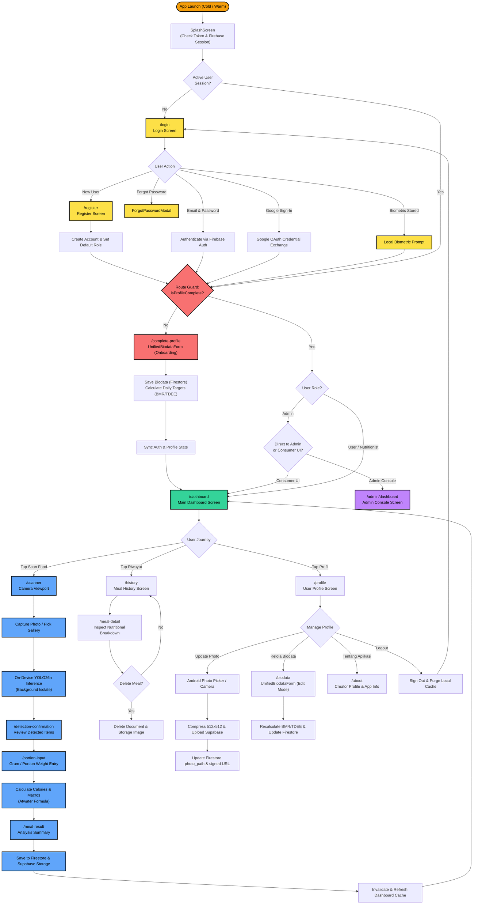

# Application Master Flow

## 1. Executive Master Flow

The Master Flow maps the complete lifecycle of a NutriView session from cold launch, authentication check, mandatory onboarding guard, primary dashboard interactions, food scanning inference, meal persistence, and administrative delegation.

---

## 2. Key Transitions & Milestones

1. **Deterministic App Initialization:** `SplashScreen` verifies Firebase Auth persistent token, loads user profile from Firestore, checks biometric availability, and resolves profile image signed URLs.
2. **Onboarding Gatekeeper:** If `is_profile_complete == false`, the route guard halts navigation to `/dashboard` and forces entry into `/complete-profile`. Only completing the `UnifiedBiodataForm` unlocks the main dashboard.
3. **Seamless Food Analysis:** The food scanning journey isolates ML inference to keep UI rendering smooth, validates nutrition values according to the Atwater physiological fuel factor system, and writes meal logs atomically.
4. **Resilient Session State:** When users update profile photo or physical biodata, changes immediately propagate to `AuthProvider`, `ProfileProvider`, and `DashboardProvider`.
