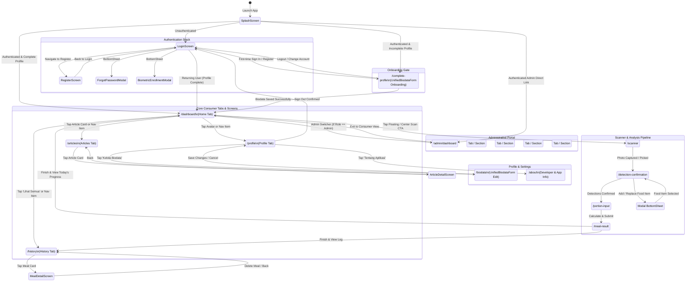

# Application Navigation Flow

## 1. Declarative Navigation Architecture

NutriView uses Flutter's native declarative routing map coupled with an assertive runtime Route Guard evaluated at application launch, state mutations, and route transitions.



---

## 2. Route Guarding & Navigation Security

### 2.1 Route Guard Evaluation Rules
The route guard in `lib/main.dart` evaluates every route transition against three strict conditions:

```dart
// Route Guard Evaluation Logic
final isAuthenticated = authProvider.isAuthenticated;
final isProfileComplete = authProvider.isProfileComplete || profileProvider.isProfileComplete;
final isAdmin = authProvider.isAdmin;

if (!isAuthenticated) {
  // Allow only public auth routes
  if (route != Routes.login && route != Routes.register && route != Routes.splash) {
    return Routes.login;
  }
} else if (!isProfileComplete) {
  // Prevent skipping onboarding
  if (route != Routes.completeProfile) {
    return Routes.completeProfile;
  }
} else {
  // Profile is complete; protect admin routes
  if (route.startsWith('/admin') && !isAdmin) {
    return Routes.dashboard;
  }
}
```

### 2.2 Route Table Reference

| Route Name | Target Widget | Guard Requirements | Primary Parameters |
| :--- | :--- | :--- | :--- |
| `Routes.splash` (`/`) | `SplashScreen` | None (Initial) | None |
| `Routes.login` (`/login`) | `LoginScreen` | Guest Only | None |
| `Routes.register` (`/register`) | `RegisterScreen` | Guest Only | None |
| `Routes.completeProfile` (`/complete-profile`) | `CompleteProfileScreen` | Authenticated & Profile Incomplete | None |
| `Routes.dashboard` (`/dashboard`) | `DashboardScreen` | Authenticated & Profile Complete | None |
| `Routes.scanner` (`/scanner`) | `ScannerScreen` | Authenticated & Profile Complete | None |
| `Routes.detectionConfirmation` (`/detection-confirmation`) | `DetectionConfirmationScreen` | Authenticated & Profile Complete | `imageFile`, `detections` |
| `Routes.portionInput` (`/portion-input`) | `PortionInputScreen` | Authenticated & Profile Complete | `confirmedItems`, `imageFile` |
| `Routes.mealResult` (`/meal-result`) | `MealResultScreen` | Authenticated & Profile Complete | `mealData`, `imageFile` |
| `Routes.history` (`/history`) | `MealHistoryScreen` | Authenticated & Profile Complete | None |
| `Routes.mealDetail` (`/meal-detail`) | `MealDetailScreen` | Authenticated & Profile Complete | `mealId` |
| `Routes.profile` (`/profile`) | `ProfileScreen` | Authenticated & Profile Complete | None |
| `Routes.biodata` (`/biodata`) | `BiodataScreen` | Authenticated & Profile Complete | None |
| `Routes.about` (`/about`) | `AboutScreen` | Authenticated & Profile Complete | None |
| `Routes.adminDashboard` (`/admin/dashboard`) | `AdminDashboardScreen` | Authenticated & Role == 'admin' | None |
