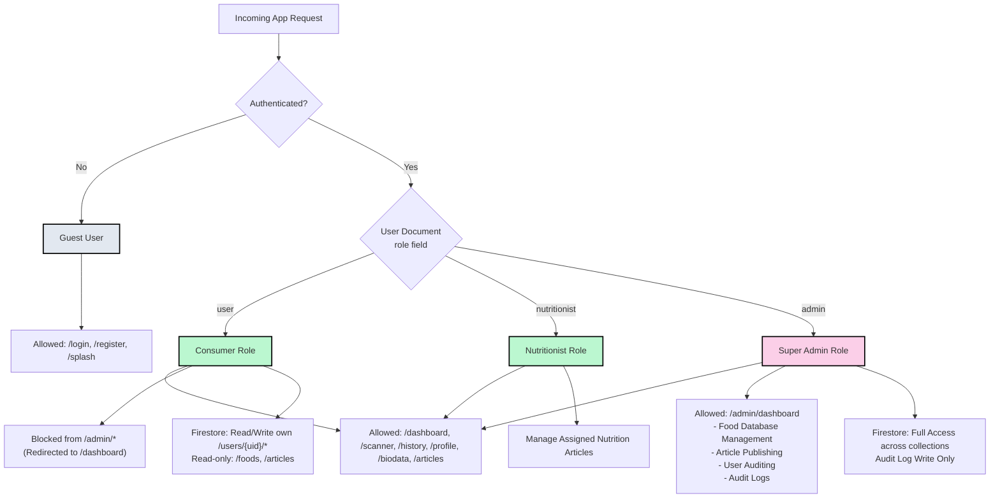

# Application Role Access Flow

## 1. Role-Based Access Control (RBAC) Architecture

NutriView implements strict multi-tiered RBAC enforced at both the client-side Route Guard and the server-side Cloud Firestore Security Rules.



---

## 2. Permission Matrix

| Capability / Resource | Guest | Standard User (`user`) | Nutritionist | Administrator (`admin`) |
| :--- | :---: | :---: | :---: | :---: |
| **View Splash & Auth Screens** | Yes | Yes | Yes | Yes |
| **Access Main Dashboard** | No | Yes | Yes | Yes |
| **Scan Food & On-Device YOLO** | No | Yes | Yes | Yes |
| **Log Meals & Upload Images** | No | Yes | Yes | Yes |
| **Read / Edit Own Profile** | No | Yes | Yes | Yes |
| **Read Nutrition Articles** | No | Yes | Yes | Yes |
| **Access Admin Dashboard (`/admin/dashboard`)** | No | No | No | Yes |
| **Create / Edit Food Catalog Items** | No | No | No | Yes |
| **Publish / Delete Articles** | No | No | Review Only | Yes |
| **View Audit Trail & System Logs** | No | No | No | Yes |
| **Change User Roles / Permissions** | No | No | No | Yes |

---

## 3. Server-Side Enforcement (Cloud Firestore Rules)

Client-side route guards are backed by declarative Firestore rules preventing tampering:

```javascript
// Firestore Security Rules Enforcement
match /foods/{foodId} {
  allow read: if request.auth != null;
  allow write: if isAdmin();
}

match /articles/{articleId} {
  allow read: if request.auth != null;
  allow write: if isAdmin();
}

match /users/{userId} {
  allow read: if isOwner(userId) || isAdmin();
  allow create: if isOwner(userId) && isValidUserCreate(userId);
  allow update: if (isOwner(userId) && isValidUserUpdateByOwner(userId)) || isAdmin();
  allow delete: if isAdmin();
}

match /audit_logs/{logId} {
  allow read: if isAdmin();
  allow create: if request.auth != null; // Append-only audit trail
  allow update, delete: if false; // Immutable audit log
}
```
