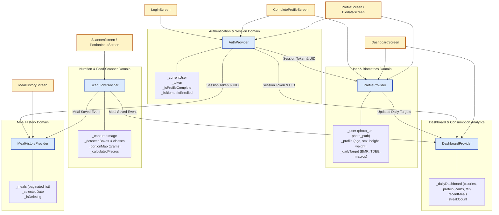
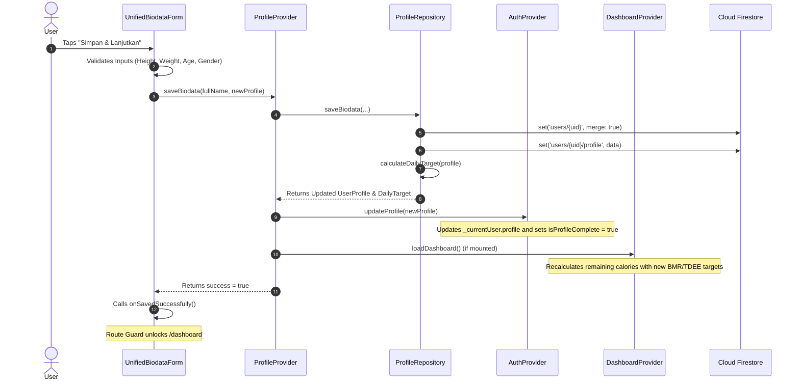
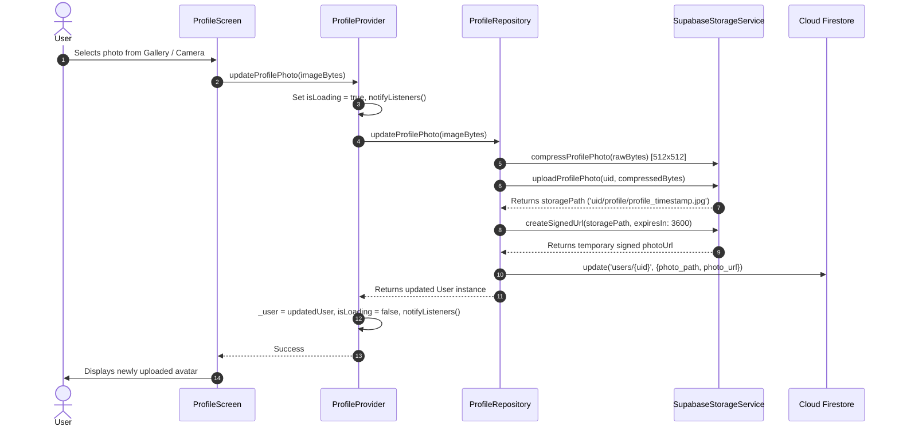

# Application State Flow

## 1. Multi-Provider State Architecture

NutriView utilizes Provider (`ChangeNotifier`) for reactive state management, maintaining clear state boundaries and decoupled lifecycle domains across the application.

---

## 2. State Mutation & Cross-Provider Synchronization

### 2.1 Profile Completion & Synchronization Flow
When a user completes their physical biodata in either `CompleteProfileScreen` (onboarding) or `BiodataScreen` (edit mode):

### 2.2 Profile Photo Lifecycle State Management

