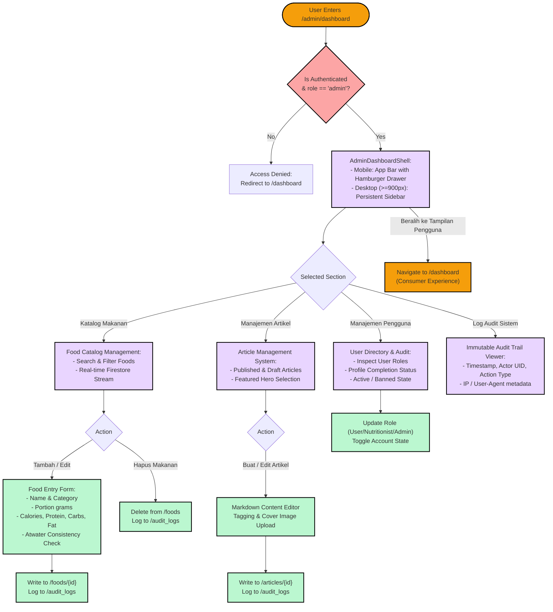

# User Flow: Administrative Console & CMS

## 1. Admin Portal Flow Diagram

---

## 2. Server-Side Security & Audit Invariants
1. **Atwater Mathematical Validation:** New food items created in the admin portal must satisfy the energy balance equation:
   $$\left|\text{Calories} - (4 \times \text{Protein} + 4 \times \text{Carbs} + 9 \times \text{Fat})\right| \le 5.0\text{ kcal}$$
   Mismatched values are rejected prior to Firestore commitment.
2. **Append-Only Audit Logs:** The `/audit_logs` collection can only be written to by authenticated admins and cannot be updated or deleted by any user or administrator, guaranteeing complete forensic integrity.
