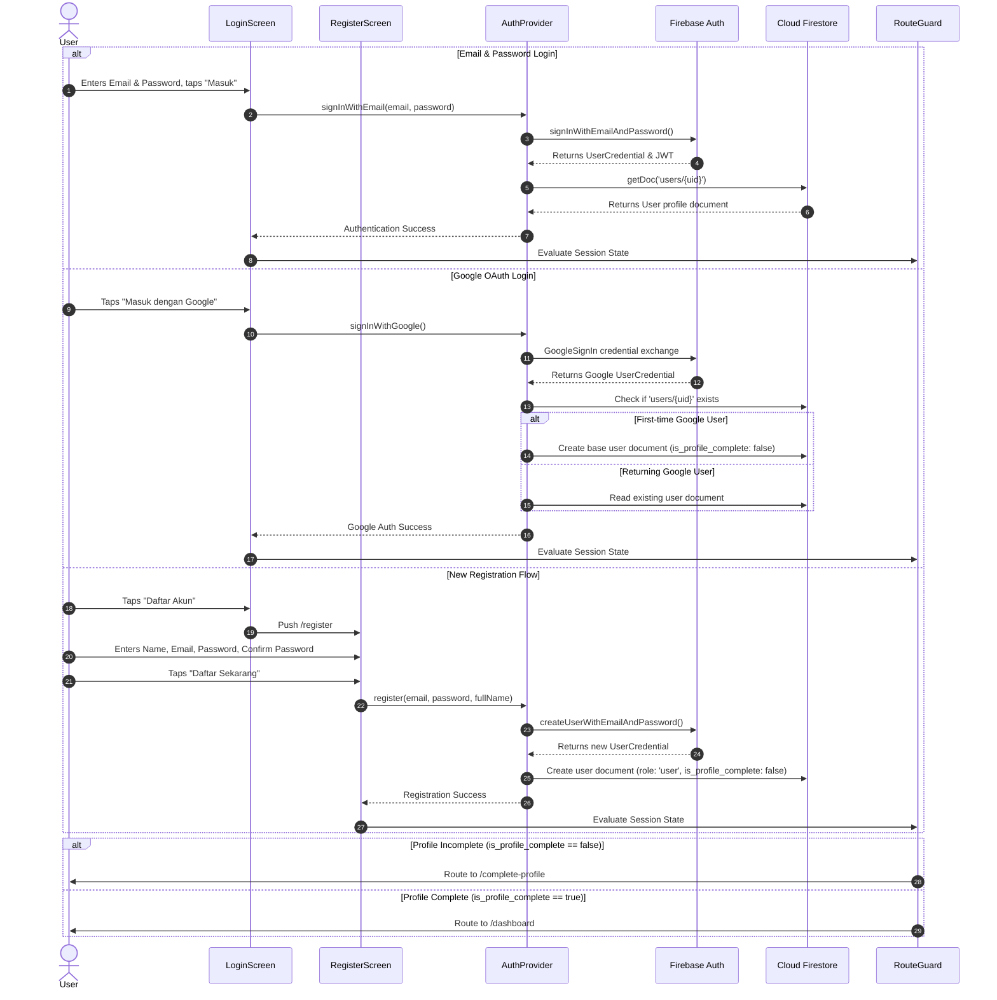
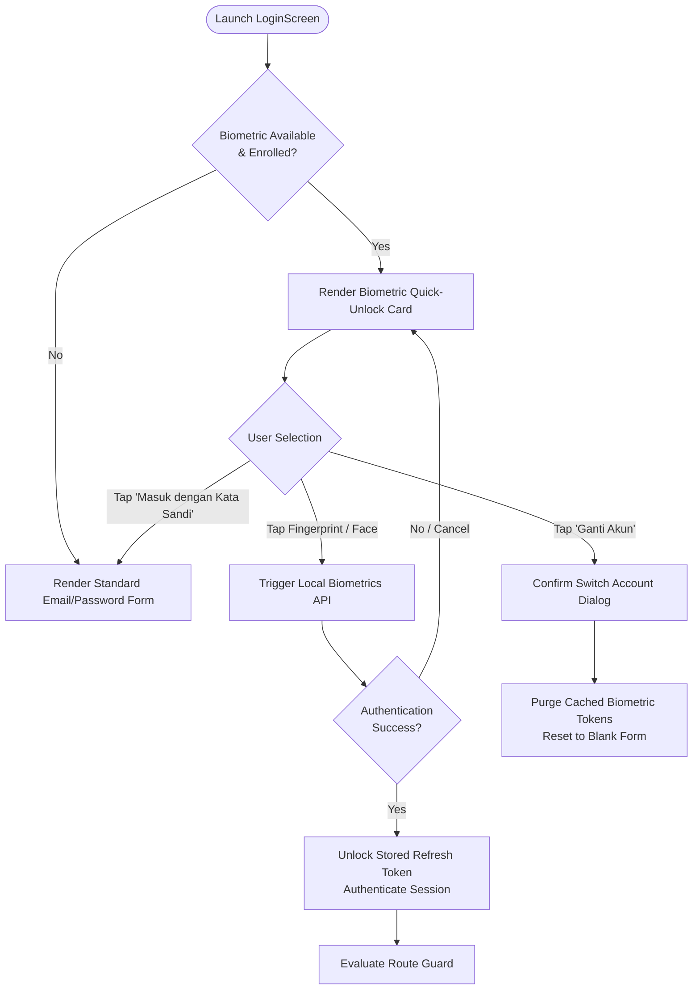

# User Flow: Authentication & Identity

## 1. Authentication Flow Diagram

---

## 2. Biometric Authentication & Password Fallback

---

## 3. Password Recovery Flow
1. User taps `Lupa Kata Sandi?` on `LoginScreen`.
2. `ForgotPasswordModal` appears as a bottom sheet.
3. User enters registered email address and taps `Kirim Tautan Reset`.
4. Firebase Auth sends an out-of-band password reset email.
5. User receives a confirmation snackbar, and the modal safely dismisses.
