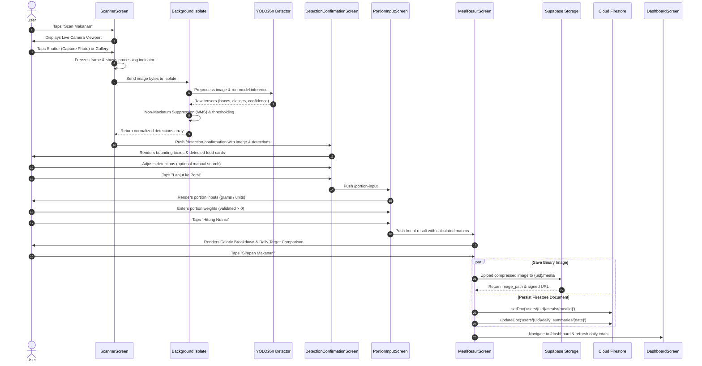

# User Flow: Food Scanning & Nutritional Inference

## 1. Scanner & YOLO26n Inference Pipeline

---

## 2. Portion Input Validation & Formatter Standards
- **Initial Clean State:** Numeric portion fields start at `0` without misleading default estimates (e.g., 150g).
- **Direct Overwrite:** Tapping the input automatically selects all text, allowing immediate overwrite without typing `0150`.
- **Locale Sanitization:** Replaces European commas with decimal points (`12,5` $\rightarrow$ `12.5`).
- **Zero-Value Protection:** Rejects submission if portion is $\le 0$ grams, preventing distorted macronutrient logs.

---

## 3. Atwater Specific Physiological Factor System
Nutrient energy totals are calculated via deterministic Atwater equations:

$$\text{Calories (kcal)} = (4 \times \text{Protein (g)}) + (4 \times \text{Carbohydrates (g)}) + (9 \times \text{Fat (g)})$$
