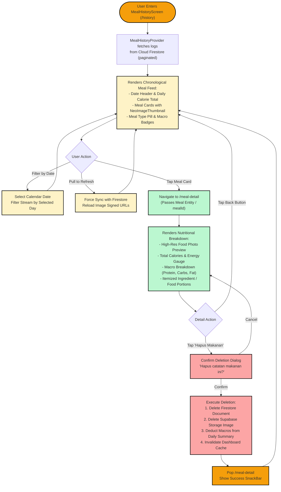

# User Flow: Meal History & Nutritional Tracking

## 1. Meal History Flow Diagram

---

## 2. Thumbnail & Asset Resilience (`NeoImageThumbnail`)
- When an image exists, it is loaded via a secure signed URL through `CachedNetworkImage` with a shimmer loading placeholder.
- If the image fails to load or the meal was logged without a photo, `NeoImageThumbnail` renders an elegant Material Rounded `restaurant` icon on a warm paper background, ensuring zero broken layouts.
