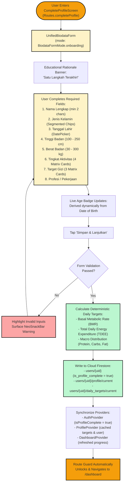

# User Flow: Mandatory Onboarding & Physical Biodata

## 1. Onboarding Gate & Biodata Flow

---

## 2. Parity Comparison: Onboarding vs Edit Mode

NutriView uses a single unified form (`UnifiedBiodataForm`) to ensure 100% UI and validation parity across both onboarding and profile management.

| Aspect | Onboarding Mode (`CompleteProfileScreen`) | Edit Mode (`BiodataScreen`) |
| :--- | :--- | :--- |
| **Route Path** | `/complete-profile` | `/biodata` |
| **Form Mode** | `BiodataFormMode.onboarding` | `BiodataFormMode.edit` |
| **Initial Inputs** | Clean blank fields (Zero dummy values) | Pre-filled with saved metrics from Firestore |
| **Hero Card Copy** | *"Satu Langkah Terakhir!"* | *"Informasi Fisik & Kesehatan"* |
| **Primary Button** | `Simpan & Lanjutkan` (with `arrowForward` icon) | `Simpan Perubahan Biodata` (with `save` icon) |
| **Secondary Action** | `Ganti Akun / Keluar` (Sign out shortcut) | `Hapus Biodata Fisik` (with destructive confirmation) |
| **Exit Navigation** | Unlocks Route Guard to `/dashboard` | `Navigator.pop()` back to `/profile` |
| **Dynamic Age Pill** | Instant pill badge derived from DatePicker | Instant pill badge derived from DatePicker |
| **Validation Rules** | Strict: Height (100-250cm), Weight (30-300kg) | Identical strict validation |

---

## 3. Physical Metric Formulas (Harris-Benedict / Mifflin-St Jeor)

$$\text{BMR}_{\text{male}} = 10 \times \text{weight (kg)} + 6.25 \times \text{height (cm)} - 5 \times \text{age} + 5$$

$$\text{BMR}_{\text{female}} = 10 \times \text{weight (kg)} + 6.25 \times \text{height (cm)} - 5 \times \text{age} - 161$$

$$\text{TDEE} = \text{BMR} \times \text{Activity Multiplier}$$

Where Activity Multipliers are:
- Sedentary: $1.2$
- Lightly Active: $1.375$
- Moderately Active: $1.55$
- Very Active: $1.725$
