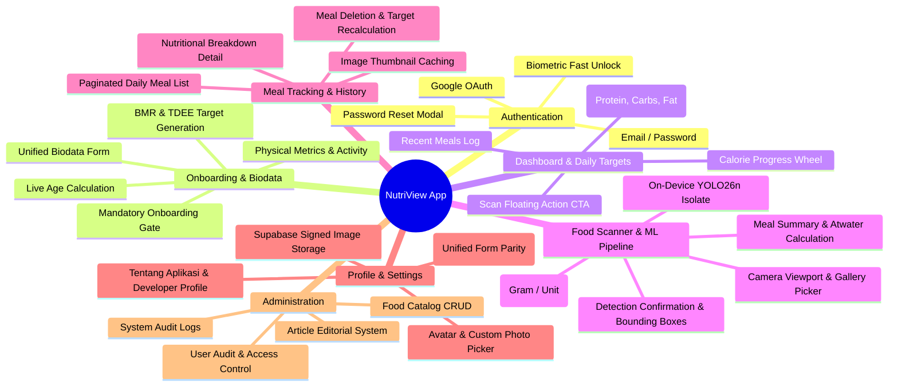

# User Flow: System Overview

## 1. Feature Map & Flow Index

The NutriView user journey is structured into 7 core functional feature modules:

---

## 2. Directory & Documentation Index

| Documentation File | Module Focus | Primary Flow & Sequence |
| :--- | :--- | :--- |
| `USER_FLOW_AUTHENTICATION.md` | Authentication | Sign-in, Register, Google OAuth, Biometric fast unlock. |
| `USER_FLOW_ONBOARDING_BIODATA.md` | Onboarding | Mandatory gate, UnifiedBiodataForm, zero-dummy inputs. |
| `USER_FLOW_PROFILE.md` | Profile & Identity | Photo upload, Supabase signed storage, edit biodata. |
| `USER_FLOW_FOOD_ANALYSIS.md` | Scanner & YOLO | Camera capture, background isolate ML, portion input. |
| `USER_FLOW_HISTORY.md` | Meal Records | History list, date filtering, meal detail breakdown. |
| `USER_FLOW_ADMIN.md` | Admin Portal | Food DB, article publishing, user audits. |
| `USER_FLOW_SYSTEM.md` | System Operations | App launch, token refresh, offline caching, error recovery. |
