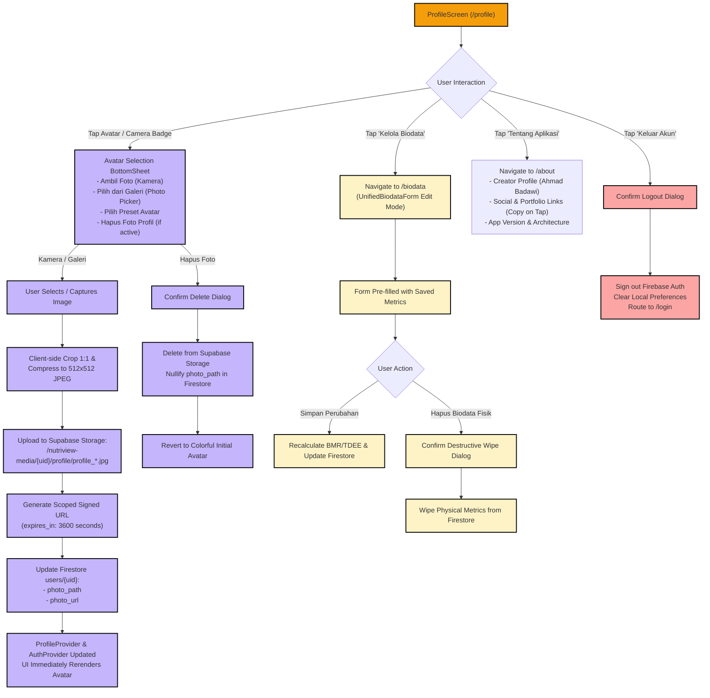
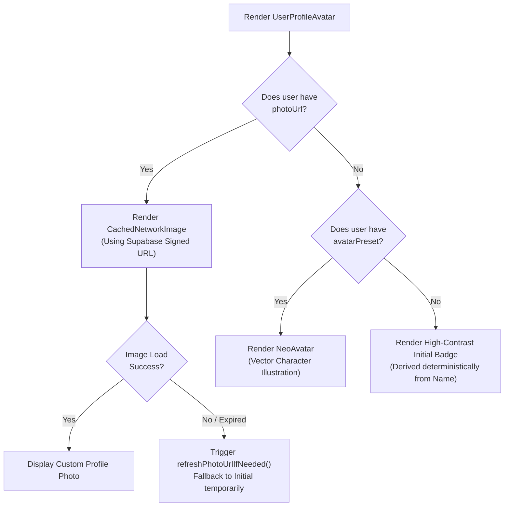

# User Flow: Profile & Photo Management

## 1. Profile Screen Flow

---

## 2. Avatar Rendering Hierarchy

The `UserProfileAvatar` widget guarantees an intuitive visual presentation across all network conditions:

---

## 3. Persistence Across App Restarts
- **Cloud Reference:** `photo_path` is permanently saved to `users/{uid}` in Cloud Firestore.
- **Signed URL Resolution:** On cold startup or re-login, `ProfileRepository.refreshPhotoUrlIfNeeded()` checks the signed URL expiration. If stale, it requests a fresh signed token from Supabase Storage without requiring the user to re-upload.
