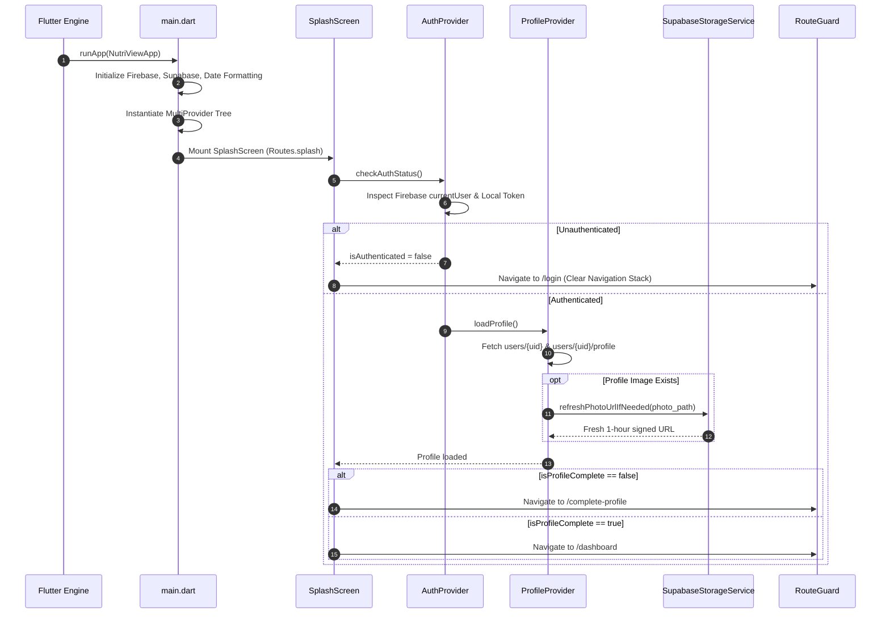

# User Flow: System Boot, Session Lifecycle & Recovery

## 1. System Boot & Startup Sequence

---

## 2. Session Invariants & Security Architecture

1. **Deterministic Boot Route:** Regardless of the previous screen prior to app closure, the application always initializes through `SplashScreen` (`/`). This ensures session tokens, remote user profiles, and storage signed URLs are verified before any user screen renders.
2. **Infinite Loop Immunity:**
   - In earlier builds, if `_currentUser` was null when launching directly to `/complete-profile`, updating the profile would silently fail and cause an infinite redirect loop.
   - The hardened `AuthProvider.updateProfile()` instantiates a valid `User` model on demand, and the route guard checks composite completeness (`auth.isProfileComplete || profileProvider.isProfileComplete`), guaranteeing that saving biodata immediately unlocks the dashboard.
3. **Graceful Degradation:**
   - When device connectivity drops, the on-device YOLO26n food scanner continues to operate seamlessly because the model and inference pipeline run completely locally in a Dart `Isolate`.
   - Firestore provides offline persistence for previously fetched meal history and dashboard metrics.
